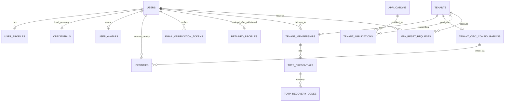
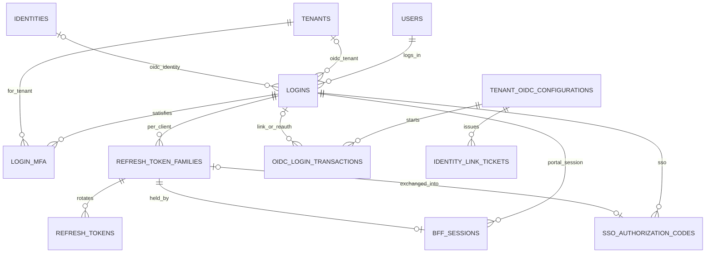

# Passport DB 모델 (Phase 1)

이 문서는 Phase 1 산출물이다. REQUIREMENTS 6장의 논리 모델과 `docs/API_CONTRACT.yaml`(Phase 0)을 기준으로 P0 범위의 물리 모델을 정의한다.
Phase 2의 ORM(`passport/db/models/`)과 초기 Alembic 마이그레이션은 이 문서를 따른다. 모델 때문에 API 계약을 바꿔야 하면 두 문서를 함께 고친다.

**[제안]** 표시는 승인이 필요한 설계 선택이다. 13장에 모았다.

## 1. 공통 규약

| 항목 | 규약 |
| --- | --- |
| DBMS | PostgreSQL 18, 스키마 `public` |
| 테이블 이름 | 복수형 snake_case(`users`, `tenant_memberships`). PostgreSQL 예약어 `user`를 피한다 |
| 기본 키 | `id uuid`. 값은 애플리케이션에서 `uuid.uuid7()`로 만든다. 시간순이라 인덱스 지역성이 좋고 계약의 ID 예시 형식과 같다. 1:1 확장 테이블은 부모 키를 PK로 쓴다 |
| 시각 | `timestamptz`, UTC. `created_at`·`updated_at`의 기본값은 `now()` |
| 열거 값 | PostgreSQL ENUM 대신 `varchar` + 이름 있는 CHECK. 값 추가가 마이그레이션 한 줄로 끝난다 |
| ETag | 변경 가능 리소스는 `version integer NOT NULL DEFAULT 1`. SQLAlchemy `version_id_col`로 매핑해 `UPDATE … WHERE version = :expected`가 되게 한다. ETag는 `"{version}"` |
| 접근 자격 버전 | `access_version bigint NOT NULL DEFAULT 1`. `tenants`, `tenant_memberships`, `tenant_applications`에만 둔다(FR-APP-008-05). `version`과 별개다 |
| 이메일 | 소문자 정규화 값만 저장한다(계약 `Email`). CHECK `email = lower(email)` |
| FK 삭제 동작 | 기본 `RESTRICT`. 부모 없이 의미 없는 자식만 `CASCADE`이며 표에 적는다 |
| 표 읽는 법 | "NULL" 열이 `예`인 열만 NULL을 허용한다. "공통 열"은 `created_at`, `updated_at`, `version` 세 개다 |

**비밀값 저장**

| 종류 | 예 | 저장 방식 |
| --- | --- | --- |
| 비밀번호 | Local 비밀번호 | Argon2id PHC 문자열(NFR-SEC-005) |
| 서버가 만든 128비트 이상 무작위 값 | Refresh Token, BFF 세션 ID, SSO 코드, OIDC `state`·`nonce`, 이메일 확인 토큰, 링크 티켓, 서비스 `client_secret` | SHA-256 `bytea`(32바이트). 원문은 저장하지 않고 해시의 UNIQUE 인덱스로 조회한다 |
| 사람이 입력하는 짧은 값 | 복구 코드(60비트) | 서버 비밀 키로 만든 HMAC-SHA-256. DB만 유출되면 대입 공격이 불가능하다 |
| 다시 꺼내 써야 하는 값 | TOTP secret, OIDC `client_secret`, 서명 개인 키, BFF가 보관하는 토큰, PKCE verifier | **[제안]** 애플리케이션 AES-256-GCM 암호문 `bytea`. 암호문 앞에 키 ID를 붙여 키 교체를 지원한다. 키는 env로 받는다 |

비밀값 원문과 해시는 로그·감사 기록에 남기지 않는다(NFR-SEC-008).

## 2. 저장소 분담

| 데이터 | 저장소 | 이유 |
| --- | --- | --- |
| 계정·테넌트·멤버십·서비스·MFA·감사 | PostgreSQL | 원본 |
| 로그인, Refresh Token 계열, BFF 세션, 서명 키 | PostgreSQL **[제안]** | 철회·재사용 탐지·복원 시 일괄 무효화를 같은 트랜잭션과 같은 백업 기준으로 처리한다 |
| OIDC 트랜잭션, 링크 티켓, SSO 코드, 이메일 확인 토큰, 확인 전 TOTP | PostgreSQL + 만료 정리 작업 **[제안]** | 소비와 로그인·계정 생성을 한 트랜잭션으로 묶는다. 목표 부하(100 RPS)에서 충분하다 |
| 접근 자격 버전 캐시 | Valkey | FR-APP-008-07. 원본은 DB의 `access_version`이다(8장) |
| 속도·실패 제한 카운터, OIDC Discovery·JWKS 캐시 | Valkey 또는 프로세스 메모리 | 잃어도 안전하다 |
| 고정 client(`passport-portal`, `passport-native`), 포털 완료 URI, 암호화 키 | 설정(config.json, env) | 설치 단위 값이다 |

Access Token은 저장하지 않는다. 철회는 `sid`(= `logins.id`)의 상태로 판단하므로(계약 3.5) `jti` 거부 목록이 필요 없다.

## 3. 물리 ERD

### 3.1 계정·테넌트·서비스·MFA

### 3.2 로그인·토큰·일회성 값

`signing_keys`, `idempotency_keys`, `access_version_syncs`, `audit_events`에는 FK가 없다.

## 4. 데이터 사전

### 4.1 사용자

#### `users`

전역 불변 사용자. 탈퇴해도 행을 지우지 않고 개인정보 없이 남긴다. 멤버십·감사 기록이 이 ID를 참조하기 때문이다.

| 컬럼 | 형식 | NULL | 기본값 | 설명 |
| --- | --- | --- | --- | --- |
| `id` | uuid | | UUIDv7 | `user_id` |
| `status` | varchar(32) | | `pending_verification` | `pending_verification`, `active`, `suspended`, `deactivated`, `deleted` |
| `is_platform_admin` | boolean | | `false` | P0는 설치 CLI로만 지정한다. 계약의 `platform_roles`로 변환 |
| `withdrawn_at` | timestamptz | 예 | | 탈퇴 시각 |
| 공통 열 | | | | |

- CHECK `ck_users_status`, CHECK `ck_users_withdrawn`: `(status = 'deleted') = (withdrawn_at IS NOT NULL)`

#### `user_profiles`

개인정보. 탈퇴하면 보관 대상만 `retained_profiles`로 옮기고 행을 지운다.

| 컬럼 | 형식 | NULL | 기본값 | 설명 |
| --- | --- | --- | --- | --- |
| `user_id` | uuid | | | PK, FK `users` `CASCADE` |
| `email` | varchar(254) | | | 정규화 값 |
| `email_verified_at` | timestamptz | 예 | | Local은 확인 시각. OIDC는 Provider가 `email_verified = true`를 준 시각 |
| `display_name` | varchar(50) | | | |
| `phone` | varchar(16) | 예 | | E.164 |
| `real_name` | varchar(100) | 예 | | |
| 공통 열 | | | | `version`은 `getMe`·`updateMe`의 ETag |

- UNIQUE `email`. Local 로그인 식별자이고(FR-AUTH-001), 같은 이메일로 계정을 새로 만들지 않는다(D-08). 외부 신원 연결 판단에는 쓰지 않는다(6장 모델링 주의).
- CHECK `ck_user_profiles_email_lower`
- **[제안]** `pg_trgm` GIN 인덱스: `email`, `display_name`. `adminSearchUsers`는 100만 사용자에 대한 부분 일치 검색이다. 테넌트 안 검색은 멤버십으로 먼저 좁히므로 필요 없다.

#### `credentials`

| 컬럼 | 형식 | NULL | 기본값 | 설명 |
| --- | --- | --- | --- | --- |
| `user_id` | uuid | | | PK, FK `users` `CASCADE` |
| `password_hash` | text | | | Argon2id PHC 문자열 |
| `password_changed_at` | timestamptz | | `now()` | |
| `created_at`, `updated_at` | | | | |

OIDC로만 가입한 사용자는 행이 없다. 이때 비밀번호 API는 `409 local_credential_not_set`이다.

#### `user_avatars`

| 컬럼 | 형식 | NULL | 기본값 | 설명 |
| --- | --- | --- | --- | --- |
| `id` | varchar(32) | | 무작위 128비트 base64url | 공개 `avatar_id`(`getAvatar` URL) |
| `user_id` | uuid | | | FK `users`, UNIQUE |
| `content_type` | varchar(16) | | | `image/png`, `image/jpeg`, `image/webp` |
| `data` | bytea | | | 메타데이터를 제거하고 다시 인코딩한 이미지 |
| `created_at` | timestamptz | | `now()` | |

- CHECK `ck_user_avatars_content_type`, CHECK `ck_user_avatars_size`: `octet_length(data) <= 2097152`
- **[제안]** 이미지는 DB에 저장한다. 단일 패키지 설치에 별도 파일 저장소가 필요 없다.
- 교체는 삭제 후 새 ID로 삽입한다. 그래서 이전 URL이 즉시 무효가 된다.

#### `identities`

외부 OIDC 신원. Local 인증 수단은 `credentials`이며, `listMyIdentities`가 둘을 합쳐 반환한다.

| 컬럼 | 형식 | NULL | 기본값 | 설명 |
| --- | --- | --- | --- | --- |
| `id` | uuid | | UUIDv7 | `identity_id` |
| `user_id` | uuid | | | FK `users` |
| `issuer` | varchar(2048) | | | |
| `subject` | varchar(255) | | | |
| `tenant_id` | uuid | | | FK `tenants`. 연결에 쓴 테넌트 |
| `oidc_config_id` | uuid | | | FK `tenant_oidc_configurations` |
| `linked_at` | timestamptz | | `now()` | |
| `last_used_at` | timestamptz | 예 | | |

- UNIQUE `uq_identities_issuer_subject` (`issuer`, `subject`): FR-OIDC-004, FR-OIDC-005
- 인덱스 `user_id`

#### `email_verification_tokens`

| 컬럼 | 형식 | NULL | 기본값 | 설명 |
| --- | --- | --- | --- | --- |
| `id` | uuid | | UUIDv7 | |
| `user_id` | uuid | | | FK `users` |
| `token_hash` | bytea | | | UNIQUE |
| `expires_at` | timestamptz | | | **[제안]** 발급 후 24시간 |
| `consumed_at` | timestamptz | 예 | | |
| `created_at` | timestamptz | | `now()` | |

- 인덱스 `user_id`
- **[제안]** 재발송하면 그 사용자의 미사용 토큰을 지우고 새로 발급한다.

#### `retained_profiles`

탈퇴 후 보관 정보(FR-USER-005, 005-01). 프로필 사진은 보관하지 않는다.

| 컬럼 | 형식 | NULL | 기본값 | 설명 |
| --- | --- | --- | --- | --- |
| `user_id` | uuid | | | PK, FK `users` |
| `email` | varchar(254) | | | |
| `display_name` | varchar(50) | | | |
| `phone` | varchar(16) | 예 | | |
| `real_name` | varchar(100) | 예 | | |
| `withdrawn_at` | timestamptz | | | |
| `retention_expires_at` | timestamptz | | | `withdrawn_at` + 24시간 |

- 인덱스 `retention_expires_at`(삭제 작업)
- 탈퇴 시점 소속 테넌트는 `tenant_memberships`의 `removed_reason = 'withdrawal'` 행으로 찾는다. 별도 테이블이 필요 없다.

### 4.2 테넌트

#### `tenants`

| 컬럼 | 형식 | NULL | 기본값 | 설명 |
| --- | --- | --- | --- | --- |
| `id` | uuid | | UUIDv7 | `tenant_id` |
| `code` | varchar(32) | | | UNIQUE. 생성 후 바꾸지 않는다 |
| `name` | varchar(100) | | | |
| `status` | varchar(32) | | `active` | `active`, `suspended`, `deactivated` |
| `mfa_enabled` | boolean | | `false` | FR-MFA-002 |
| `mfa_enabled_at` | timestamptz | 예 | | 마지막 활성화 시각. 이보다 먼저 인증한 로그인은 유예한다(FR-MFA-003) |
| `access_version` | bigint | | `1` | 상태 변경마다 1 증가 |
| 공통 열 | | | | `version`은 테넌트·MFA 정책 API의 ETag |

- CHECK `ck_tenants_status`, CHECK `ck_tenants_code`: 계약 `TenantCode` 정규식
- CHECK `ck_tenants_mfa`: `NOT mfa_enabled OR mfa_enabled_at IS NOT NULL`

#### `tenant_oidc_configurations`

테넌트당 하나다(FR-OIDC-010, D-06). 지우지 않고 `disabled`로 둔다.

| 컬럼 | 형식 | NULL | 기본값 | 설명 |
| --- | --- | --- | --- | --- |
| `id` | uuid | | UUIDv7 | `oidc_config_id` |
| `tenant_id` | uuid | | | FK `tenants`, UNIQUE |
| `provider_type` | varchar(16) | | | `keycloak`, `auth0` |
| `display_name` | varchar(100) | | | |
| `issuer` | varchar(2048) | | | `https://`로 시작 |
| `client_id` | varchar(255) | | | |
| `client_secret_ciphertext` | bytea | | | 암호문. 응답은 설정 여부만 준다 |
| `scopes` | text[] | | `{openid,email,profile}` | |
| `member_provisioning` | varchar(32) | | `pre_registration` | `pre_registration`, `auto`(D-08) |
| `accepted_acr_values` | text[] | | `{}` | **[제안]** 외부 MFA 인정 규칙 |
| `accepted_amr_values` | text[] | | `{}` | |
| `status` | varchar(16) | | | `enabled`, `disabled` |
| `trust_version` | integer | | `1` | 신뢰 변경마다 1 증가(계약 `putTenantOidcConfiguration`) |
| `last_validation_status` | varchar(16) | | | `ok`, `failed` |
| `last_validation_checked_at` | timestamptz | | | |
| `last_validation_error_code` | varchar(32) | 예 | | `discovery_unreachable`, `issuer_mismatch`, `jwks_unreachable`, `invalid_client` |
| 공통 열 | | | | |

- CHECK: `provider_type`, `member_provisioning`, `status`, `last_validation_status`, `last_validation_error_code`, `issuer LIKE 'https://%'`, `'openid' = ANY(scopes)`

#### `tenant_memberships`

| 컬럼 | 형식 | NULL | 기본값 | 설명 |
| --- | --- | --- | --- | --- |
| `id` | uuid | | UUIDv7 | `membership_id` |
| `tenant_id` | uuid | | | FK `tenants` |
| `user_id` | uuid | 예 | | FK `users`. `pre_registered`면 NULL |
| `pre_registered_email` | varchar(254) | 예 | | 사전 등록 이메일(정규화). 활성화 후에도 남긴다 |
| `role` | varchar(16) | | `member` | `admin`, `member` |
| `status` | varchar(32) | | | `pre_registered`, `active`, `suspended`, `removed` |
| `access_version` | bigint | | `1` | 상태 변경마다 1 증가 |
| `joined_at` | timestamptz | 예 | | 처음 `active`가 된 시각 |
| `removed_at` | timestamptz | 예 | | |
| `removed_reason` | varchar(32) | 예 | | `admin_removed`, `pre_registration_cancelled`, `withdrawal` |
| 공통 열 | | | | |

- CHECK `ck_tenant_memberships_state`:
  `(status = 'pre_registered' AND user_id IS NULL AND pre_registered_email IS NOT NULL) OR (status IN ('active', 'suspended') AND user_id IS NOT NULL) OR status = 'removed'`
- CHECK `ck_tenant_memberships_removed`: `(status = 'removed') = (removed_at IS NOT NULL AND removed_reason IS NOT NULL)`
- 부분 UNIQUE `uq_tenant_memberships_tenant_user` (`tenant_id`, `user_id`) `WHERE status <> 'removed'`: 중복 소속 방지(FR-MEM-005)
- 부분 UNIQUE `uq_tenant_memberships_tenant_email` (`tenant_id`, `pre_registered_email`) `WHERE status = 'pre_registered'`
- 인덱스 `user_id`(`listMyTenants`), (`tenant_id`, `status`)
- `removed` 행은 지우지 않는다. 감사와 P1 재가입 판단에 쓴다(FR-MEM-008). 재가입은 새 행이다.

### 4.3 서비스

#### `applications`

| 컬럼 | 형식 | NULL | 기본값 | 설명 |
| --- | --- | --- | --- | --- |
| `id` | uuid | | UUIDv7 | `application_id` |
| `code` | varchar(32) | | | UNIQUE. `client_id`이자 Access Token `aud` |
| `name` | varchar(100) | | | |
| `status` | varchar(16) | | `active` | `active`, `inactive` |
| `client_secret_hash` | bytea | | | SHA-256. 서비스 인증과 BFF client 인증에 함께 쓴다(13장 2번) |
| `previous_client_secret_hash` | bytea | 예 | | 교체 직전 secret |
| `previous_secret_valid_until` | timestamptz | 예 | | **[제안]** 교체 후 24시간 |
| `secret_rotated_at` | timestamptz | | `now()` | |
| `bff_redirect_uris` | text[] | | `{}` | SSO callback URI. 정확히 일치해야 한다 |
| 공통 열 | | | | |

- CHECK: `status`, 계약 `ApplicationCode` 정규식, `code <> 'passport'`
- CHECK `ck_applications_previous_secret`: `(previous_client_secret_hash IS NULL) = (previous_secret_valid_until IS NULL)`
- `client_secret`은 256비트 무작위 값이라 빠른 해시로 충분하다. 요청마다 인증하므로 Argon2id는 쓰지 않는다.

#### `tenant_applications`

행이 없으면 계약의 `not_enabled`다. 처음 활성화할 때 만든다.

| 컬럼 | 형식 | NULL | 기본값 | 설명 |
| --- | --- | --- | --- | --- |
| `tenant_id` | uuid | | | PK, FK `tenants` |
| `application_id` | uuid | | | PK, FK `applications` |
| `status` | varchar(16) | | | `active`, `inactive` |
| `access_version` | bigint | | `1` | 상태 변경마다 1 증가 |
| 공통 열 | | | | |

- 인덱스 `application_id`

### 4.4 MFA

#### `totp_credentials`

TOTP는 사용자×테넌트 단위다(FR-MFA-004). **[제안]** 그 키를 가진 멤버십에 묶고, 멤버십이 `removed`가 되면 함께 지운다.

| 컬럼 | 형식 | NULL | 기본값 | 설명 |
| --- | --- | --- | --- | --- |
| `id` | uuid | | UUIDv7 | |
| `membership_id` | uuid | | | FK `tenant_memberships`, UNIQUE |
| `secret_ciphertext` | bytea | | | 암호문 |
| `status` | varchar(16) | | | `pending`, `active` |
| `pending_expires_at` | timestamptz | 예 | | `pending`일 때만. **[제안]** 등록 시작 후 10분 |
| `confirmed_at` | timestamptz | 예 | | |
| `last_used_step` | bigint | 예 | | 마지막으로 받은 시간 스텝. 같은 스텝 재사용을 막는다(FR-MFA-005) |
| `created_at` | timestamptz | | `now()` | |

- CHECK `ck_totp_credentials_state`:
  `(status = 'pending' AND pending_expires_at IS NOT NULL) OR (status = 'active' AND confirmed_at IS NOT NULL)`
- 등록 시작 때 `pending` 행이 있으면 지우고 새로 만든다. `active`가 있으면 `409 totp_already_enrolled`다.
- `MemberAdminView.mfa_totp_enrolled`는 `active` 행이 있는지로 계산한다.

#### `totp_recovery_codes`

| 컬럼 | 형식 | NULL | 기본값 | 설명 |
| --- | --- | --- | --- | --- |
| `id` | uuid | | UUIDv7 | |
| `totp_credential_id` | uuid | | | FK `totp_credentials` `CASCADE` |
| `code_hmac` | bytea | | | 하이픈을 빼고 대문자로 정규화한 뒤 HMAC |
| `used_at` | timestamptz | 예 | | |
| `created_at` | timestamptz | | `now()` | |

- UNIQUE `uq_totp_recovery_codes_credential_code` (`totp_credential_id`, `code_hmac`)
- 등록 확인 때 10개를 만든다. `recovery_codes_remaining`은 `used_at IS NULL`인 행 수다.

#### `mfa_reset_requests`

| 컬럼 | 형식 | NULL | 기본값 | 설명 |
| --- | --- | --- | --- | --- |
| `id` | uuid | | UUIDv7 | `request_id` |
| `tenant_id` | uuid | | | FK `tenants` |
| `user_id` | uuid | | | FK `users` |
| `status` | varchar(16) | | `pending` | `pending`, `approved`, `rejected`, `expired` |
| `note` | varchar(500) | 예 | | 사용자 메모 |
| `expires_at` | timestamptz | | | **[제안]** 생성 후 72시간 |
| `decided_at` | timestamptz | 예 | | |
| `decided_by` | uuid | 예 | | FK `users` |
| `decided_as` | varchar(16) | 예 | | `tenant_admin`, `platform_admin` |
| `verification_method` | varchar(32) | 예 | | `organization_contact`, `in_person`, `other` |
| `verification_note` | varchar(500) | 예 | | |
| `decision_reason` | varchar(500) | 예 | | |
| `created_at` | timestamptz | | `now()` | |

- CHECK `ck_mfa_reset_requests_decision`: `(status IN ('approved', 'rejected')) = (decided_at IS NOT NULL AND decided_by IS NOT NULL AND decision_reason IS NOT NULL)`
- CHECK `ck_mfa_reset_requests_verification`: `status <> 'approved' OR verification_method IS NOT NULL`
- 부분 UNIQUE `uq_mfa_reset_requests_pending` (`tenant_id`, `user_id`) `WHERE status = 'pending'`: 대기 요청은 하나다(계약상 기존 요청을 반환)
- 인덱스 (`tenant_id`, `status`, `created_at`), (`status`, `created_at`)(플랫폼 관리자 목록)

### 4.5 로그인·토큰

#### `logins`

로그인 하나 = Access Token의 `sid` 하나(계약 3.1).

| 컬럼 | 형식 | NULL | 기본값 | 설명 |
| --- | --- | --- | --- | --- |
| `id` | uuid | | UUIDv7 | `sid`, `login_id` |
| `user_id` | uuid | | | FK `users` |
| `auth_method` | varchar(16) | | | `local`, `oidc` |
| `client_type` | varchar(16) | | | `web`, `native` |
| `authenticated_at` | timestamptz | | | `auth_time` |
| `expires_at` | timestamptz | | | 최대 유지 시각. web +8시간, native +7일. 갱신으로 늘리지 않는다 |
| `last_activity_at` | timestamptz | | | 미사용 만료 기준. 만료 시각은 이 값 + 30분(web) 또는 3일(native) |
| `tenant_id` | uuid | 예 | | FK `tenants`. OIDC 로그인의 대상 테넌트 |
| `oidc_config_id` | uuid | 예 | | FK `tenant_oidc_configurations` |
| `oidc_trust_version` | integer | 예 | | 로그인 시점의 `trust_version` |
| `identity_id` | uuid | 예 | | FK `identities` `SET NULL` |
| `reauthenticated_at` | timestamptz | | | 최근 재인증. 로그인 시각으로 시작한다 |
| `reauth_method` | varchar(16) | | | `password`, `oidc` |
| `ended_at` | timestamptz | 예 | | |
| `end_reason` | varchar(32) | 예 | | 5.6절 |
| `created_at` | timestamptz | | `now()` | |

- CHECK `ck_logins_oidc`: `auth_method = 'local' OR (tenant_id IS NOT NULL AND oidc_config_id IS NOT NULL AND oidc_trust_version IS NOT NULL)`
- CHECK `ck_logins_ended`: `(ended_at IS NULL) = (end_reason IS NULL)`
- 부분 인덱스 `WHERE ended_at IS NULL`: `user_id`(전체 로그아웃·계정 차단), `oidc_config_id`(신뢰 변경), `identity_id`(외부 계정 차단·Provider 로그아웃)
- 인덱스 `expires_at`(정리 작업)
- Passport API와 `verifyAccess`는 요청마다 PK로 이 행을 읽는다. OIDC 로그인은 `oidc_trust_version`을 현재 설정과 비교한다.
- **[제안]** `last_activity_at`은 1분 단위로만 갱신해 쓰기를 줄인다.

#### `login_mfa`

현재 로그인의 테넌트별 MFA 충족 기록(FR-MFA-003). 유예(`grace`)는 저장하지 않고 `logins.authenticated_at < tenants.mfa_enabled_at`으로 계산한다.

| 컬럼 | 형식 | NULL | 기본값 | 설명 |
| --- | --- | --- | --- | --- |
| `login_id` | uuid | | | PK, FK `logins` `CASCADE` |
| `tenant_id` | uuid | | | PK, FK `tenants` |
| `method` | varchar(16) | | | `totp`, `external` |
| `verified_at` | timestamptz | | `now()` | |

#### `refresh_token_families`

로그인 하나에 client마다 계열 하나다. Passport 포털·네이티브·SaaS BFF가 각자의 계열을 쓴다(FR-AUTH-009-02-01).

| 컬럼 | 형식 | NULL | 기본값 | 설명 |
| --- | --- | --- | --- | --- |
| `id` | uuid | | UUIDv7 | |
| `login_id` | uuid | | | FK `logins` `CASCADE` |
| `client_id` | varchar(32) | | | `passport-portal`, `passport-native` 또는 Application `code`. Access Token `client_id` |
| `revoked_at` | timestamptz | 예 | | 계열만 폐기할 때. SSO 코드 재사용 등 |
| `created_at` | timestamptz | | `now()` | |

- 인덱스 `login_id`

#### `refresh_tokens`

| 컬럼 | 형식 | NULL | 기본값 | 설명 |
| --- | --- | --- | --- | --- |
| `id` | uuid | | UUIDv7 | |
| `family_id` | uuid | | | FK `refresh_token_families` `CASCADE` |
| `token_hash` | bytea | | | UNIQUE |
| `issued_at` | timestamptz | | `now()` | |
| `rotated_at` | timestamptz | 예 | | 회전되어 무효가 된 시각. 이 토큰이 다시 오면 재사용이다(FR-AUTH-009-07-01) |

- 부분 UNIQUE `uq_refresh_tokens_active` (`family_id`) `WHERE rotated_at IS NULL`: 계열마다 유효한 토큰은 하나다
- 자체 만료 시각이 없다. 유효 기간은 로그인의 최대 유지·미사용 만료를 따른다.

#### `bff_sessions`

Passport 포털 BFF의 세션만 저장한다. SaaS BFF 세션은 각 SaaS가 저장한다.

| 컬럼 | 형식 | NULL | 기본값 | 설명 |
| --- | --- | --- | --- | --- |
| `id` | uuid | | UUIDv7 | |
| `session_hash` | bytea | | | UNIQUE. 쿠키 값의 SHA-256 |
| `login_id` | uuid | | | FK `logins` `CASCADE` |
| `refresh_family_id` | uuid | | | FK `refresh_token_families` `CASCADE`, UNIQUE |
| `refresh_token_ciphertext` | bytea | | | BFF가 다음 갱신에 쓸 토큰 |
| `tenant_id` | uuid | 예 | | FK `tenants`. 현재 선택한 테넌트 |
| `access_token_ciphertext` | bytea | 예 | | 현재 Access Token |
| `access_token_expires_at` | timestamptz | 예 | | |
| `created_at`, `updated_at` | | | | |

- 인덱스 `login_id`
- 로그아웃·로그인 종료 때 행을 지운다. 유효성은 항상 연결된 `logins`로 판단한다.

#### `signing_keys`

Access Token 서명 키(FR-AUTH-008). 여러 프로세스가 같은 키를 쓰므로 DB에 둔다.

| 컬럼 | 형식 | NULL | 기본값 | 설명 |
| --- | --- | --- | --- | --- |
| `kid` | varchar(64) | | | PK |
| `alg` | varchar(16) | | `ES256` | **[제안]** |
| `public_jwk` | jsonb | | | JWKS에 게시하는 공개 키 |
| `private_key_ciphertext` | bytea | | | 암호문 |
| `activates_at` | timestamptz | | | 서명 시작. **[제안]** 생성(게시) 후 24시간 |
| `retires_at` | timestamptz | | | 서명 중단. 시작 후 90일 |
| `expires_at` | timestamptz | | | JWKS에서 내림. **[제안]** 서명 중단 후 24시간 |
| `revoked_at` | timestamptz | 예 | | 복원·사고 시 즉시 폐기 |
| `created_at` | timestamptz | | `now()` | |

### 4.6 일회성 값

모두 해시로 찾고, 소비는 `UPDATE … SET consumed_at = now() WHERE … AND consumed_at IS NULL AND expires_at > now() RETURNING …` 한 문장으로 한다.

#### `oidc_login_transactions`

| 컬럼 | 형식 | NULL | 기본값 | 설명 |
| --- | --- | --- | --- | --- |
| `id` | uuid | | UUIDv7 | |
| `state_hash` | bytea | | | UNIQUE |
| `nonce_hash` | bytea | | | ID Token `nonce`와 비교 |
| `pkce_verifier_ciphertext` | bytea | | | Provider 토큰 교환에 다시 쓴다 |
| `tenant_id` | uuid | | | FK `tenants`. 콜백 경로의 `tenant_id`와 비교(FR-OIDC-012) |
| `oidc_config_id` | uuid | | | FK `tenant_oidc_configurations` |
| `oidc_trust_version` | integer | | | 시작 시점 값. 콜백에서 현재 값과 같아야 한다 |
| `intent` | varchar(16) | | | `login`, `link`, `reauth` |
| `return_to` | varchar(2048) | | | 등록된 포털 완료 URI |
| `login_id` | uuid | 예 | | FK `logins` `CASCADE`. `link`·`reauth`가 묶인 로그인 |
| `expires_at` | timestamptz | | | **[제안]** 생성 후 10분 |
| `consumed_at` | timestamptz | 예 | | |
| `created_at` | timestamptz | | `now()` | |

- CHECK `ck_oidc_login_transactions_intent`: `(intent = 'login') = (login_id IS NULL)`

#### `identity_link_tickets`

| 컬럼 | 형식 | NULL | 기본값 | 설명 |
| --- | --- | --- | --- | --- |
| `id` | uuid | | UUIDv7 | |
| `ticket_hash` | bytea | | | UNIQUE |
| `issuer` | varchar(2048) | | | 연결할 외부 신원 |
| `subject` | varchar(255) | | | |
| `tenant_id` | uuid | | | FK `tenants` |
| `oidc_config_id` | uuid | | | FK `tenant_oidc_configurations` |
| `login_id` | uuid | 예 | | FK `logins` `CASCADE`. `intent = link`에서 시작한 로그인 |
| `expires_at` | timestamptz | | | **[제안]** 발급 후 10분 |
| `consumed_at` | timestamptz | 예 | | |
| `created_at` | timestamptz | | `now()` | |

#### `sso_authorization_codes`

| 컬럼 | 형식 | NULL | 기본값 | 설명 |
| --- | --- | --- | --- | --- |
| `id` | uuid | | UUIDv7 | |
| `code_hash` | bytea | | | UNIQUE |
| `client_id` | varchar(32) | | | 코드를 요청한 Application `code` |
| `redirect_uri` | varchar(2048) | | | |
| `login_id` | uuid | | | FK `logins` `CASCADE` |
| `tenant_id` | uuid | | | FK `tenants` |
| `code_challenge` | varchar(128) | | | S256 |
| `expires_at` | timestamptz | | | **[제안]** 발급 후 60초 |
| `consumed_at` | timestamptz | 예 | | |
| `refresh_family_id` | uuid | 예 | | FK `refresh_token_families` `SET NULL`. 교환으로 만든 계열. 코드가 다시 오면 이 계열을 폐기한다 |
| `created_at` | timestamptz | | `now()` | |

### 4.7 운영

#### `idempotency_keys`

| 컬럼 | 형식 | NULL | 기본값 | 설명 |
| --- | --- | --- | --- | --- |
| `id` | uuid | | UUIDv7 | |
| `principal_id` | uuid | | | 호출한 `user_id` 또는 `application_id` |
| `key` | varchar(128) | | | `Idempotency-Key` |
| `request_method` | varchar(8) | | | |
| `request_path` | varchar(512) | | | |
| `request_hash` | bytea | | | 메서드·경로·본문의 SHA-256. 다르면 `422 idempotency_key_reused` |
| `response_status` | smallint | 예 | | 처음 결과. 키를 먼저 삽입하고 같은 트랜잭션 끝에 채우므로 커밋된 행에는 항상 값이 있다 |
| `response_body` | jsonb | 예 | | `204`면 NULL |
| `response_etag` | varchar(64) | 예 | | |
| `expires_at` | timestamptz | | | **[제안]** 생성 후 24시간 |
| `created_at` | timestamptz | | `now()` | |

- UNIQUE `uq_idempotency_keys_principal_key` (`principal_id`, `key`)
- 인덱스 `expires_at`

#### `access_version_syncs`

DB에는 커밋됐지만 Valkey에 아직 반영하지 못한 접근 자격 버전이다(8장).

| 컬럼 | 형식 | NULL | 기본값 | 설명 |
| --- | --- | --- | --- | --- |
| `scope` | varchar(24) | | | PK. `tenant`, `membership`, `tenant_application` |
| `tenant_id` | uuid | | | PK |
| `entity_id` | uuid | | | PK. `tenant`이면 `tenant_id`, `membership`이면 `membership_id`, `tenant_application`이면 `application_id` |
| `version` | bigint | | | 반영할 버전 |
| `enqueued_at` | timestamptz | | `now()` | |

#### `audit_events`

추가만 하는 감사 기록(NFR-SEC-007). 대상이 지워져도 남아야 하므로 FK를 두지 않는다.

| 컬럼 | 형식 | NULL | 기본값 | 설명 |
| --- | --- | --- | --- | --- |
| `id` | uuid | | UUIDv7 | |
| `occurred_at` | timestamptz | | `now()` | |
| `action` | varchar(64) | | | 계약의 `x-audit-event` 이름(예 `membership.removed`) |
| `result` | varchar(16) | | | `success`, `failure` |
| `actor_type` | varchar(16) | | | `user`, `platform_admin`, `application`, `system` |
| `actor_id` | uuid | 예 | | `user_id` 또는 `application_id` |
| `tenant_id` | uuid | 예 | | |
| `target_type` | varchar(32) | 예 | | |
| `target_id` | varchar(64) | 예 | | |
| `request_id` | varchar(128) | 예 | | `X-Request-ID` |
| `source_ip` | inet | 예 | | **[제안]** |
| `reason` | varchar(500) | 예 | | 관리자 사유, 보관 정보 열람 목적·사유 |
| `details` | jsonb | | `{}` | 비밀값·민감 개인정보 금지 |

- 인덱스 `occurred_at`(보존 기간 삭제), (`tenant_id`, `occurred_at`)
- 실행 계정에서 `UPDATE` 권한을 회수한다(11장).

## 5. 상태 전이

### 5.1 계정(`users.status`)

| 전이 | 주체 | 함께 일어나는 일 |
| --- | --- | --- |
| `pending_verification` → `active` | 이메일 확인 | OIDC로 만든 계정은 `active`로 시작한다 |
| `active`, `suspended`, `deactivated` 사이 | 플랫폼 관리자(`updateUserStatus`) | `active`가 아니게 되면 그 사용자의 모든 로그인 종료(`account_inactive`) |
| 그 외 모든 상태 → `deleted` | 본인 탈퇴 | 9.2절. 종착 상태 |

### 5.2 멤버십(`tenant_memberships.status`)

| 전이 | 주체 |
| --- | --- |
| 없음 → `pre_registered` | 테넌트 관리자 사전 등록 |
| `pre_registered` → `active` | 같은 이메일 사용자의 첫 토큰 요청, 이 테넌트 OIDC 로그인 |
| 없음 → `active` | 테넌트 생성자(`admin`), OIDC 자동 등록(`member`) |
| `active` ↔ `suspended` | 테넌트 관리자 |
| `pre_registered`, `active`, `suspended` → `removed` | 테넌트 관리자 해지·사전 등록 취소, 본인 탈퇴. 종착 상태 |

상태가 바뀔 때마다 `access_version`을 1 올린다. `removed`가 되면 그 멤버십의 TOTP와 복구 코드를 지우고, 대기 중인 MFA 초기화 요청은 `expired`로 바꾼다.

### 5.3 테넌트, 서비스

- `tenants.status`: `active`, `suspended`, `deactivated` 사이를 플랫폼 관리자가 바꾼다. 바뀔 때마다 `access_version` + 1
- `tenant_applications.status`: 없음 → `active` → `inactive` ↔ `active`. 바뀔 때마다 `access_version` + 1
- `applications.status`: `active` ↔ `inactive`. 접근 자격 버전 대상이 아니며 요청마다 직접 확인한다.
- MFA 정책 변경은 접근 자격 변경 API가 아니므로(계약 8장) `access_version`을 바꾸지 않는다. Passport가 검증 시점에 정책을 직접 평가한다.

### 5.4 OIDC 설정

`enabled` ↔ `disabled`. 신뢰 변경(`issuer`, `client_id`, `client_secret`, `accepted_acr_values`, `accepted_amr_values` 변경과 `enabled → disabled`)이면 같은 트랜잭션에서 `trust_version` + 1, 그리고 `oidc_config_id`가 같은 진행 중 로그인을 `oidc_trust_changed`로 끝낸다(D-06).

### 5.5 MFA

- `totp_credentials`: `pending` → `active`. `pending`이 만료되면 삭제한다. `active`는 개인 해제·복구 코드 사용·관리자 초기화 승인·멤버십 해지 때 삭제한다.
- `mfa_reset_requests`: `pending` → `approved` | `rejected` | `expired`. 모두 종착 상태다.

### 5.6 로그인

진행 중(`ended_at IS NULL`) → 종료. 최대 유지·미사용 만료는 시각으로 계산하며 상태를 바꾸지 않는다.

| `end_reason` | 사건 | 범위 |
| --- | --- | --- |
| `logout` | 현재 로그인 로그아웃(SSO 단일 로그아웃 포함) | 그 로그인 |
| `logout_all` | 모든 기기 로그아웃 | 사용자의 모든 로그인 |
| `password_changed` | 비밀번호 변경 | 사용자의 모든 로그인 |
| `account_inactive` | 계정 차단·비활성화 | 사용자의 모든 로그인 |
| `refresh_reuse` | Refresh Token 재사용 탐지 | 사용자의 모든 로그인 |
| `oidc_trust_changed` | OIDC 신뢰 변경 | 그 설정의 로그인 |
| `external_account_blocked`, `provider_logout`, `external_token_revoked` | FR-OIDC-015/017/018 | 그 외부 신원·테넌트의 로그인 |
| `withdrawal` | 탈퇴 | 사용자의 모든 로그인 |
| `restore` | 백업 복원 | 모든 로그인 |

## 6. 무결성·격리·비밀값 보호

- **외부 신원 유일성**: UNIQUE(`issuer`, `subject`). 이메일로 신원을 합치지 않는다. 동시에 첫 로그인이 오면 한쪽이 UNIQUE 위반으로 롤백된 뒤 기존 신원으로 다시 처리한다.
- **테넌트 격리**: 테넌트 데이터 테이블(`tenant_memberships`, `tenant_oidc_configurations`, `tenant_applications`, `mfa_reset_requests`, `login_mfa`)은 모두 `tenant_id`를 가진다. 조회는 항상 `tenant_id` 조건을 포함한다. TOTP secret은 멤버십마다 따로 만들어 다른 테넌트와 공유하지 않는다.
- **OIDC 트랜잭션 바인딩**: 트랜잭션에 `tenant_id`·`oidc_config_id`·`oidc_trust_version`을 함께 저장하고 콜백에서 모두 대조한다(FR-OIDC-012, D-06).
- **비밀값**: 1장 표를 따른다. 응답 스키마에 비밀값 열을 매핑하지 않는다.
- **DB 계정**: 실행 계정 `passport_user`는 DML만, 마이그레이션 계정 `passport_owner`는 DDL을 가진다(Phase 2 구성).

## 7. 트랜잭션 경계와 동시성

트랜잭션은 `apps`의 서비스가 유스케이스 단위로 연다(REQUIREMENTS Phase 2). ETag가 있는 변경은 `If-Match` 값을 `version`과 비교하고, `version_id_col`이 동시 변경을 한 번 더 막는다. 갱신 행이 0이면 `412`다.

| 유스케이스 | 한 트랜잭션 안에서 | 동시성·중복 방지 |
| --- | --- | --- |
| Local 가입 | `users`, `user_profiles`, `credentials`, `email_verification_tokens` 삽입 | 이메일 UNIQUE 위반이면 롤백하고 안내 메일만 보낸다(응답은 항상 202) |
| 이메일 확인 | 토큰 소비, `email_verified_at`, `users.status = active` | 원자적 소비 |
| Local 로그인 | `logins`, `refresh_token_families`, `refresh_tokens` 삽입. 포털이면 `bff_sessions`도 | 새 세션 ID 발급(세션 고정 방지) |
| 토큰 발급·갱신 | 계열 잠금, 토큰 회전, 사전 등록 멤버십 활성화 | `SELECT … FROM refresh_token_families WHERE id = :id FOR UPDATE`로 같은 계열을 직렬화한다. 회전된 토큰이 오면 같은 트랜잭션에서 사용자의 모든 로그인을 끝내고 커밋한 뒤 401이다. 503이나 조건 미충족이면 롤백해 회전하지 않는다 |
| 로그아웃, 비밀번호 변경, 계정 차단 | `logins` 종료, `bff_sessions` 삭제, (`credentials` 갱신) | `WHERE ended_at IS NULL` |
| OIDC 콜백 | 트랜잭션 소비, 사용자·신원 생성 또는 조회, 멤버십 활성화·자동 등록, `logins`·`login_mfa`·계열·`bff_sessions` 생성, 또는 링크 티켓 발급 | 원자적 소비, 신원 UNIQUE. 로그인에 `oidc_trust_version`을 남겨 설정 변경과의 경합을 요청 시 검사로 막는다 |
| 외부 신원 연결 | 링크 티켓 소비, `identities` 삽입 | UNIQUE 위반 → `409 identity_already_linked` |
| SSO 코드 발급·교환 | 발급: 코드 삽입. 교환: 코드 소비, 계열·토큰 삽입, 코드에 계열 기록 | 원자적 소비. 이미 소비된 코드면 기록된 계열을 폐기한다 |
| 테넌트 생성 | `tenants`, 생성자 `admin` 멤버십 삽입 | `code` UNIQUE → `409 already_exists` |
| 접근 자격 변경 | 8장 | 마지막 관리자 검사는 그 테넌트의 `active` `admin` 멤버십을 `FOR UPDATE`로 잠근 뒤 센다 |
| OIDC 설정 변경 | 설정 갱신, 신뢰 변경이면 `trust_version` + 1과 로그인 종료 | ETag |
| TOTP 등록 확인 | `active` 전환, 복구 코드 10개, `login_mfa` | `WHERE status = 'pending' AND pending_expires_at > now()` |
| MFA 인증 | `UPDATE totp_credentials SET last_used_step = :s WHERE id = :id AND (last_used_step IS NULL OR last_used_step < :s)`, `login_mfa` 기록 | 갱신 행이 0이면 같은 스텝 재사용이다 |
| 복구 코드 사용 | 코드 사용 처리, TOTP 삭제 | `WHERE used_at IS NULL` |
| MFA 초기화 승인 | 요청 `approved`, 대상 TOTP 삭제 | 요청 행 `FOR UPDATE`, `pending`만 |
| 탈퇴 | 9.2절 | 접근 자격 변경 규약 |

## 8. 접근 자격 버전과 Valkey

원본은 DB의 `access_version`이고, Valkey는 Passport 검증 경로의 최신 버전 캐시다(FR-APP-008-07).

1. 변경 API는 한 트랜잭션에서 다음을 한다.
   - `idempotency_keys`에 먼저 삽입한다. 같은 키의 동시 요청은 UNIQUE 인덱스에서 기다렸다가 처음 결과를 재생한다. 멱등 키 확인은 `If-Match` 평가보다 먼저다(계약 8장).
   - 상태를 바꾸고 `access_version`을 1 올린다(FR-APP-008-06).
   - `access_version_syncs`에 `version = GREATEST(기존, 새 값)`로 upsert한다.
   - 돌려줄 응답을 `idempotency_keys`에 기록한다.
2. 커밋 후 `access_version_syncs`에 남은 행을 Valkey에 "더 클 때만 쓰기"로 반영하고(이전 버전으로 덮어쓰지 않음), 반영한 버전 이하인 행을 지운다. 평소 이 테이블은 비어 있으므로 남은 행 전체를 반영해도 비용이 작고, 여러 대상을 바꾸는 탈퇴도 같은 방식으로 처리된다.
3. 2가 끝나야 성공을 응답한다. 실패하면 `503 access_sync_pending`이다. 행은 남는다.
4. 같은 `Idempotency-Key`로 재시도하면 상태를 다시 바꾸지 않는다. 2를 다시 하고 저장된 응답을 돌려준다(FR-APP-008-09). 행의 `version`은 upsert로 항상 최신 커밋 값이다.
5. **[제안]** 정리 작업이 10초마다 2를 실행한다. 클라이언트가 재시도하지 않아도 Valkey가 뒤처진 채로 남지 않게 하기 위해서다.
6. `verifyAccess`는 SaaS가 보낸 버전이 Valkey 값과 **같을 때만** `fresh`다. Valkey에 값이 없거나 Valkey를 쓸 수 없으면 DB의 커밋된 상태·버전으로 검증한다(FR-APP-008-08).

## 9. 데이터 생명주기

### 9.1 만료 정리 (Celery beat)

| 대상 | 조건 | 주기 **[제안]** |
| --- | --- | --- |
| `oidc_login_transactions`, `identity_link_tickets`, `sso_authorization_codes`, `email_verification_tokens` | `expires_at` 경과 | 1시간 |
| `totp_credentials`(`pending`) | `pending_expires_at` 경과 | 1시간 |
| `logins`(`CASCADE`로 `login_mfa`, 계열, 토큰, `bff_sessions`) | `ended_at` 또는 `expires_at`에서 1일 경과 | 1일 |
| `retained_profiles` | `retention_expires_at` 경과 | 15분 |
| `mfa_reset_requests` | `pending`이고 `expires_at` 경과 → `expired`. 결정 후 365일 경과 → 삭제 | 1시간 / 1일 |
| `idempotency_keys` | `expires_at` 경과 | 1시간 |
| `audit_events` | `occurred_at`에서 365일 경과(NFR-SEC-007-01) | 1일 |
| `signing_keys` | `expires_at`에서 7일 경과 | 1일 |
| `access_version_syncs` | 남은 행 재반영(8장 5) | 10초 |

### 9.2 탈퇴 (FR-USER-005)

한 트랜잭션에서 다음을 처리하고, 8장 규약으로 Valkey에 반영한다.

1. `users.status = deleted`, `withdrawn_at` 기록
2. `user_profiles`의 이메일·표시 이름·전화번호·실명을 `retained_profiles`로 복사(24시간)
3. `user_profiles`, `credentials`, `identities`, `user_avatars`, `email_verification_tokens` 삭제
4. 모든 비해지 멤버십을 `removed`(`withdrawal`)로 바꾸고 `access_version` + 1, 그 멤버십의 TOTP 삭제, 대기 중인 MFA 초기화 요청을 `expired`로 변경
5. 모든 로그인 종료(`withdrawal`), `bff_sessions` 삭제

`users` 행과 `removed` 멤버십은 개인정보 없이 남는다.

### 9.3 백업 복원 (NFR-OPS-002-01)

서비스를 다시 열기 전에 다음을 실행한다.

1. 모든 진행 중 로그인을 `restore`로 끝내고 `bff_sessions`를 지운다.
2. 모든 `signing_keys`를 폐기하고 새 키를 만든다. 복원 전 Access Token은 서명 검증에서 거부된다.
3. 모든 `access_version`을 크게 올린다(예: + 2^32). 잃어버린 기간에 SaaS가 캐시한 버전과 복원 후 새로 생길 버전이 우연히 같아져 잘못 `fresh`가 되는 일을 막는다.
4. Valkey의 접근 자격 버전 키를 모두 지운다. 이후 DB 대체 검증으로 다시 채운다.
5. 백업 이후에 일어난 탈퇴·계정 차단·멤버십 해지·삭제는 복원된 DB에 없다. 다시 적용하려면 DB 백업 밖에 그 기록이 있어야 한다(13장 9번).

## 10. API·요구사항 대응

### 10.1 API → 테이블

`/bff/api/v1/*` 중계는 원 operation과 같다. `getLiveness`, `getReadiness`는 테이블을 쓰지 않는다. 접근 자격 변경 API는 모두 `idempotency_keys`, `access_version_syncs`를 함께 쓰고, `x-audit-event`가 있는 operation은 모두 `audit_events`에 쓴다.

| API 묶음 | operation | 주로 읽음 | 씀 |
| --- | --- | --- | --- |
| 가입·이메일 확인 | `signupLocal`, `confirmEmailVerification`, `resendEmailVerification` | `user_profiles` | `users`, `user_profiles`, `credentials`, `email_verification_tokens` |
| Local 로그인·재인증 | `loginLocal`, `bffLoginLocal`, `reauthenticateWithPassword` | `user_profiles`, `credentials`, `users` | `logins`, `refresh_token_families`, `refresh_tokens`, `bff_sessions` |
| 토큰 | `issueToken`, `bffSelectContext`, `exchangeSsoCode` | `logins`, `login_mfa`, `tenants`, `tenant_memberships`, `tenant_applications`, `applications`, `tenant_oidc_configurations` | `refresh_tokens`, `tenant_memberships`(사전 등록 활성화), `sso_authorization_codes`, `bff_sessions`, `logins` |
| 로그아웃·세션 | `logout`, `logoutAll`, `bffLogout`, `bffLogoutAll`, `bffGetSession` | `bff_sessions`, `logins`, `refresh_tokens` | `logins`, `bff_sessions` |
| JWKS | `getJwks` | `signing_keys` | |
| OIDC | `getTenantLoginOptions`, `startOidcAuthorization`, `bffOidcCallback` | `tenants`, `tenant_oidc_configurations`, `identities` | `oidc_login_transactions`, `users`, `user_profiles`, `identities`, `tenant_memberships`, `logins`, `login_mfa`, 계열·토큰, `bff_sessions`, `identity_link_tickets` |
| SSO | `bffAuthorizeSso` | `bff_sessions`, `logins`, `applications`, `tenant_memberships`, `tenant_applications`, `login_mfa` | `sso_authorization_codes` |
| 본인 정보 | `getMe`, `updateMe`, `uploadMyAvatar`, `deleteMyAvatar`, `getAvatar`, `changePassword`, `listMyTenants`, `listMyIdentities`, `linkIdentity`, `withdrawMe` | `users`, `user_profiles`, `user_avatars`, `credentials`, `identities`, `tenant_memberships` | 같은 테이블, `identity_link_tickets`, `retained_profiles`, `logins` |
| 본인 MFA | `getMyTenantMfa`, `startTotpEnrollment`, `confirmTotpEnrollment`, `verifyMfa`, `recoverMfaWithCode`, `disableTotp`, `createMfaResetRequest` | `tenant_memberships`, `tenants`, `totp_credentials`, `mfa_reset_requests` | `totp_credentials`, `totp_recovery_codes`, `login_mfa`, `mfa_reset_requests` |
| 테넌트 설정 | `createTenant`, `getTenant`, `updateTenant`, `getTenantMfaPolicy`, `putTenantMfaPolicy`, `getTenantOidcConfiguration`, `putTenantOidcConfiguration` | `tenants`, `tenant_oidc_configurations` | `tenants`, `tenant_memberships`, `tenant_oidc_configurations`, `logins` |
| 멤버 | `listTenantMembers`, `addTenantMember`, `getTenantMember`, `updateTenantMember`, `removeTenantMember` | `tenant_memberships`, `user_profiles`, `totp_credentials` | `tenant_memberships`, `totp_credentials`, `mfa_reset_requests` |
| MFA 초기화 처리 | `listTenantMfaResetRequests`, `approveTenantMfaResetRequest`, `rejectTenantMfaResetRequest`, `adminListMfaResetRequests`, `adminApproveMfaResetRequest`, `adminRejectMfaResetRequest` | `mfa_reset_requests`, `user_profiles` | `mfa_reset_requests`, `totp_credentials` |
| 탈퇴 보관 정보 | `listWithdrawnMembers`, `accessRetainedProfile`, `adminListWithdrawnUsers`, `adminAccessRetainedProfile` | `retained_profiles`, `tenant_memberships` | `audit_events` |
| 테넌트 서비스 | `listTenantApplications`, `putTenantApplication`, `adminListTenantApplications`, `adminPutTenantApplication` | `applications`, `tenant_applications` | `tenant_applications` |
| 플랫폼 관리 | `adminListTenants`, `adminGetTenant`, `adminUpdateTenantStatus`, `adminSearchUsers`, `adminGetUser`, `updateUserStatus`, `adminCreateApplication`, `adminListApplications`, `adminGetApplication`, `adminUpdateApplication`, `adminRotateApplicationSecret`, `adminGetTenantMfaPolicy`, `adminPutTenantMfaPolicy`, `adminGetTenantOidcConfiguration`, `adminPutTenantOidcConfiguration` | 위와 같음 | `tenants`, `users`, `logins`, `applications`, `tenant_oidc_configurations` |
| 서비스 API | `verifyAccess`, `getServiceTenant`, `listServiceTenantMembers`, `getServiceTenantMember` | `applications`, `logins`, `login_mfa`, `tenants`, `tenant_memberships`, `tenant_applications`, `user_profiles` | `logins.last_activity_at` |

### 10.2 요구사항 → 모델

| 요구사항 | 모델 |
| --- | --- |
| FR-USER-001~004, 002-01, 002-02 | `users`, `user_profiles`, `user_avatars` |
| FR-USER-003, D-04 | `users.status`, `email_verification_tokens` |
| FR-USER-005, 005-01 | `retained_profiles`, `users.withdrawn_at`, `tenant_memberships.removed_reason`, 9.2절 |
| FR-USER-006, 007, FR-OIDC-004, 005, D-08 | `identities` UNIQUE(`issuer`, `subject`), `identity_link_tickets`, `credentials` |
| FR-AUTH-001, 005~007, NFR-SEC-005 | `credentials` |
| FR-AUTH-008, 008-01, NFR-SEC-002 | `signing_keys` |
| FR-AUTH-009-01~07, 009-07-01 | `logins`, `refresh_token_families`, `refresh_tokens`, 5.6절 |
| ADR-014, D-03, FR-AUTH-009-02-01~04, NFR-SEC-003 | `bff_sessions`, `refresh_token_families.client_id`, `sso_authorization_codes`, `applications.bff_redirect_uris` |
| FR-OIDC-006, 010, 014, D-06, FR-TEN-009 | `tenant_oidc_configurations`, `trust_version`, `logins.oidc_trust_version` |
| FR-OIDC-007, 008, 012 | `oidc_login_transactions` |
| FR-OIDC-013, 015~018 | `logins.tenant_id`, `identity_id`, `end_reason` |
| FR-TEN-001~004, D-05 | `tenants` |
| FR-MEM-001~005, 008 | `tenant_memberships` 부분 UNIQUE, `removed` 보존 |
| FR-APP-001~005, 007, D-07 | `applications`, `tenant_applications` |
| FR-APP-008-01~09 | `access_version`, `idempotency_keys`, `access_version_syncs`, 8장 |
| FR-MFA-001~005, 004-01, 004-02 | `tenants.mfa_enabled_at`, `totp_credentials`, `totp_recovery_codes`, `login_mfa`, `mfa_reset_requests` |
| NFR-SEC-006, 008 | 1장 비밀값 저장, `retained_profiles` 보존 기간 |
| NFR-SEC-007, 007-01 | `audit_events` |
| NFR-OPS-002, 002-01 | 9.3절 |

## 11. 초기 마이그레이션 계획

1. **사전 조건**: `scripts/postgresql`로 `passport_owner`·`passport_user`와 기본 권한을 만든다. **[제안]** `pg_trgm`을 쓰면 `passport_owner`가 `CREATE EXTENSION pg_trgm`을 실행한다.
2. **리비전 0001 하나로 전체 생성**: ORM 모델에서 autogenerate하고 다음을 손으로 확인한다.
   - 부분 UNIQUE 인덱스(`postgresql_where`)와 CHECK가 빠짐없이 들어갔는지
   - 이름: 현재 `naming_convention`은 첫 열 이름만 쓴다. 그래서 여러 열 인덱스·UNIQUE와 모든 CHECK는 이 문서의 이름을 명시한다. 예를 들어 `tenant_memberships`의 두 부분 UNIQUE는 이름을 주지 않으면 충돌한다.
   - 테이블 생성 순서(FK 의존): `users` → `user_profiles`, `credentials`, `user_avatars`, `email_verification_tokens`, `retained_profiles` → `tenants` → `applications` → `tenant_oidc_configurations` → `identities` → `tenant_memberships` → `tenant_applications` → `totp_credentials` → `totp_recovery_codes` → `mfa_reset_requests` → `logins` → `login_mfa` → `refresh_token_families` → `refresh_tokens` → `bff_sessions` → `oidc_login_transactions` → `identity_link_tickets` → `sso_authorization_codes` → `signing_keys`, `idempotency_keys`, `access_version_syncs`, `audit_events`
3. **권한**: 기본 권한으로 `passport_user`가 DML을 받는다. 0001에서 `REVOKE UPDATE ON audit_events FROM passport_user`를 실행한다(추가만 가능, 삭제는 보존 기간 작업용으로 남김). 시퀀스는 쓰지 않는다(UUID PK).
4. **초기 데이터**: 마이그레이션에 넣지 않는다. 플랫폼 관리자는 설치 CLI가 지정하고, 첫 서명 키는 시작 시 또는 CLI로 만든다.
5. **검증**:
   - 빈 DB에서 `alembic upgrade head`, `alembic downgrade base`가 모두 성공한다.
   - 업그레이드 직후 `alembic check`에 차이가 없다.
   - 기존 `test_api_account_cannot_change_schema`에 더해 `passport_user`의 `audit_events` UPDATE가 거부되는지 확인한다.
   - CHECK·부분 UNIQUE마다 위반 삽입이 실패하는 테스트를 둔다.

## 12. 6장 논리 모델과의 차이

| 6장 | 이 문서 | 이유 |
| --- | --- | --- |
| `UserProfile.avatar_ref` | `user_avatars` | 교체 시 공개 ID를 바꿔 즉시 무효화한다. 별도 파일 저장소가 필요 없다 |
| `TenantOIDCConfiguration.credential_ref` | `client_secret_ciphertext` | **[제안]** 외부 비밀 저장소 없이 설치한다(13장 4번) |
| `Identity.provider_type` | 없음 | 외부 신원은 OIDC만 있다. Local은 `credentials`다 |
| `AuditEvent`(`actor_id`, `tenant_id`, `action`, `target_id`, `at`) | `audit_events` + `actor_type`, `result`, `request_id`, `source_ip`, `reason`, `details` | 계약의 `x-audit-event`, 관리자 사유, 보관 정보 열람 목적을 기록한다 |
| 없음 | 4.4~4.7절 테이블 | REQUIREMENTS 11장 Phase 1 범위(로그인·토큰·일회성 값·MFA·멱등·동기화) |

## 13. 미결·제안 목록 (승인 필요)

1. **인증 상태 저장소**: 로그인·계열·BFF 세션·일회성 값을 모두 PostgreSQL에 둔다(2장). 대안은 수명 10분 이하의 일회성 값만 Valkey TTL에 두는 것이다.
2. **BFF 자격 증명 분리**: 현재는 `applications`의 서비스 자격 증명 하나로 서비스 API와 SSO 교환을 모두 인증한다. 분리하면 `bff_client_secret_hash` 등 열이 추가된다.
3. **TOTP와 멤버십**: TOTP를 멤버십에 묶고 해지 시 삭제한다(4.4절).
4. **비밀값 암호화**: 애플리케이션 AES-256-GCM, 키는 env. REQUIREMENTS 6장의 `credential_ref`가 외부 비밀 저장소를 뜻한다면 이 설계가 바뀐다.
5. **프로필 사진 저장**: DB `bytea`(4.1절).
6. **전화번호·실명 열 암호화**(NFR-SEC-006): 제안은 P0에서 열 암호화를 하지 않고 디스크·백업 암호화로 보호하는 것이다. 테넌트 관리자 검색 `q`가 실명 부분 일치를 요구하기 때문이다.
7. **`pg_trgm`**: 플랫폼 관리자 사용자 검색용(4.1절).
8. **감사 기록**: 단일 테이블 + 일 단위 삭제로 시작하고, 양이 커지면 월 단위 파티션으로 바꾼다. `source_ip`를 기록할지 정해야 한다.
9. **복원 후 재적용 기록**(미결): 백업 이후의 탈퇴·차단·해지·삭제를 다시 적용하려면 DB 백업 밖에 그 기록을 따로 남겨야 한다. 보관 위치와 형식은 백업·복원 설계(NFR-OPS-002)에서 정한다.
10. **`last_activity_at` 갱신 단위**: 1분.
11. **OIDC 로그인 브라우저 바인딩**(로그인 CSRF 방어): 승인하면 `oidc_login_transactions`에 `browser_binding_hash`를 추가한다.
12. **수명·보관 값**: 이메일 확인 토큰 24시간, OIDC 트랜잭션·링크 티켓·확인 전 TOTP 10분, SSO 코드 60초, MFA 초기화 요청 72시간(결정 후 365일 보관), 멱등 키 24시간, 종료된 로그인 1일 보관, 서명 키 게시 일정.
