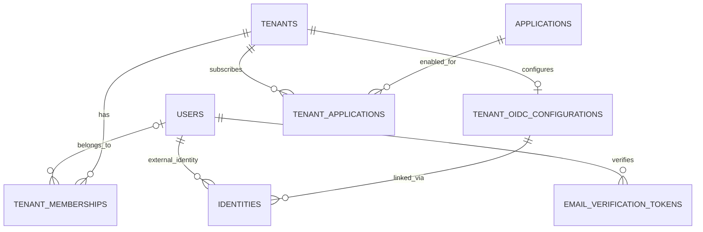
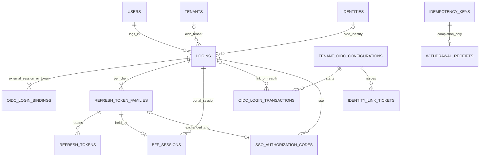

# Passport DB 모델 (Phase 1)

이 문서는 Phase 1 산출물이다. REQUIREMENTS 6장의 논리 모델과 `docs/API_CONTRACT.yaml`(Phase 0)을 기준으로 P0 범위의 물리 모델을 정의한다.
Phase 2의 ORM(`passport/db/models/`)과 초기 Alembic 마이그레이션은 이 문서를 따른다. 모델 때문에 API 계약을 바꿔야 하면 두 문서를 함께 고친다.

**[제안]** 표시는 승인이 필요한 설계 선택이다. 13장에 모았다.

**2026-11-02 확정 반영:** Python IntEnum·smallint 저장, 사전 등록 이메일의 활성화·취소 즉시 삭제, 외부 로그아웃·철회의 정확한 대상 매핑, 외부 보안 변경 기록의 저장 성공 후 완료 응답, 탈퇴 완료 확인 키 24시간을 적용한다.

**2026-11-05 탈퇴 정책 변경:** 탈퇴 시 `users` 행과 직접·간접 FK 자손을 같은 트랜잭션에서 물리 삭제한다. 개인정보 추가 보관과 탈퇴자 개인정보 조회는 제공하지 않으며 `audit_logs`는 보존한다. 사용자 FK가 없는 완료 확인·동기화·복원용 운영 기록은 개인정보 값 없이 각 보존 정책을 따른다.

**인증 정책 책임:** OTP 등록·검증·복구와 MFA 정책은 OIDC Provider에서 관리한다. Passport는 별도 MFA 판정·저장·재전달을 하지 않으며 ID Token의 `acr`·`amr`과 인정 규칙을 저장하지 않는다. OIDC 토큰의 기본 검증과 민감 작업 재인증은 유지한다.

## 1. 공통 규약

| 항목 | 규약 |
| --- | --- |
| DBMS | PostgreSQL 18, 스키마 `public` |
| 테이블 이름 | 복수형 snake_case(`users`, `tenant_memberships`). PostgreSQL 예약어 `user`를 피한다 |
| 기본 키 | 기본 `id uuid`, `users`는 `user_id uuid`. 값은 애플리케이션에서 `uuid.uuid7()`로 만든다. 시간순이라 인덱스 지역성이 좋고 계약의 ID 예시 형식과 같다. 1:1 확장 테이블은 부모 키를 PK로 쓴다 |
| 시각 | `timestamptz`, UTC. `created_at`·`updated_at`의 기본값은 `now()` |
| 열거 값 | Python `enum.IntEnum`의 명시적 정수 키(`.value`)를 PostgreSQL `smallint`에 저장한다. 이름 있는 CHECK로 허용 키를 제한한다(1.1절) |
| ETag | 변경 가능 리소스는 `version integer NOT NULL DEFAULT 1`. SQLAlchemy `version_id_col`로 매핑해 `UPDATE … WHERE version = :expected`가 되게 한다. ETag는 `"{version}"` |
| 접근 자격 버전 | `access_version bigint NOT NULL DEFAULT 1`. `tenants`, `tenant_memberships`, `tenant_applications`에만 둔다(FR-APP-008-05). `version`과 별개다 |
| 이메일 | 소문자 정규화 값만 저장한다(계약 `Email`). `user_email`에는 CHECK `user_email = lower(user_email)`을 적용한다. 사전 등록 이메일도 같은 정규화를 적용한다 |
| FK 삭제 동작 | 기본 `RESTRICT`. `users`를 참조하는 모든 FK와 그 자손으로 내려가는 FK는 `ON DELETE CASCADE`이며 표에 적는다. 공유 부모인 테넌트·서비스·OIDC 설정은 삭제하지 않는다. `audit_logs`에는 FK를 두지 않는다 |
| 표 읽는 법 | "NULL" 열이 `예`인 열만 NULL을 허용한다. "공통 열"은 `created_at`, `updated_at`, `version` 세 개다 |

### 1.1 Python Enum과 정수 키

- 영속 열거값은 Python `IntEnum`으로 선언한다. 멤버 이름은 대문자이고 `.value`는 아래에 명시한 `smallint` 키다. `auto()`·선언 순서로 키를 생성하지 않는다.
- 키는 Enum 종류별로 관리하며 기존 키를 변경·재사용하지 않는다. 새 값에는 새 키를 배정한다. 선택값 부재는 `NULL`로 표현하며 0을 임의의 기본값으로 쓰지 않는다.
- ORM은 `SmallInteger` 기반 공통 변환 타입으로 쓰기 시 `Enum.value`, 읽기 시 `Enum(value)`를 적용한다. 알 수 없는 키를 정상 상태로 대체하지 않는다. SQLAlchemy의 문자열 Enum 타입과 PostgreSQL ENUM은 사용하지 않는다.
- 각 열에는 `ck_<table>_<column>_enum`으로 `CHECK (<column> IN (...))`를 둔다. NULL 허용 여부는 데이터 사전과 같고, 상태 조합 CHECK·부분 인덱스도 정수 키를 사용한다. 키 추가·폐기는 Alembic으로 CHECK와 함께 관리한다.
- API·JWT·HTTP 헤더·외부 저널은 계약의 문자열 명칭을 사용한다. API DTO와 프로토콜 어댑터에서 명시적으로 변환하며, `IntEnum`의 정수 값이 JSON으로 직접 노출되지 않게 한다. 아래 표의 오른쪽 명칭이 외부 표현이며 모두 대문자로 표기한다.
- 상태 전이표와 업무 설명의 `ACTIVE` 등은 읽기 위한 명칭이다. SQL 조건과 DB 기본값에는 키를 사용한다. `client_id`·Application `code`·issuer·subject처럼 런타임에 등록하는 식별자와 OIDC scopes·acr·amr은 열거값이 아니다.
- `idempotency_keys.response_status`는 표준 라이브러리 `http.HTTPStatus`의 실제 HTTP 코드(예: `204`)를 `smallint`에 저장한다. 영속 JSON은 버전이 있는 기록 형식이며, 중첩 상태·유형은 문자열 명칭으로 보관한다.

| Python IntEnum | 적용 컬럼 | 키 = 외부 명칭 |
| --- | --- | --- |
| `UserStatus` | `users.user_status` | `1=PENDING_VERIFICATION`, `2=ACTIVE`, `3=SUSPENDED`, `4=DEACTIVATED` |
| `TenantStatus` | `tenants.tenant_status` | `1=ACTIVE`, `2=SUSPENDED`, `3=DEACTIVATED` |
| `ApplicationStatus` | `applications.status`, `tenant_applications.status` | `1=ACTIVE`, `2=INACTIVE` |
| `OidcProviderType` | `tenant_oidc_configurations.provider_type` | `1=KEYCLOAK`, `2=AUTH0` |
| `MemberProvisioning` | `tenant_oidc_configurations.member_provisioning` | `1=PRE_REGISTRATION`, `2=AUTO` |
| `OidcConfigurationStatus` | `tenant_oidc_configurations.status` | `1=ENABLED`, `2=DISABLED` |
| `OidcValidationStatus` | `tenant_oidc_configurations.last_validation_status` | `1=OK`, `2=FAILED` |
| `OidcValidationError` | `tenant_oidc_configurations.last_validation_error_code` | `1=DISCOVERY_UNREACHABLE`, `2=ISSUER_MISMATCH`, `3=JWKS_UNREACHABLE`, `4=INVALID_CLIENT`, `5=UNSUPPORTED_LIFECYCLE_BINDING` |
| `TenantRole` | `tenant_memberships.role` | `1=ADMIN`, `2=MEMBER` |
| `MembershipStatus` | `tenant_memberships.membership_status` | `1=PRE_REGISTERED`, `2=ACTIVE`, `3=SUSPENDED`, `4=REMOVED` |
| `MembershipRemovalReason` | `tenant_memberships.removed_reason` | `1=ADMIN_REMOVED`, `2=PRE_REGISTRATION_CANCELLED` |
| `AuthenticationMethod` | `logins.auth_method` | `1=LOCAL`, `2=OIDC` |
| `ClientType` | `logins.client_type` | `1=WEB`, `2=NATIVE` |
| `ReauthenticationMethod` | `logins.reauth_method` | `1=PASSWORD`, `2=OIDC` |
| `LoginEndReason` | `logins.end_reason` | `1=LOGOUT`, `2=LOGOUT_ALL`, `3=PASSWORD_CHANGED`, `4=ACCOUNT_INACTIVE`, `5=REFRESH_REUSE`, `6=OIDC_TRUST_CHANGED`, `7=EXTERNAL_ACCOUNT_BLOCKED`, `8=PROVIDER_LOGOUT`, `9=EXTERNAL_TOKEN_REVOKED`, `11=RESTORE` |
| `OidcBindingKind` | `oidc_login_bindings.kind` | `1=SESSION`, `2=TOKEN` |
| `SigningAlgorithm` | `signing_keys.alg` | `1=ES256` |
| `OidcIntent` | `oidc_login_transactions.intent` | `1=LOGIN`, `2=LINK`, `3=REAUTH` |
| `RequestMethod` | `idempotency_keys.request_method` | `1=GET`, `2=POST`, `3=PUT`, `4=PATCH`, `5=DELETE`, `6=HEAD`, `7=OPTIONS`, `8=TRACE`, `9=CONNECT` |
| `AccessScope` | `access_version_syncs.scope` | `1=TENANT`, `2=MEMBERSHIP`, `3=TENANT_APPLICATION` |
| `AuditResult` | `audit_logs.result` | `1=SUCCESS`, `2=FAILURE` |
| `AuditActorType` | `audit_logs.actor_type` | `1=USER`, `2=PLATFORM_ADMIN`, `3=APPLICATION`, `4=SYSTEM` |
| `AuditTargetType` | `audit_logs.target_type` | `1=USER`, `2=TENANT`, `3=TENANT_MEMBERSHIP`, `4=APPLICATION`, `5=TENANT_APPLICATION`, `6=TENANT_OIDC_CONFIGURATION`, `7=LOGIN`, `8=IDENTITY`, `12=USER_PROFILE` |
| `AuditAction` | `audit_logs.action` | 아래 `AuditAction` 키 표 |

`AuditAction`의 키는 현재 API 계약에 있는 이벤트를 아래처럼 고정한다. 폐기한 `UserStatus` 키 `5`, `MembershipRemovalReason` 키 `3`, `LoginEndReason` 키 `10`, `AuditAction` 키 `9`·`10`·`15`~`21`·`24`·`29`~`31`, `AuditTargetType` 키 `9`~`11`·`13`은 재사용하지 않는다. 계약에 새 이벤트나 서버 내부 이벤트를 추가할 때 기존 키를 유지하고 새 키를 명시 배정한다.

| 키 | 이벤트 명칭 |
| --- | --- |
| `1` | `USER.SIGNUP_REQUESTED` |
| `2` | `USER.EMAIL_VERIFIED` |
| `3` | `AUTH.LOGIN_SUCCEEDED` |
| `4` | `AUTH.LOGIN_FAILED` |
| `5` | `AUTH.LOGOUT` |
| `6` | `AUTH.LOGOUT_ALL` |
| `7` | `AUTH.REAUTHENTICATED` |
| `8` | `USER.PROFILE_UPDATED` |
| `11` | `USER.PASSWORD_CHANGED` |
| `12` | `USER.WITHDRAWAL_COMPLETION_RETRIED` |
| `13` | `USER.WITHDRAWN` |
| `14` | `IDENTITY.LINKED` |
| `22` | `TENANT.CREATED` |
| `23` | `TENANT.UPDATED` |
| `25` | `TENANT.OIDC_CONFIGURATION_CHANGED` |
| `26` | `MEMBERSHIP.PRE_REGISTERED` |
| `27` | `MEMBERSHIP.UPDATED` |
| `28` | `MEMBERSHIP.REMOVED` |
| `32` | `TENANT_APPLICATION.CHANGED` |
| `33` | `ADMIN.TENANTS_LISTED` |
| `34` | `TENANT.STATUS_CHANGED` |
| `35` | `ADMIN.USERS_SEARCHED` |
| `36` | `ADMIN.USER_VIEWED` |
| `37` | `USER.STATUS_CHANGED` |
| `38` | `APPLICATION.CREATED` |
| `39` | `APPLICATION.UPDATED` |
| `40` | `APPLICATION.SECRET_ROTATED` |
| `41` | `AUTH.OIDC_LOGIN_SUCCEEDED` |
| `42` | `AUTH.OIDC_LOGIN_FAILED` |
| `43` | `USER.CREATED_FROM_OIDC` |
| `44` | `MEMBERSHIP.AUTO_PROVISIONED` |

**비밀값 저장**

| 종류 | 예 | 저장 방식 |
| --- | --- | --- |
| 비밀번호 | Local 비밀번호 | Argon2id PHC 문자열(NFR-SEC-005) |
| CSPRNG로 만든 128비트 이상 무작위 값 | Refresh Token, BFF 세션 ID, SSO 코드, OIDC `state`·`nonce`, 이메일 확인 토큰, 링크 티켓, 서비스 `client_secret`, OIDC 브라우저 쿠키, 탈퇴 확인 키 | SHA-256 `bytea`(32바이트). 원문은 저장하지 않고 해시의 UNIQUE 인덱스로 조회한다 |
| 다시 꺼내 써야 하는 값 | OIDC `client_secret`, 서명 개인 키, BFF가 보관하는 토큰, PKCE verifier | **[제안]** 애플리케이션 AES-256-GCM 암호문 `bytea`. 암호문 앞에 키 ID를 붙여 키 교체를 지원한다. 키는 env로 받는다 |

비밀값 원문과 해시는 로그·감사 기록에 남기지 않는다(NFR-SEC-008).

## 2. 저장소 분담

| 데이터 | 저장소 | 이유 |
| --- | --- | --- |
| 계정·테넌트·멤버십·서비스·감사 | PostgreSQL | 원본 |
| 로그인, Refresh Token 계열, BFF 세션, 서명 키 | PostgreSQL **[제안]** | 철회·재사용 탐지·복원 시 일괄 무효화를 같은 트랜잭션과 같은 백업 기준으로 처리한다 |
| OIDC 트랜잭션, 링크 티켓, SSO 코드, 이메일 확인 토큰 | PostgreSQL + 만료 정리 작업 **[제안]** | 소비와 로그인·계정 생성을 한 트랜잭션으로 묶는다. 목표 부하(100 RPS)에서 충분하다 |
| 접근 자격 버전 캐시 | Valkey | FR-APP-008-07. 원본은 DB의 `access_version`이다(8장) |
| 복원용 보안 변경 기록 | DB 백업과 독립적인 외부 영속 저장소 | 성공 응답 전 영속화를 확인한다. DB에는 연결·재시도용 기록만 둔다(9.4절) |
| 속도·실패 제한 카운터, OIDC Discovery·JWKS 캐시 | Valkey 또는 프로세스 메모리 | 잃어도 안전하다 |
| 고정 client(`passport-portal`, `passport-native`), 포털 완료 URI, 암호화 키 | 설정(config.json, env) | 설치 단위 값이다 |

Access Token은 저장하지 않는다. 철회는 `sid`(= `logins.id`)의 상태로 판단하므로(계약 3.5) `jti` 거부 목록이 필요 없다.

## 3. 물리 ERD

### 3.1 계정·테넌트·서비스

### 3.2 로그인·토큰·일회성 값

`signing_keys`, `idempotency_keys`, `access_version_syncs`, `security_change_events`, `audit_logs`에는 FK가 없다. `withdrawal_receipts`는 `idempotency_keys`를 참조한다.

## 4. 데이터 사전

### 4.1 사용자

#### `users`

**목적:** Passport 전체에서 사용자의 불변 식별자·계정 상태·프로필과 Local 비밀번호 인증 정보를 관리한다.

**역할:** Local·OIDC 인증 수단과 테넌트 멤버십이 공통으로 참조하는 계정의 기준점이며, 로그인·재인증·비밀번호 변경·프로필 수정과 역할·테넌트별 개인정보 조회에 사용한다. 탈퇴 시 이 행과 직접·간접 FK 자손을 물리 삭제한다. 탈퇴 시각과 기존 사용자 ID는 개인정보 값 없이 `audit_logs` 및 복원용 보안 기록에 기록하며 사용자 ID는 재사용하지 않는다.

| 컬럼 | 형식 | NULL | 기본값 | 설명 |
| --- | --- | --- | --- | --- |
| `user_id` | uuid | | UUIDv7 | PK. 생성 후 변경·재사용하지 않는 식별자 |
| `user_status` | smallint | | `1` | `UserStatus`. `pending_verification`, `active`, `suspended`, `deactivated` |
| `is_system` | boolean | | `false` | 시스템 계정 여부
| `is_platform_admin` | boolean | | `false` | P0는 설치 CLI로만 지정한다. 계약의 `platform_roles`로 변환 |
| `user_email` | varchar(254) | | | 정규화 값. 필수. API의 `email`로 매핑 |
| `display_name` | varchar(50) | | | 필수 |
| `fist_name` | varchar(50) | 예 | | 선택 실명 항목인 이름. 요청한 컬럼명을 그대로 사용한다 |
| `last_name` | varchar(50) | 예 | | 선택 실명 항목인 성 |
| `password_hash` | text | 예 | | Local 비밀번호의 Argon2id PHC 문자열. Local 인증 수단이 없으면 NULL |
| `password_changed_at` | timestamptz | 예 | | Local 비밀번호 설정·변경 시각. Local 인증 수단이 없으면 NULL |
| `email_verified_at` | timestamptz | 예 | | Local은 확인 시각. OIDC는 Provider가 `email_verified = true`를 준 시각 |
| `created_at` | timestamptz | 예 | | 생성 시각 |
| `updated_at` | timestamptz | 예 | | 수정 시각 |
| `external_id` | varchar(50) | 예 | | 외부 서비스 연결용 식별값 |
| `external_source` | varchar(50) | 예 | 외부 서비스 연결용 식별값이 보관된 곳 |
| 공통 열 | | | | `version`은 프로필·계정 상태 변경이 공유하는 ETag이며 `getMe`·`updateMe`에도 사용한다 |

- CHECK `ck_users_user_status_enum`
- UNIQUE `uq_users_user_email` (`user_email`). Local 로그인 식별자이고(FR-AUTH-001), 같은 이메일로 계정을 새로 만들지 않는다(D-08). 외부 신원 연결 판단에는 쓰지 않는다. 탈퇴 시 행이 삭제되므로 같은 이메일로 다시 가입할 수 있으며 새 사용자 ID를 발급한다.
- CHECK `ck_users_user_email_lower`: `user_email = lower(user_email)`
- CHECK `ck_users_local_password`: `(password_hash IS NULL) = (password_changed_at IS NULL)`
- Local 가입 시 두 비밀번호 열을 함께 설정하고 `password_changed_at`에는 현재 시각을 넣는다. OIDC로만 가입한 사용자는 둘 다 NULL이다. `password_hash IS NULL`이면 비밀번호 API는 `409 local_credential_not_set`이다.
- 비밀번호 변경은 두 비밀번호 열 갱신과 사용자의 모든 로그인 종료를 같은 트랜잭션에서 처리한다. 비밀번호 해시·변경 시각은 사용자 API 응답에 포함하지 않는다.
- 개인정보 조회·변경 DTO는 인증 비밀값을 제외하고 역할·테넌트별 허용 필드만 명시적으로 매핑한다(FR-USER-007). 삭제된 사용자는 일반·관리자 조회에서 찾을 수 없으며 탈퇴자 개인정보 조회 경로도 제공하지 않는다.
- `fist_name`·`last_name`은 각각 선택 항목이며 기존 실명 열람 권한을 적용한다. 전화번호는 현재 수집·저장·반환하지 않는다.
- **[제안]** `pg_trgm` GIN 인덱스: `user_email`, `display_name`. `adminSearchUsers`는 100만 사용자에 대한 부분 일치 검색이다. 테넌트 안 검색은 멤버십으로 먼저 좁히므로 필요 없다.

#### `identities`

**목적:** 외부 OIDC 신원인 `(issuer, subject)`를 Passport 사용자 계정에 연결한다.

**역할:** 외부 인증 결과를 전역 사용자로 매핑하고 연결에 사용한 테넌트·OIDC 설정과 사용 이력을 관리한다. Local 인증 수단은 `users.password_hash`의 존재로 판단하며 `listMyIdentities`는 이 여부와 외부 신원 목록을 합쳐 반환한다. 비밀번호 해시는 반환하지 않는다.

| 컬럼 | 형식 | NULL | 기본값 | 설명 |
| --- | --- | --- | --- | --- |
| `id` | uuid | | UUIDv7 | `identity_id` |
| `user_id` | uuid | | | FK `users` `CASCADE` |
| `issuer` | varchar(2048) | | | |
| `subject` | varchar(255) | | | |
| `tenant_id` | uuid | | | FK `tenants`. 연결에 쓴 테넌트 |
| `oidc_config_id` | uuid | | | FK `tenant_oidc_configurations` |
| `linked_at` | timestamptz | | `now()` | |
| `last_used_at` | timestamptz | 예 | | |

- UNIQUE `uq_identities_issuer_subject` (`issuer`, `subject`): FR-OIDC-004, FR-OIDC-005
- 인덱스 `user_id`

#### `email_verification_tokens`

**목적:** Local 가입자의 이메일 소유 확인에 사용하는 일회용 토큰의 발급·소비 상태를 관리한다.

**역할:** 토큰 해시와 만료·소비 시각으로 확인 요청의 유효성을 검증하는 근거를 제공한다. 이메일 확인 완료와 가입 계정 활성화를 같은 트랜잭션에서 처리할 수 있도록 사용자에 연결한다.

| 컬럼 | 형식 | NULL | 기본값 | 설명 |
| --- | --- | --- | --- | --- |
| `id` | uuid | | UUIDv7 | |
| `user_id` | uuid | | | FK `users` `CASCADE` |
| `token_hash` | bytea | | | UNIQUE |
| `expires_at` | timestamptz | | | **[제안]** 발급 후 24시간 |
| `consumed_at` | timestamptz | 예 | | |
| `created_at` | timestamptz | | `now()` | |

- 인덱스 `user_id`
- **[제안]** 재발송하면 그 사용자의 미사용 토큰을 지우고 새로 발급한다.

### 4.2 테넌트

#### `tenants`

**목적:** 모든 연동 SaaS에서 공통으로 사용하는 전역 테넌트의 식별자와 조직 정보를 관리한다.

**역할:** 사용자 소속과 서비스 이용 관계의 기준이 되며, 테넌트 상태·접근 자격 버전을 통해 테넌트 범위의 접근 판단을 지원한다.

| 컬럼 | 형식 | NULL | 기본값 | 설명 |
| --- | --- | --- | --- | --- |
| `id` | uuid | | UUIDv7 | `tenant_id` |
| `code` | varchar(32) | | | UNIQUE. 생성 후 바꾸지 않는다 |
| `name` | varchar(100) | | | |
| `tenant_status` | smallint | | `1` | `TenantStatus`. `active`, `suspended`, `deactivated` |
| `access_version` | bigint | | `1` | 상태 변경마다 1 증가 |
| 공통 열 | | | | `version`은 테넌트 API의 ETag |

- CHECK `ck_tenants_tenant_status_enum`, CHECK `ck_tenants_code`: 계약 `TenantCode` 정규식

#### `tenant_oidc_configurations`

**목적:** 테넌트별 외부 OIDC 인증 연동 설정과 인증 신뢰 정책을 보관한다.

**역할:** 대상 테넌트의 Provider·클라이언트·소속 부여 방식을 적용하고 신뢰 버전으로 설정 변경에 따른 로그인 무효화를 지원한다. 테넌트당 하나의 설정을 유지하며 삭제 대신 `disabled`로 전환한다(FR-OIDC-010, D-06).

| 컬럼 | 형식 | NULL | 기본값 | 설명 |
| --- | --- | --- | --- | --- |
| `id` | uuid | | UUIDv7 | `oidc_config_id` |
| `tenant_id` | uuid | | | FK `tenants`, UNIQUE |
| `provider_type` | smallint | | | `OidcProviderType`. `keycloak`, `auth0` |
| `display_name` | varchar(100) | | | |
| `issuer` | varchar(2048) | | | `https://`로 시작 |
| `client_id` | varchar(255) | | | |
| `client_secret_ciphertext` | bytea | | | 암호문. 응답은 설정 여부만 준다 |
| `scopes` | text[] | | `{openid,email,profile}` | |
| `member_provisioning` | smallint | | `1` | `MemberProvisioning`. `pre_registration`, `auto`(D-08) |
| `status` | smallint | | | `OidcConfigurationStatus`. `enabled`, `disabled` |
| `trust_version` | integer | | `1` | 신뢰 변경마다 1 증가(계약 `putTenantOidcConfiguration`) |
| `last_validation_status` | smallint | | | `OidcValidationStatus`. `ok`, `failed` |
| `last_validation_checked_at` | timestamptz | | | |
| `last_validation_error_code` | smallint | 예 | | `OidcValidationError`. `discovery_unreachable`, `issuer_mismatch`, `jwks_unreachable`, `invalid_client`, `unsupported_lifecycle_binding` |
| 공통 열 | | | | |

- CHECK: `provider_type`, `member_provisioning`, `status`, `last_validation_status`, `last_validation_error_code`, `issuer LIKE 'https://%'`, `'openid' = ANY(scopes)`
- 활성화 전 Provider별 로그아웃·철회 감지 계약의 검증된 세션·토큰 식별자를 시험하고, 정확한 대상 매핑을 지원하지 않는 기능·설정은 `unsupported_lifecycle_binding`으로 거부한다. 제품 이름만으로 지원을 가정하지 않는다(FR-OIDC-017-01).

#### `tenant_memberships`

**목적:** 사용자와 전역 테넌트 사이의 소속 관계, 테넌트 내 역할 및 이용 상태를 관리한다.

**역할:** 사전 등록부터 활성·비활성·해지까지의 소속 상태를 기록하여 테넌트 접근과 관리자 권한을 판단하는 기준을 제공한다. 멤버십별 접근 자격 버전과 해지 이력을 유지하여 캐시 검증과 재가입 판단을 지원한다.

| 컬럼 | 형식 | NULL | 기본값 | 설명 |
| --- | --- | --- | --- | --- |
| `id` | uuid | | UUIDv7 | `membership_id` |
| `tenant_id` | uuid | | | FK `tenants` |
| `user_id` | uuid | 예 | | FK `users` `CASCADE`. `pre_registered`면 NULL |
| `pre_registered_email` | varchar(254) | 예 | | 사전 등록 이메일(정규화). `pre_registered` 동안만 보관하며 활성화·취소 즉시 NULL로 바꾼다 |
| `role` | smallint | | `2` | `TenantRole`. `admin`, `member` |
| `membership_status` | smallint | | | `MembershipStatus`. `pre_registered`, `active`, `suspended`, `removed` |
| `access_version` | bigint | | `1` | 상태·역할 변경마다 1 증가 |
| `joined_at` | timestamptz | 예 | | 처음 `active`가 된 시각 |
| `removed_at` | timestamptz | 예 | | |
| `removed_reason` | smallint | 예 | | `MembershipRemovalReason`. `admin_removed`, `pre_registration_cancelled` |
| 공통 열 | | | | |

- CHECK `ck_tenant_memberships_state`:
  `(membership_status = 1 AND user_id IS NULL AND pre_registered_email IS NOT NULL) OR (membership_status IN (2, 3) AND user_id IS NOT NULL) OR membership_status = 4`
- CHECK `ck_tenant_memberships_removed`: `(membership_status = 4) = (removed_at IS NOT NULL AND removed_reason IS NOT NULL)`
- FR-MEM-005-01의 이메일 보존 규칙을 CHECK `ck_tenant_memberships_email_lifecycle`로 강제한다: `(membership_status = 1) = (pre_registered_email IS NOT NULL)`
- 부분 UNIQUE `uq_tenant_memberships_tenant_user` (`tenant_id`, `user_id`) `WHERE membership_status <> 4`: 중복 소속 방지(FR-MEM-005)
- 부분 UNIQUE `uq_tenant_memberships_tenant_email` (`tenant_id`, `pre_registered_email`) `WHERE membership_status = 1`
- 인덱스 `user_id`(`listMyTenants`), (`tenant_id`, `membership_status`)
- 계정이 존재하는 동안 `removed` 행은 감사와 P1 재가입 판단을 위해 보존한다(FR-MEM-008). 계정 탈퇴 시에는 과거 `removed` 행을 포함한 모든 소속 행을 FK 연쇄 삭제한다. 관리자 해지 후 재가입은 새 행이다.

### 4.3 서비스

#### `applications`

**목적:** Passport와 연동하는 SaaS의 등록 정보와 신뢰할 수 있는 서비스 클라이언트 정보를 관리한다.

**역할:** 서비스 코드를 토큰의 audience·client_id로 사용하고, 서비스 자격 증명·SSO callback URI·활성 상태로 서버 간 호출과 서비스 간 로그인 연계의 대상을 제한한다.

| 컬럼 | 형식 | NULL | 기본값 | 설명 |
| --- | --- | --- | --- | --- |
| `id` | uuid | | UUIDv7 | `application_id` |
| `code` | varchar(32) | | | UNIQUE. `client_id`이자 Access Token `aud` |
| `name` | varchar(100) | | | |
| `status` | smallint | | `1` | `ApplicationStatus`. `active`, `inactive` |
| `client_secret_hash` | bytea | | | SHA-256. 서비스 인증과 BFF client 인증에 함께 쓴다(13장 2번) |
| `previous_client_secret_hash` | bytea | 예 | | 교체 직전 secret |
| `previous_secret_valid_until` | timestamptz | 예 | | **[제안]** 교체 후 24시간 |
| `secret_rotated_at` | timestamptz | | `now()` | |
| `bff_redirect_uris` | text[] | | `{}` | API의 `sso_redirect_uris`에 매핑하는 SSO callback URI. 정확히 일치해야 한다 |
| 공통 열 | | | | |

- CHECK: `status`, 계약 `ApplicationCode` 정규식, `code <> 'passport'`
- CHECK `ck_applications_previous_secret`: `(previous_client_secret_hash IS NULL) = (previous_secret_valid_until IS NULL)`
- `client_secret`은 256비트 무작위 값이라 빠른 해시로 충분하다. 요청마다 인증하므로 Argon2id는 쓰지 않는다.

#### `tenant_applications`

**목적:** 전역 테넌트와 등록 SaaS 사이의 서비스 이용 관계를 관리한다.

**역할:** 테넌트별 서비스 활성 상태와 접근 자격 버전을 통해 해당 테넌트 구성원들의 서비스 이용 자격을 판단하는 기준을 제공한다. 행이 없으면 계약의 `not_enabled`이며 처음 활성화할 때 생성한다.

| 컬럼 | 형식 | NULL | 기본값 | 설명 |
| --- | --- | --- | --- | --- |
| `tenant_id` | uuid | | | PK, FK `tenants` |
| `application_id` | uuid | | | PK, FK `applications` |
| `status` | smallint | | | `ApplicationStatus`. `active`, `inactive` |
| `access_version` | bigint | | `1` | 상태 변경마다 1 증가 |
| 공통 열 | | | | |

- 인덱스 `application_id`

### 4.4 로그인·토큰

#### `logins`

**목적:** 한 번의 사용자 인증으로 성립한 Passport 로그인의 인증 컨텍스트와 유효 상태를 관리한다.

**역할:** Access Token의 `sid`에 대응하는 기준 행으로 최대 유지·미사용 만료·종료·OIDC 신뢰 버전을 검증한다. SSO 세션·Refresh Token 계열을 같은 원 로그인에 연결한다(계약 3.1).

| 컬럼 | 형식 | NULL | 기본값 | 설명 |
| --- | --- | --- | --- | --- |
| `id` | uuid | | UUIDv7 | `sid`, `login_id` |
| `user_id` | uuid | | | FK `users` `CASCADE` |
| `auth_method` | smallint | | | `AuthenticationMethod`. `local`, `oidc` |
| `client_type` | smallint | | | `ClientType`. `web`, `native` |
| `authenticated_at` | timestamptz | | | `auth_time` |
| `expires_at` | timestamptz | | | 최대 유지 시각. web +8시간, native +7일. 갱신으로 늘리지 않는다 |
| `last_activity_at` | timestamptz | | | 미사용 만료 기준. 만료 시각은 이 값 + 30분(web) 또는 3일(native) |
| `tenant_id` | uuid | 예 | | FK `tenants`. OIDC 로그인의 대상 테넌트 |
| `oidc_config_id` | uuid | 예 | | FK `tenant_oidc_configurations` |
| `oidc_trust_version` | integer | 예 | | 로그인 시점의 `trust_version` |
| `identity_id` | uuid | 예 | | FK `identities` `CASCADE` |
| `reauthenticated_at` | timestamptz | | | 최근 재인증. 로그인 시각으로 시작한다 |
| `reauth_method` | smallint | | | `ReauthenticationMethod`. `password`, `oidc` |
| `ended_at` | timestamptz | 예 | | |
| `end_reason` | smallint | 예 | | `LoginEndReason`. 5.5절 |
| `created_at` | timestamptz | | `now()` | |

- CHECK `ck_logins_oidc`: `auth_method = 1 OR (tenant_id IS NOT NULL AND oidc_config_id IS NOT NULL AND oidc_trust_version IS NOT NULL)`
- CHECK `ck_logins_ended`: `(ended_at IS NULL) = (end_reason IS NULL)`
- 부분 인덱스 `WHERE ended_at IS NULL`: `user_id`(전체 로그아웃·계정 차단), `oidc_config_id`(신뢰 변경), `identity_id`(외부 계정 차단·Provider 로그아웃)
- 인덱스 `expires_at`(정리 작업)
- Passport API와 `verifyAccess`는 요청마다 PK로 이 행과 사용자 존재 여부를 확인하며 사용자 또는 로그인 행이 없으면 기존 토큰을 거부한다. OIDC 로그인은 `oidc_trust_version`을 현재 설정과 비교한다.
- **[제안]** `last_activity_at`은 1분 단위로만 갱신해 쓰기를 줄인다.

#### `oidc_login_bindings`

**목적:** 검증된 외부 세션·토큰과 Passport 로그인 사이의 대응 관계를 관리한다.

**역할:** Provider 로그아웃·명시적 토큰 철회의 대상을 정확히 식별하고 같은 외부 신원의 서로 다른 로그인도 구별한다. Provider별 식별자 추출·정규화 규칙은 검증된 연동 계약에 고정한다.

| 컬럼 | 형식 | NULL | 기본값 | 설명 |
| --- | --- | --- | --- | --- |
| `login_id` | uuid | | | PK, FK `logins` `CASCADE` |
| `kind` | smallint | | | `OidcBindingKind`. PK. `session`, `token` |
| `binding_hash` | bytea | | | PK. 검증한 외부 `sid` 또는 철회 대상 토큰 식별자의 SHA-256 |
| `created_at` | timestamptz | | `now()` | |

- CHECK `ck_oidc_login_bindings_kind_enum`, CHECK `ck_oidc_login_bindings_hash`: `octet_length(binding_hash) = 32`
- 인덱스 (`kind`, `binding_hash`). 조회 시 `logins`와 조인해 `tenant_id`, `oidc_config_id`, `oidc_trust_version`을 모두 대조한다. 외부 토큰 원문은 보관하지 않는다.
- 신뢰할 수 있는 통지의 대상 식별자와 일치하는 로그인만 종료한다. 식별자가 없거나 매핑되지 않는 통지는 거부·감사하며, `(issuer, subject)`만으로 종료 범위를 넓히지 않는다. 외부 계정 차단은 별도로 해당 신원·테넌트의 로그인 전체를 종료한다.

#### `refresh_token_families`

**목적:** 한 로그인에서 클라이언트별 Refresh Token 발급·회전을 관리하는 계열을 정의한다.

**역할:** 로그인 하나에 클라이언트마다 계열 하나를 두어 Passport 포털·네이티브·SaaS의 토큰 이력을 구분한다. 계열 단위 잠금과 폐기를 통해 동시 회전 처리와 SSO 코드 재사용 시 해당 계열의 철회를 지원한다(FR-AUTH-009-02-01).

| 컬럼 | 형식 | NULL | 기본값 | 설명 |
| --- | --- | --- | --- | --- |
| `id` | uuid | | UUIDv7 | |
| `login_id` | uuid | | | FK `logins` `CASCADE` |
| `client_id` | varchar(32) | | | `passport-portal`, `passport-native` 또는 Application `code`. Access Token `client_id` |
| `revoked_at` | timestamptz | 예 | | 계열만 폐기할 때. SSO 코드 재사용 등 |
| `created_at` | timestamptz | | `now()` | |

- 인덱스 `login_id`

#### `refresh_tokens`

**목적:** 발급한 Refresh Token의 해시와 회전 이력을 보관한다.

**역할:** 계열의 현재 유효 토큰을 확인하고 회전으로 무효화된 이전 토큰의 재사용을 탐지하는 근거를 제공한다. 재사용 탐지 시 사용자의 전체 로그인 종료·토큰 철회 정책을 적용할 수 있도록 계열과 로그인에 연결한다.

| 컬럼 | 형식 | NULL | 기본값 | 설명 |
| --- | --- | --- | --- | --- |
| `id` | uuid | | UUIDv7 | |
| `family_id` | uuid | | | FK `refresh_token_families` `CASCADE` |
| `token_hash` | bytea | | | UNIQUE |
| `issued_at` | timestamptz | | `now()` | |
| `rotated_at` | timestamptz | 예 | | 회전되어 무효가 된 시각. 이 토큰이 다시 오면 재사용이다(FR-AUTH-009-07-01) |

- 부분 UNIQUE `uq_refresh_tokens_active` (`family_id`) `WHERE rotated_at IS NULL`: 계열마다 유효한 토큰은 하나다
- 자체 만료 시각이 없다. 유효 기간은 로그인의 최대 유지·미사용 만료를 따른다.

#### `bff_sessions`

**목적:** Passport 포털의 SSO 브라우저 세션과 서버 측 토큰 보관 정보를 관리한다.

**역할:** 불투명 세션 쿠키를 원 로그인·Refresh Token 계열·선택 테넌트·암호화된 토큰에 연결하여 브라우저에 토큰을 노출하지 않는 API 중계·갱신을 지원한다. SaaS의 브라우저 세션은 각 SaaS가 별도로 관리한다.

| 컬럼 | 형식 | NULL | 기본값 | 설명 |
| --- | --- | --- | --- | --- |
| `id` | uuid | | UUIDv7 | |
| `session_hash` | bytea | | | UNIQUE. 쿠키 값의 SHA-256 |
| `login_id` | uuid | | | FK `logins` `CASCADE` |
| `refresh_family_id` | uuid | | | FK `refresh_token_families` `CASCADE`, UNIQUE |
| `refresh_token_ciphertext` | bytea | | | BFF가 다음 갱신에 쓸 토큰 |
| `tenant_id` | uuid | 예 | | FK `tenants`. 현재 선택한 테넌트 |
| `access_token_ciphertext` | bytea | 예 | | 현재 Access Token |
| `access_token_expires_at` | timestamptz | 예 | | |
| `created_at`, `updated_at` | | | | |

- 인덱스 `login_id`
- 로그아웃·로그인 종료 때 행을 지운다. 유효성은 항상 연결된 `logins`로 판단한다.

#### `signing_keys`

**목적:** Passport JWT Access Token의 서명 키와 공개 검증 키를 보관한다(FR-AUTH-008).

**역할:** 여러 프로세스가 같은 키를 사용하도록 하고 키의 활성화·서명 중단·검증 만료·긴급 폐기 시각을 관리한다. 정기 키 교체와 JWKS를 통한 공개 키 배포의 기준이 된다.

| 컬럼 | 형식 | NULL | 기본값 | 설명 |
| --- | --- | --- | --- | --- |
| `kid` | varchar(64) | | | PK |
| `alg` | smallint | | `1` | `SigningAlgorithm`. **[제안]** |
| `public_jwk` | jsonb | | | JWKS에 게시하는 공개 키 |
| `private_key_ciphertext` | bytea | | | 암호문 |
| `activates_at` | timestamptz | | | 서명 시작. **[제안]** 생성(게시) 후 24시간 |
| `retires_at` | timestamptz | | | 서명 중단. 시작 후 90일 |
| `expires_at` | timestamptz | | | JWKS에서 내림. **[제안]** 서명 중단 후 24시간 |
| `revoked_at` | timestamptz | 예 | | 복원·사고 시 즉시 폐기 |
| `created_at` | timestamptz | | `now()` | |

### 4.5 일회성 값

모두 해시로 찾고, 소비는 `UPDATE … SET consumed_at = now() WHERE … AND consumed_at IS NULL AND expires_at > now() RETURNING …` 한 문장으로 한다.

#### `oidc_login_transactions`

**목적:** 외부 OIDC 로그인·신원 연결·재인증의 시작 요청과 콜백을 연결하는 단기 인증 트랜잭션을 보관한다.

**역할:** state·nonce·PKCE와 대상 테넌트·설정 버전·최초 브라우저를 함께 연결하여 콜백의 유효성을 검증하는 근거를 제공한다. 만료·소비 상태를 관리하여 다른 트랜잭션의 응답 혼용과 재사용을 방지하는 흐름을 지원한다.

| 컬럼 | 형식 | NULL | 기본값 | 설명 |
| --- | --- | --- | --- | --- |
| `id` | uuid | | UUIDv7 | |
| `state_hash` | bytea | | | UNIQUE |
| `browser_binding_hash` | bytea | | | 최초 브라우저의 트랜잭션 전용 비밀 쿠키 값의 SHA-256 |
| `nonce_hash` | bytea | | | ID Token `nonce`와 비교 |
| `pkce_verifier_ciphertext` | bytea | | | Provider 토큰 교환에 다시 쓴다 |
| `tenant_id` | uuid | | | FK `tenants`. 콜백 경로의 `tenant_id`와 비교(FR-OIDC-012) |
| `oidc_config_id` | uuid | | | FK `tenant_oidc_configurations` |
| `oidc_trust_version` | integer | | | 시작 시점 값. 콜백에서 현재 값과 같아야 한다 |
| `intent` | smallint | | | `OidcIntent`. `login`, `link`, `reauth` |
| `return_to` | varchar(2048) | | | 등록된 포털 완료 URI |
| `login_id` | uuid | 예 | | FK `logins` `CASCADE`. `link`·`reauth`가 묶인 로그인 |
| `expires_at` | timestamptz | | | **[제안]** 생성 후 10분 |
| `consumed_at` | timestamptz | 예 | | |
| `created_at` | timestamptz | | `now()` | |

- CHECK `ck_oidc_login_transactions_browser_binding_hash`: `octet_length(browser_binding_hash) = 32`
- CHECK `ck_oidc_login_transactions_intent`: `(intent = 1) = (login_id IS NULL)`
- BFF 시작 경로가 트랜잭션마다 256비트 난수를 만들어 `__Host-passport_oidc_<id>` 쿠키(`HttpOnly; Secure; SameSite=Lax; Path=/`, `Domain` 없음)에 둔다. 만료는 트랜잭션과 같고 값은 JSON·URL에 반환하지 않는다. 병렬 로그인은 별도 쿠키를 사용한다.
- 콜백은 **소비 전에** 해당 쿠키의 해시를 대조한다. 누락·불일치면 거부하며 세션 생성·신원 연결·재인증을 수행하지 않는다. 성공 또는 정상적인 종결 시 쿠키를 지운다. `state`·`nonce`·PKCE 검증도 함께 유지한다.

#### `identity_link_tickets`

**목적:** 외부 인증에 성공한 신원을 기존 Passport 계정에 명시적으로 연결하기 위한 일회용 확인 근거를 보관한다.

**역할:** 티켓을 검증된 외부 신원·테넌트·OIDC 설정 및 필요한 경우 원 로그인에 연결하고 만료·소비 여부를 관리한다. 기존 계정 재인증과 사용자의 연결 확인을 거쳐 외부 신원을 추가하는 절차에 사용한다.

| 컬럼 | 형식 | NULL | 기본값 | 설명 |
| --- | --- | --- | --- | --- |
| `id` | uuid | | UUIDv7 | |
| `ticket_hash` | bytea | | | UNIQUE |
| `issuer` | varchar(2048) | | | 연결할 외부 신원 |
| `subject` | varchar(255) | | | |
| `tenant_id` | uuid | | | FK `tenants` |
| `oidc_config_id` | uuid | | | FK `tenant_oidc_configurations` |
| `login_id` | uuid | 예 | | FK `logins` `CASCADE`. `intent = link`에서 시작한 로그인 |
| `expires_at` | timestamptz | | | **[제안]** 발급 후 10분 |
| `consumed_at` | timestamptz | 예 | | |
| `created_at` | timestamptz | | `now()` | |

#### `sso_authorization_codes`

**목적:** 서비스 간 SSO 로그인 연계에 사용하는 짧은 수명의 일회용 인가 코드를 관리한다.

**역할:** 코드를 클라이언트·redirect URI·원 로그인·테넌트·PKCE에 연결하여 서버 간 교환 조건과 소비 여부를 검증한다. 교환으로 발급한 Refresh Token 계열을 기록하여 코드 재사용 시 해당 계열을 폐기할 수 있게 한다.

| 컬럼 | 형식 | NULL | 기본값 | 설명 |
| --- | --- | --- | --- | --- |
| `id` | uuid | | UUIDv7 | |
| `code_hash` | bytea | | | UNIQUE |
| `client_id` | varchar(32) | | | 코드를 요청한 Application `code` |
| `redirect_uri` | varchar(2048) | | | |
| `login_id` | uuid | | | FK `logins` `CASCADE` |
| `tenant_id` | uuid | | | FK `tenants` |
| `code_challenge` | varchar(128) | | | S256 |
| `expires_at` | timestamptz | | | **[제안]** 발급 후 60초 |
| `consumed_at` | timestamptz | 예 | | |
| `refresh_family_id` | uuid | 예 | | FK `refresh_token_families` `CASCADE`. 교환으로 만든 계열. 코드가 다시 오면 이 계열을 폐기한다 |
| `created_at` | timestamptz | | `now()` | |

### 4.6 운영

#### `idempotency_keys`

**목적:** 동일한 클라이언트 요청의 재시도를 식별하고 중복 변경을 방지하기 위한 처리 결과를 보관한다.

**역할:** 요청자·멱등 키별로 요청 해시와 응답·ETag를 기록하여 요청의 동일성을 검증하고 처음 처리 결과를 재생한다. 외부 기록·Valkey 반영의 부분 실패 후에도 DB 상태와 버전을 중복 변경하지 않는 재시도의 기준이 된다.

| 컬럼 | 형식 | NULL | 기본값 | 설명 |
| --- | --- | --- | --- | --- |
| `id` | uuid | | UUIDv7 | |
| `principal_id` | uuid | | | 호출한 `user_id` 또는 `application_id` |
| `key` | varchar(128) | | | `Idempotency-Key` |
| `request_method` | smallint | | | `RequestMethod`. 원 요청 HTTP 메서드 |
| `request_path` | varchar(512) | | | |
| `request_hash` | bytea | | | 메서드·경로·본문의 SHA-256. 다르면 `422 idempotency_key_reused` |
| `response_status` | smallint | 예 | | 처음 결과. 키를 먼저 삽입하고 같은 트랜잭션 끝에 채우므로 커밋된 행에는 항상 값이 있다 |
| `response_body` | jsonb | 예 | | `204`면 NULL |
| `response_etag` | varchar(64) | 예 | | |
| `expires_at` | timestamptz | | | **[제안]** 생성 후 24시간 |
| `created_at` | timestamptz | | `now()` | |

- UNIQUE `uq_idempotency_keys_principal_key` (`principal_id`, `key`)
- 인덱스 `expires_at`

#### `withdrawal_receipts`

**목적:** 탈퇴로 로그인·토큰이 종료된 후에도 원 탈퇴 요청의 완료 처리만 재개·확인할 수 있는 전용 키를 관리한다(FR-USER-005-02).

**역할:** 키 해시·원 멱등 요청과의 연결·24시간 만료를 보관하여 외부 커밋 확인과 Valkey 동기화의 제한된 재시도를 지원한다. 일반 API 인증이나 계정 복구에는 사용하지 않는다.

| 컬럼 | 형식 | NULL | 기본값 | 설명 |
| --- | --- | --- | --- | --- |
| `id` | uuid | | UUIDv7 | |
| `receipt_hash` | bytea | | | UNIQUE. `Withdrawal-Receipt`의 SHA-256 |
| `idempotency_id` | uuid | | | FK `idempotency_keys` `CASCADE`, UNIQUE. 원 탈퇴 요청·사용자·본문 해시에 바인딩 |
| `expires_at` | timestamptz | | | 원 탈퇴 DB 커밋 시점 + 24시간 |
| `created_at` | timestamptz | | `now()` | |

- CHECK `ck_withdrawal_receipts_hash`: `octet_length(receipt_hash) = 32`
- 인덱스 `expires_at`. 연결된 멱등 행은 확인 키의 만료 전에 삭제하지 않는다. 클라이언트가 첫 탈퇴 요청 **전에** CSPRNG로 256비트 값을 만들고 보관한다. 서버 응답이 유실되어도 키는 클라이언트에 남는다. 원문은 서버에 저장·로그·응답하지 않는다.
- 인증된 최초 탈퇴 트랜잭션에서만 생성한다. 같은 멱등 키에 다른 확인 키를 제출하면 거부한다. 완료 경로는 키로 연결된 **이미 커밋된** 요청의 외부 기록 확인·Valkey 동기화·완료 응답만 수행한다.
- 쿠키·Bearer 인증 없이 완료 경로에서만 수용한다. 탈퇴 시작·취소·계정 복구·로그인·개인정보 조회·다른 API 호출에는 사용할 수 없다. 만료되어도 서버의 미완료 처리 재시도는 계속한다.

#### `security_change_events`

**목적:** DB에 커밋한 보안 변경과 외부 복원용 저널의 연결 및 재시도 상태를 관리한다.

**역할:** 원 작업 ID·외부 순번·변경 명령·참조·커밋 확인 시각을 보관하여 미확인 외부 기록을 재처리하는 DB 내 원장으로 사용한다. 복원 원본은 9.4절의 독립 외부 기록이며 이 테이블의 백업으로 대체하지 않는다.

| 컬럼 | 형식 | NULL | 기본값 | 설명 |
| --- | --- | --- | --- | --- |
| `id` | uuid | | UUIDv7 | 외부 기록의 멱등 `event_id`와 동일 |
| `journal_sequence` | bigint | | | 외부 저장소가 부여한 설치 내 단조 증가 순번, UNIQUE |
| `operation_id` | uuid | | | 원 `idempotency_keys.id` 또는 서버 작업 ID. 인덱스 |
| `changes` | jsonb | | | 대상 유형·ID·버전과 재적용할 상태·삭제 명령 |
| `external_ref` | varchar(2048) | | | 외부 변경 의도 기록의 참조 |
| `confirmed_at` | timestamptz | 예 | | DB 커밋 사실의 외부 기록까지 확인한 시각 |
| `created_at` | timestamptz | | `now()` | |

- 상태 변경과 함께 커밋한다. 외부 기록과 동일하게 개인정보 값·자격 증명·토큰은 넣지 않는다. 재처리는 `event_id` 기준 멱등이다. 보관은 9.4절을 따른다.

#### `access_version_syncs`

**목적:** DB에 커밋한 접근 자격 버전 중 Valkey 반영이 완료되지 않은 동기화 대기 항목을 관리한다.

**역할:** 테넌트·멤버십·테넌트별 서비스 이용 관계마다 미반영 최신 버전을 유지한다. 커밋 후 캐시 반영, 실패 후 재시도, 변경 완료 응답 전 동기화 확인에 사용한다(8장).

| 컬럼 | 형식 | NULL | 기본값 | 설명 |
| --- | --- | --- | --- | --- |
| `scope` | smallint | | | `AccessScope`. PK. `tenant`, `membership`, `tenant_application` |
| `tenant_id` | uuid | | | PK |
| `entity_id` | uuid | | | PK. `tenant`이면 `tenant_id`, `membership`이면 `membership_id`, `tenant_application`이면 `application_id` |
| `version` | bigint | | | 반영할 버전 |
| `enqueued_at` | timestamptz | | `now()` | |

#### `audit_logs`

**목적:** 로그인·설정 변경·관리자 조회 등 보안상 중요한 행위의 감사 추적 기록을 보관한다(NFR-SEC-007).

**역할:** 행위자·대상·시각·작업·결과·사유를 기록하여 운영 확인과 사고 조사를 지원한다. 추가만 하는 기록이며 대상이 삭제된 뒤에도 남도록 FK를 두지 않는다.

| 컬럼 | 형식 | NULL | 기본값 | 설명 |
| --- | --- | --- | --- | --- |
| `id` | uuid | | UUIDv7 | |
| `occurred_at` | timestamptz | | `now()` | |
| `action` | smallint | | | `AuditAction`. 계약의 `x-audit-event` 이름(예 `membership.removed`) |
| `result` | smallint | | | `AuditResult`. `success`, `failure` |
| `actor_type` | smallint | | | `AuditActorType`. `user`, `platform_admin`, `application`, `system` |
| `actor_id` | uuid | 예 | | `user_id` 또는 `application_id` |
| `tenant_id` | uuid | 예 | | |
| `target_type` | smallint | 예 | | `AuditTargetType`. 대상 리소스 유형 |
| `target_id` | varchar(64) | 예 | | |
| `request_id` | varchar(128) | 예 | | `X-Request-ID` |
| `source_ip` | inet | 예 | | **[제안]** |
| `reason` | varchar(500) | 예 | | 관리자 작업·조회 사유 |
| `details` | jsonb | | `{}` | 비밀값·민감 개인정보 금지 |

- 인덱스 `occurred_at`(보존 기간 삭제), (`tenant_id`, `occurred_at`)
- 실행 계정에서 `UPDATE` 권한을 회수한다(11장).

## 5. 상태 전이

### 5.1 계정(`users.user_status`)

| 전이 | 주체 | 함께 일어나는 일 |
| --- | --- | --- |
| `pending_verification` → `active` | 이메일 확인 | OIDC로 만든 계정은 `active`로 시작한다 |
| `active`, `suspended`, `deactivated` 사이 | 플랫폼 관리자(`updateUserStatus`) | `active`가 아니게 되면 그 사용자의 모든 로그인 종료(`account_inactive`) |
| 모든 상태 → 행 삭제 | 본인 탈퇴 | 9.2절. 계정과 모든 FK 자손을 물리 삭제한다 |

### 5.2 멤버십(`tenant_memberships.membership_status`)

| 전이 | 주체 |
| --- | --- |
| 없음 → `pre_registered` | 테넌트 관리자 사전 등록 |
| `pre_registered` → `active` | 같은 이메일 사용자의 첫 토큰 요청, 이 테넌트 OIDC 로그인 |
| 없음 → `active` | 테넌트 생성자(`admin`), OIDC 자동 등록(`member`) |
| `active` ↔ `suspended` | 테넌트 관리자 |
| `pre_registered`, `active`, `suspended` → `removed` | 테넌트 관리자 해지·사전 등록 취소. 계정이 존재하는 동안 보존 |
| 모든 상태 → 행 삭제 | 본인 탈퇴 시 FK 연쇄 삭제. 과거 `removed`도 포함 |

상태 또는 역할이 바뀔 때마다 `access_version`을 1 올린다. 사전 등록 활성화·취소와 같은 트랜잭션에서 `pre_registered_email`을 NULL로 바꾼다.

### 5.3 테넌트, 서비스

- `tenants.tenant_status`: `active`, `suspended`, `deactivated` 사이를 플랫폼 관리자가 바꾼다. 바뀔 때마다 `access_version` + 1
- `tenant_applications.status`: 없음 → `active` → `inactive` ↔ `active`. 바뀔 때마다 `access_version` + 1
- `applications.status`: `active` ↔ `inactive`. 접근 자격 버전 대상이 아니며 요청마다 직접 확인한다.

### 5.4 OIDC 설정

`enabled` ↔ `disabled`. 신뢰 변경(`issuer`, `client_id`, `client_secret` 변경과 `enabled → disabled`)이면 같은 트랜잭션에서 `trust_version` + 1, 그리고 `oidc_config_id`가 같은 진행 중 로그인을 `oidc_trust_changed`로 끝낸다(D-06).

### 5.5 로그인

진행 중(`ended_at IS NULL`) → 종료. 최대 유지·미사용 만료는 시각으로 계산하며 상태를 바꾸지 않는다.

| `end_reason` | 사건 | 범위 |
| --- | --- | --- |
| `logout` | 현재 로그인 로그아웃(SSO 단일 로그아웃 포함) | 그 로그인 |
| `logout_all` | 모든 기기 로그아웃 | 사용자의 모든 로그인 |
| `password_changed` | 비밀번호 변경 | 사용자의 모든 로그인 |
| `account_inactive` | 계정 차단·비활성화 | 사용자의 모든 로그인 |
| `refresh_reuse` | Refresh Token 재사용 탐지 | 사용자의 모든 로그인 |
| `oidc_trust_changed` | OIDC 신뢰 변경 | 그 설정의 로그인 |
| `external_account_blocked` | FR-OIDC-015 | 그 외부 신원·테넌트의 로그인 전체 |
| `provider_logout` | FR-OIDC-017, 017-01 | 검증된 외부 세션과 `oidc_login_bindings`로 연결된 로그인만 |
| `external_token_revoked` | FR-OIDC-018, 017-01 | 검증된 철회 대상 토큰과 `oidc_login_bindings`로 연결된 로그인만 |
| `restore` | 백업 복원 | 모든 로그인 |

## 6. 무결성·격리·비밀값 보호

- **외부 신원 유일성**: UNIQUE(`issuer`, `subject`). 이메일로 신원을 합치지 않는다. 동시에 첫 로그인이 오면 한쪽이 UNIQUE 위반으로 롤백된 뒤 기존 신원으로 다시 처리한다.
- **테넌트 격리**: 테넌트 데이터 테이블(`tenant_memberships`, `tenant_oidc_configurations`, `tenant_applications`)은 모두 `tenant_id`를 가진다. 조회는 항상 `tenant_id` 조건을 포함한다.
- **OIDC 트랜잭션 바인딩**: 트랜잭션에 `tenant_id`·`oidc_config_id`·`oidc_trust_version`·`browser_binding_hash`를 함께 저장하고 콜백에서 모두 대조한다(FR-OIDC-007, 012, D-06). 시작 처리는 BFF가 직접 맡으며 공개 `/api/v1` 시작 경로로 브라우저 바인딩을 우회하지 않는다.
- **비밀값**: 1장 표를 따른다. 응답 스키마에 비밀값 열을 매핑하지 않는다.
- **DB 계정**: 실행 계정 `passport_user`는 DML만, 마이그레이션 계정 `passport_owner`는 DDL을 가진다(Phase 2 구성).

### 6.1 계정 삭제의 FK 범위

`users.user_id` 삭제는 아래 방향의 자손 행에만 적용한다. 모든 경로에 `ON DELETE CASCADE`를 사용하며 테넌트·서비스·OIDC 설정 같은 공유 부모는 삭제하지 않는다.

| 경로 | 삭제 대상 |
| --- | --- |
| 사용자 직접 참조 | `identities`, `email_verification_tokens`, `tenant_memberships`, `logins` |
| 로그인 자손 | `oidc_login_bindings`, `refresh_token_families` → `refresh_tokens`, `bff_sessions` |
| 로그인·토큰 계열에 연결된 일회성 값 | `oidc_login_transactions`, `identity_link_tickets`, `sso_authorization_codes` |
| FK가 없는 감사 기록 | `audit_logs`는 삭제하지 않는다. 원 사용자 ID·탈퇴 시각·삭제 결과를 개인정보 값 없이 기록한다 |
| 사용자 FK가 없는 운영 기록 | 원 탈퇴의 `idempotency_keys`·`withdrawal_receipts`, `access_version_syncs`, `security_change_events`는 완료 확인·동기화·복원을 위해 필요한 기간 유지한다. 프로필 값·인증 비밀값은 보관하지 않는다 |

## 7. 트랜잭션 경계와 동시성

트랜잭션은 `apps`의 서비스가 유스케이스 단위로 연다(REQUIREMENTS Phase 2). ETag가 있는 변경은 `If-Match` 값을 `version`과 비교하고, `version_id_col`이 동시 변경을 한 번 더 막는다. 갱신 행이 0이면 `412`다.

| 유스케이스 | 한 트랜잭션 안에서 | 동시성·중복 방지 |
| --- | --- | --- |
| Local 가입 | 필수 프로필과 두 비밀번호 열을 설정한 `users`, `email_verification_tokens` 삽입 | 이메일 UNIQUE 위반이면 롤백하고 안내 메일만 보낸다(응답은 항상 202) |
| 이메일 확인 | 토큰 소비, `email_verified_at`, `users.user_status = active` | 원자적 소비 |
| Local 로그인 | `logins`, `refresh_token_families`, `refresh_tokens` 삽입. 포털이면 `bff_sessions`도 | 새 세션 ID 발급(세션 고정 방지) |
| 토큰 발급·갱신 | 계열 잠금, 토큰 회전, 사전 등록 멤버십 활성화·이메일 삭제 | `SELECT … FROM refresh_token_families WHERE id = :id FOR UPDATE`로 같은 계열을 직렬화한다. 포털 BFF는 잠금 안에서 최신 저장 토큰을 읽고, 회전과 `bff_sessions`의 토큰 교체를 같은 트랜잭션에서 커밋한다. 회전된 토큰이 제출되면 사용자의 모든 로그인을 끝내고 커밋한 뒤 401이다. 503이나 조건 미충족이면 롤백해 회전하지 않는다 |
| 로그아웃, 비밀번호 변경, 계정 차단 | `logins` 종료, `bff_sessions` 삭제. 비밀번호 변경이면 `users.password_hash`·`password_changed_at`도 갱신 | `WHERE ended_at IS NULL` |
| OIDC 콜백 | 브라우저 바인딩 대조 후 트랜잭션 소비, 사용자·신원 생성 또는 조회, 멤버십 활성화·이메일 삭제·자동 등록, `logins`·`oidc_login_bindings`·계열·`bff_sessions` 생성, 또는 링크 티켓 발급 | 원자적 소비, 신원 UNIQUE. 로그인에 `oidc_trust_version`을 남겨 설정 변경과의 경합을 요청 시 검사로 막는다 |
| 외부 신원 연결 | 링크 티켓 소비, `identities` 삽입 | UNIQUE 위반 → `409 identity_already_linked` |
| SSO 코드 발급·교환 | 발급: 코드 삽입. 교환: 코드 소비, 계열·토큰 삽입, 코드에 계열 기록 | 원자적 소비. 이미 소비된 코드면 기록된 계열을 폐기한다 |
| 테넌트 생성 | `tenants`, 생성자 `admin` 멤버십 삽입 | `code` UNIQUE → `409 already_exists` |
| 접근 자격 변경 | 8장 | 마지막 관리자 검사는 그 테넌트의 `active` `admin` 멤버십을 `FOR UPDATE`로 잠근 뒤 센다 |
| OIDC 설정 변경 | 설정 갱신, 신뢰 변경이면 `trust_version` + 1과 로그인 종료 | ETag |
| 탈퇴 | 9.2절. `withdrawal_receipts`도 원 멱등 키와 함께 삽입 | 접근 자격 변경 규약. 완료 재시도는 전용 확인 키로만 원 요청에 연결 |

## 8. 접근 자격 버전과 Valkey

원본은 DB의 `access_version`이고, Valkey는 Passport 검증 경로의 버전 캐시다(FR-APP-008-07). 보안 변경 기록의 영속화·완료 확인은 아래 처리에 9.4절을 함께 적용한다.

1. 변경 API는 한 트랜잭션에서 다음을 한다. 9.4절 대상이면 상태 변경 전에 외부 변경 의도의 영속화를 확인한다.
   - `idempotency_keys`에 먼저 삽입한다. 같은 키의 동시 요청은 UNIQUE 인덱스에서 기다렸다가 처음 결과를 재생한다. 멱등 키 확인은 `If-Match` 평가보다 먼저다(계약 8장).
   - 상태를 바꾸고 `access_version`을 1 올린다(FR-APP-008-06). 탈퇴로 삭제할 멤버십은 삭제 직전 버전 + 1을 최종 무효화 버전으로 확보하고 실제 행은 삭제한다.
   - `access_version_syncs`에 `version = GREATEST(기존, 새 값)`로 upsert한다.
   - 돌려줄 응답을 `idempotency_keys`에 기록한다.
2. 커밋 후 `access_version_syncs`에 남은 행을 Valkey에 "더 클 때만 쓰기"로 반영하고(이전 버전으로 덮어쓰지 않음), 반영한 버전 이하인 행을 지운다. 삭제한 멤버십도 큐에 저장한 최종 무효화 버전을 반영하므로 원 행 없이 재시도할 수 있다. 이 버전만으로 접근을 허용하지 않고 6의 DB 존재·상태 검사를 적용한다. 평소 이 테이블은 비어 있으므로 남은 행 전체를 반영해도 비용이 작다.
3. 2와 9.4절의 외부 기록 확인이 끝나야 성공을 응답한다. Valkey 반영 실패는 `503 access_sync_pending`, 외부 기록 확인 실패는 `503 security_record_pending`이다. 재시도할 행은 남는다.
4. 같은 `Idempotency-Key`로 재시도하면 상태를 다시 바꾸지 않는다. 원 작업의 외부 커밋 확인과 2를 다시 수행하고 저장된 응답을 돌려준다(FR-APP-008-09). 행의 `version`은 upsert로 항상 최신 커밋 값이다. 탈퇴의 로그인 종료 후 재시도는 9.2절의 전용 완료 경로를 사용한다.
5. **[제안]** 정리 작업이 10초마다 2를 실행한다. 클라이언트가 재시도하지 않아도 Valkey가 뒤처진 채로 남지 않게 하기 위해서다.
6. `verifyAccess`는 매 요청 DB에서 사용자·로그인 존재 여부와 관련 세 단위의 현재 커밋된 상태·버전을 함께 읽는다. 삭제된 사용자·로그인·멤버십은 접근 거부이며 DB 연결 장애로 검증할 수 없는 경우와 구분한다. **SaaS 버전 = Valkey 버전 = DB 버전**이고 현재 자격도 유효할 때만 `fresh`다. Valkey 값 누락·불일치·장애이면 DB 결과로 검증하고 현재 자격을 함께 반환한다(캐시를 보냈으면 `stale`, 없으면 `absent`). DB 검증 실패 시 `503 entitlement_unverifiable`이며 기존 로그인은 유지한다(FR-APP-008-08).
7. Valkey 재시작·이전 스냅샷 복구·키 재생성·지연된 쓰기로 값이 되돌아가도 6의 대조로 이전 허용 캐시를 신뢰하지 않는다. DB와 다른 값은 폐기 후 DB 기준으로 재구축한다. 이 방식은 요청별 DB 버전 조회 비용을 들여 캐시 복구 시 최신성 증명 문제를 단순화한다. 변경 API의 성공 조건인 Valkey 반영은 그대로 유지한다.

## 9. 데이터 생명주기

### 9.1 만료 정리 (Celery beat)

| 대상 | 조건 | 주기 **[제안]** |
| --- | --- | --- |
| `oidc_login_transactions`, `identity_link_tickets`, `sso_authorization_codes`, `email_verification_tokens` | `expires_at` 경과 | 1시간 |
| `logins`(`CASCADE`로 계열, 토큰, `bff_sessions`) | `ended_at` 또는 `expires_at`에서 1일 경과 | 1일 |
| `idempotency_keys` | `expires_at` 경과 | 1시간 |
| `withdrawal_receipts` | `expires_at` 경과. 만료 확인은 조회 시에도 적용 | 1시간 |
| `security_change_events` | 미확인 행 재처리. 확인된 행 삭제는 9.4절 보존 조건 충족 후 | 10초 / 1일 |
| `audit_logs` | `occurred_at`에서 365일 경과(NFR-SEC-007-01) | 1일 |
| `signing_keys` | `expires_at`에서 7일 경과 | 1일 |
| `access_version_syncs` | 남은 행 재반영(8장 5) | 10초 |

### 9.2 탈퇴 (FR-USER-005)

다음을 한 트랜잭션에서 처리한다. 개인정보를 별도 보관 테이블로 복사하지 않는다.

1. 원 멱등 행을 확보한 뒤 대상 `users` 행과 멤버십을 잠그고 재인증·탈퇴 확정·기존 마지막 관리자 제한을 검사한다. 사전 등록 정리에 사용할 이메일과 삭제 대상 ID·멤버십 버전을 확보한다.
2. 9.4절에 따라 사용자 및 직접·간접 FK 자손 삭제 의도를 외부에 영속 기록한다. 삭제할 멤버십의 직전 `access_version` + 1을 최종 무효화 버전으로 `access_version_syncs`에 기록한다.
3. 같은 이메일의 미활성 사전 등록 행과 본인의 과거 사전 등록 이메일 잔여값을 정리한다. 같은 이메일의 미활성 사전 등록은 사용자 FK가 NULL이므로 명시적으로 삭제한다.
4. `DELETE FROM users WHERE user_id = :user_id`로 계정을 삭제한다. 6.1절의 모든 FK 자손은 과거 해지 멤버십·종료 로그인을 포함하여 연쇄 삭제한다. 인증 비밀값과 외부 연결 정보도 사용자 행 또는 자손과 함께 삭제된다. 테넌트·서비스·OIDC 설정은 유지한다.
5. `audit_logs`에 원 사용자 ID·탈퇴 시각·삭제 결과를 기록하고 기존 감사로그는 유지한다. 삭제 대상 사용자 프로필을 포함하는 기존 멱등 응답은 요청자와 관계없이 제거하며 본인의 기존 멱등 기록도 정리한다. 원 탈퇴의 개인정보 없는 `204` 멱등 기록·`withdrawal_receipts`와 `security_change_events`를 함께 커밋한다.
6. 커밋 후 외부 커밋 확인과 8장의 최종 무효화 버전 반영을 마쳐야 성공한다. 삭제된 사용자·로그인·멤버십의 토큰은 DB 존재 검사로 즉시 거부하며 탈퇴 전 ID를 다시 사용하지 않는다.

탈퇴 시각은 `audit_logs.occurred_at` 및 외부 보안 기록에 남는다. `users`에 탈퇴 상태 행을 남기거나 개인정보를 24시간 추가 보관하지 않는다.

커밋 후 외부 기록 확인·Valkey 반영 실패 또는 응답 유실 시 클라이언트는 `POST /api/v1/auth/withdrawals/complete`(웹은 `/sso/auth/withdrawals/complete`)에 `Withdrawal-Receipt`만 보내 완료 처리를 재개한다. 원 사용자·로그인 행을 다시 조회하거나 생성하지 않고 남아 있는 원 멱등·동기화·보안 기록으로만 재시도한다. 확인 키는 기존대로 커밋 시점부터 24시간 유효하며 일반 API·개인정보 조회·계정 복구에는 사용하지 못한다. 만료·불명 키는 동일한 404로 거부한다.

### 9.3 백업 복원 (NFR-OPS-002-01)

서비스를 다시 열기 전에 다음을 실행한다.

1. 서비스 유입·변경 작업을 중지하고 복원 백업의 외부 저널 기준점과 보존 기록의 연속성을 검증한다. 9.4절에 따라 탈퇴·차단·해지·삭제를 먼저 재적용한다. 누락·검증 실패가 있으면 서비스를 재개하지 않는다.
2. 모든 진행 중 로그인을 `restore`로 끝내고 `bff_sessions`와 `withdrawal_receipts`를 지운다. 복원 전 탈퇴 확인 키도 재사용하지 않는다.
3. 모든 `signing_keys`를 폐기하고 새 키를 만든다. 복원 전 Access Token은 서명 검증에서 거부된다.
4. 외부 저널의 기존 버전 상한보다 큰 새 접근 자격 버전 구간을 외부 저장소에 영속 예약한 뒤 모든 `access_version`을 그 구간으로 올린다. 반복 복원에도 이전에 노출한 버전을 재사용하지 않는다.
5. Valkey의 접근 자격 버전 키를 모두 지우고 DB에서 재구축한다. 복원 전 토큰 거부·삭제 정보 비노출·접근 차단을 확인한 후에만 서비스를 재개한다(NFR-OPS-002-02).

### 9.4 외부 보안 변경 기록 (NFR-OPS-002-03)

외부 저장소는 Passport DB·그 백업과 장애 영역 및 복원 절차가 독립적이어야 한다. 설치별 단조 증가 순번, `event_id` 멱등 기록, 영속 저장 확인, 무결성 검증과 보존 중 삭제 방지를 제공한다. 제품 선택은 구현 사항이며 로컬 파일이나 DB 내 원장만으로 대체하지 않는다.

- **기록 대상:** 탈퇴, 계정 차단·비활성화, 멤버십 해지·비활성화·사전 등록 취소, 테넌트·서비스 이용 중지, 개인정보·인증 수단의 삭제. 대응하는 재활성화·재부여도 순서대로 기록하여 과거 차단을 무조건 재적용하지 않는다. 삭제한 비밀값의 복원 대신 해당 인증 수단을 무효화한다.
- **내용:** 기록 형식 버전(`schema_version`), 설치 ID, `event_id`, 외부 순번, 원 작업 ID, 대상 ID·상태 버전·변경/삭제 명령·시각·무결성 정보만 보관한다. 탈퇴 시 원래 탈퇴 시각·삭제한 사용자 ID·FK 자손 ID·대상 멤버십의 최종 무효화 버전을 포함한다. 프로필 값, 삭제된 개인정보·비밀값·토큰 원문은 복사하지 않는다.
- **쓰기 순서:** HTTP 변경 요청은 `Idempotency-Key`가 필수다. 먼저 원 멱등 행을 확보하고 대상 행을 잠그고 검증한 뒤 변경 의도를 외부에 영속 기록한다. 실패하면 DB 변경을 롤백하고 `503 security_record_pending`(`db_committed: false`, `security_recorded: false`)이다. 성공하면 상태·버전·`security_change_events`·필요한 멱등/확인 키를 같은 DB 트랜잭션에서 커밋한다. 이후 외부에 DB 커밋 확인을 멱등 기록하고 `confirmed_at`을 채운다. 이 확인과 필요한 Valkey 반영을 마쳐야 성공을 응답한다.
- **부분 실패:** DB 커밋 후 외부 확인 실패는 `503 security_record_pending`(`db_committed: true`, `security_recorded: false`)이며 DB 변경을 유지한다. 작업 ID로 원 이벤트를 찾아 외부 확인·캐시 반영만 재시도한다. 탈퇴는 9.2절 완료 경로를 사용한다. 서버 작업도 미확인 이벤트를 재처리한다.
- **롤백·불확실성:** 확인된 롤백은 외부에 취소 기록을 남긴다. 복원 시 변경 의도만 있고 커밋·롤백을 확정할 수 없는 기록은 제한·삭제 방향으로 적용하고 운영 확인 대상으로 남긴다. 불확실한 기록으로 접근 허용·계정 복구를 수행하지 않는다.
- **백업·복원:** 백업 기준점 생성 중 보안 변경을 잠시 막고 진행 중 트랜잭션·외부 확인을 해소한 뒤, DB의 일관된 백업 스냅샷과 외부 저널 기준 순번을 함께 확정한다. 기준점보다 앞선 미확정 의도가 백업 밖에 빠지지 않도록 하며, 이후 변경을 재개한다. 복원은 그 순번 이후부터 서비스 재개 직전까지의 기록을 연속 검증하고 대상별 순서·버전과 `event_id`로 멱등 재적용한다. 사용자 삭제 이벤트는 해당 사용자와 모든 FK 자손의 물리 삭제를 재적용하며 이미 없으면 멱등 성공이다. 탈퇴한 사용자의 계정·멤버십·개인정보 보관 행을 재생성하지 않는다. 사용자 계정이 남아 있는 관리자 해지·비활성화의 경우에만, 대상 멤버십이 백업에 없어도 해지 이력을 재생성하여 OIDC 자동 등록 우회를 막는다. 재활성화 기록은 앞선 제한 적용이 확인된 경우에만 순서대로 적용한다.
- **보존:** 모든 보존 백업의 가장 오래된 저널 기준점 이후 기록을 유지한다. 최소 백업 보존기간 30일을 포함하며, 관련 백업의 폐기 및 진행 중 복원 완료 전에는 삭제하지 않는다. 기록·백업의 삭제는 기준점의 연속성을 함께 확인한다.

## 10. API·요구사항 대응

### 10.1 API → 테이블

`/sso/api/v1/*` 중계는 원 operation과 같다. `getLiveness`, `getReadiness`는 테이블을 쓰지 않는다. 접근 자격 변경 API는 모두 `idempotency_keys`, `access_version_syncs`를 함께 쓴다. 9.4절 대상은 `security_change_events`도 함께 쓰고, `x-audit-event`가 있는 operation은 모두 `audit_logs`에 쓴다.

| API 묶음 | operation | 주로 읽음 | 씀 |
| --- | --- | --- | --- |
| 가입·이메일 확인 | `signupLocal`, `confirmEmailVerification`, `resendEmailVerification` | `users` | `users`, `email_verification_tokens` |
| Local 로그인·재인증 | `loginLocal`, `ssoLoginLocal`, `reauthenticateWithPassword` | `users` | `logins`, `refresh_token_families`, `refresh_tokens`, `bff_sessions` |
| 토큰 | `issueToken`, `ssoSelectContext`, `exchangeSsoCode` | `logins`, `tenants`, `tenant_memberships`, `tenant_applications`, `applications`, `tenant_oidc_configurations` | `refresh_tokens`, `tenant_memberships`(사전 등록 활성화), `sso_authorization_codes`, `bff_sessions`, `logins` |
| 로그아웃·세션 | `logout`, `logoutAll`, `ssoLogout`, `ssoLogoutAll`, `ssoGetSession` | `bff_sessions`, `logins`, `refresh_tokens` | `logins`, `bff_sessions` |
| JWKS | `getJwks` | `signing_keys` | |
| OIDC | `getTenantLoginOptions`, `ssoStartOidcAuthorization`, `ssoOidcCallback` | `tenants`, `tenant_oidc_configurations`, `identities` | `oidc_login_transactions`, `users`, `identities`, `tenant_memberships`, `logins`, `oidc_login_bindings`, 계열·토큰, `bff_sessions`, `identity_link_tickets` |
| SSO | `ssoAuthorize` | `bff_sessions`, `logins`, `applications`, `tenant_memberships`, `tenant_applications` | `sso_authorization_codes` |
| 본인 정보 | `getMe`, `updateMe`, `changePassword`, `listMyTenants`, `listMyIdentities`, `linkIdentity`, `withdrawMe` | `users`, `identities`, `tenant_memberships` | 같은 테이블, `identity_link_tickets`, `logins` |
| 테넌트 설정 | `createTenant`, `getTenant`, `updateTenant`, `getTenantOidcConfiguration`, `putTenantOidcConfiguration` | `tenants`, `tenant_oidc_configurations` | `tenants`, `tenant_memberships`, `tenant_oidc_configurations`, `logins` |
| 멤버 | `listTenantMembers`, `addTenantMember`, `getTenantMember`, `updateTenantMember`, `removeTenantMember` | `tenant_memberships`, `users` | `tenant_memberships` |
| 탈퇴 완료 | `withdrawMe`, `completeWithdrawal`, `ssoCompleteWithdrawal` | `withdrawal_receipts`, `idempotency_keys`, `security_change_events`, `access_version_syncs`의 최종 무효화 버전 | 탈퇴 트랜잭션의 `withdrawal_receipts`, 외부 확인·Valkey 동기화 |
| 테넌트 서비스 | `listTenantApplications`, `putTenantApplication`, `adminListTenantApplications`, `adminPutTenantApplication` | `applications`, `tenant_applications` | `tenant_applications` |
| 플랫폼 관리 | `adminListTenants`, `adminGetTenant`, `adminUpdateTenantStatus`, `adminSearchUsers`, `adminGetUser`, `updateUserStatus`, `adminCreateApplication`, `adminListApplications`, `adminGetApplication`, `adminUpdateApplication`, `adminRotateApplicationSecret`, `adminGetTenantOidcConfiguration`, `adminPutTenantOidcConfiguration` | 위와 같음 | `tenants`, `users`, `logins`, `applications`, `tenant_oidc_configurations` |
| 서비스 API | `verifyAccess`, `getServiceTenant`, `listServiceTenantMembers`, `getServiceTenantMember` | `applications`, `logins`, `tenants`, `tenant_memberships`, `tenant_applications`, `users` | `logins.last_activity_at` |

### 10.2 요구사항 → 모델

| 요구사항 | 모델 |
| --- | --- |
| FR-USER-001~004, 002-01, 002-02 | `users` |
| FR-USER-003, D-04 | `users.user_status`, `email_verification_tokens` |
| FR-USER-005, 005-01, 005-02 | 사용자 FK의 `CASCADE`, `audit_logs`, `withdrawal_receipts`, 9.2절 |
| FR-USER-006, 007, FR-OIDC-004, 005, D-08 | `users`의 전역 ID·Local 인증 정보·프로필, 인증 비밀값을 제외하는 DTO, `identities` UNIQUE(`issuer`, `subject`), `identity_link_tickets` |
| FR-AUTH-001, 005~007, NFR-SEC-005 | `users.user_status`, `users.password_hash`, `users.password_changed_at` |
| FR-AUTH-008, 008-01, NFR-SEC-002 | `signing_keys` |
| FR-AUTH-009-01~07, 009-07-01 | `logins`, `refresh_token_families`, `refresh_tokens`, 5.5절 |
| ADR-014, D-03, FR-AUTH-009-02-01~04, NFR-SEC-003 | `bff_sessions`, `refresh_token_families.client_id`, `sso_authorization_codes`, `applications.bff_redirect_uris` |
| FR-OIDC-006, 010, 014, D-06, FR-TEN-009 | `tenant_oidc_configurations`, `trust_version`, `logins.oidc_trust_version` |
| FR-OIDC-007, 008, 012 | `oidc_login_transactions` |
| FR-OIDC-013, 015~018, 017-01 | `logins.tenant_id`, `identity_id`, `end_reason`, `oidc_login_bindings` |
| FR-TEN-001~004, D-05 | `tenants` |
| FR-MEM-001~005, 005-01, 008 | `tenant_memberships` 부분 UNIQUE·이메일 생명주기 CHECK, 계정 존속 중 `removed` 보존·탈퇴 시 연쇄 삭제 |
| FR-APP-001~005, 007, D-07 | `applications`, `tenant_applications` |
| FR-APP-008-01~09 | `access_version`, `idempotency_keys`, `access_version_syncs`, 8장 |
| NFR-SEC-006, 008 | 1장 비밀값 저장, 9.2절 개인정보 즉시 삭제 |
| NFR-SEC-007, 007-01 | `audit_logs` |
| NFR-OPS-002, 002-01~03 | `security_change_events`, 독립 외부 저널, 9.3~9.4절 |

## 11. 초기 마이그레이션 계획

1. **사전 조건**: `scripts/postgresql`로 `passport_owner`·`passport_user`와 기본 권한을 만든다. **[제안]** `pg_trgm`을 쓰면 `passport_owner`가 `CREATE EXTENSION pg_trgm`을 실행한다.
2. **리비전 0001 하나로 전체 생성**: ORM 모델에서 autogenerate하고 다음을 손으로 확인한다.
   - 부분 UNIQUE 인덱스(`postgresql_where`)와 CHECK가 빠짐없이 들어갔는지
   - 이름: 현재 `naming_convention`은 첫 열 이름만 쓴다. 그래서 여러 열 인덱스·UNIQUE와 모든 CHECK는 이 문서의 이름을 명시한다. 예를 들어 `tenant_memberships`의 두 부분 UNIQUE는 이름을 주지 않으면 충돌한다.
   - 테이블 생성 순서(FK 의존): `users` → `email_verification_tokens` → `tenants` → `applications` → `tenant_oidc_configurations` → `identities` → `tenant_memberships` → `tenant_applications` → `logins` → `oidc_login_bindings` → `refresh_token_families` → `refresh_tokens` → `bff_sessions` → `oidc_login_transactions` → `identity_link_tickets` → `sso_authorization_codes` → `signing_keys`, `idempotency_keys` → `withdrawal_receipts` → `access_version_syncs`, `security_change_events`, `audit_logs`
3. **권한**: 기본 권한으로 `passport_user`가 DML을 받는다. 0001에서 `REVOKE UPDATE ON audit_logs FROM passport_user`를 실행한다(추가만 가능, 삭제는 보존 기간 작업용으로 남김). 시퀀스는 쓰지 않는다(UUID PK).
4. **초기 데이터**: 마이그레이션에 넣지 않는다. 플랫폼 관리자는 설치 CLI가 지정하고, 첫 서명 키는 시작 시 또는 CLI로 만든다.
5. **검증**:
   - 빈 DB에서 `alembic upgrade head`, `alembic downgrade base`가 모두 성공한다.
   - 업그레이드 직후 `alembic check`에 차이가 없다.
   - 기존 `test_api_account_cannot_change_schema`에 더해 `passport_user`의 `audit_logs` UPDATE가 거부되는지 확인한다.
   - CHECK·부분 UNIQUE마다 위반 삽입이 실패하는 테스트를 둔다.
   - Local 비밀번호 두 열의 동시 설정·NULL, 한쪽만 설정한 행의 거부, 비밀번호 변경 후 전체 로그인 종료 및 탈퇴 시 계정·자손의 물리 삭제를 검증한다.
   - 이메일·표시 이름 NOT NULL, 이름·성 각각 50자 제한, 탈퇴 후 사용자 및 모든 FK 자손 부재, 공유 부모·감사로그 유지, 같은 이메일 재가입 시 새 사용자 ID 발급을 검증한다.
   - 삭제된 멤버십의 최종 무효화 버전 반영, 사용자 행 없이 탈퇴 완료 확인 재시도, 사용자 FK 없는 운영 기록의 개인정보 비포함, 백업 복원 시 사용자·자손 재삭제를 검증한다.
   - Enum의 정수 키·기본값·상태 CHECK·부분 인덱스가 1.1절과 같은지, ORM에서 Enum으로 왕복 변환되는지 검증한다. 알 수 없는 키는 거부하고 API에는 문자열 명칭으로 반환되는지 확인한다.
   - 사전 등록 활성화·취소의 이메일 삭제, 다른 브라우저 콜백 거부, 외부 세션·토큰별 종료 범위를 검증한다.
   - Valkey 이전 값 복구, 탈퇴 응답 유실 후 24시간 완료 확인, 외부 기록의 커밋 전·후 실패와 복원 재적용을 통합 검증한다.

## 12. 6장 논리 모델과의 차이

| 6장 | 이 문서 | 이유 |
| --- | --- | --- |
| `TenantOIDCConfiguration.credential_ref` | `client_secret_ciphertext` | **[제안]** 외부 비밀 저장소 없이 설치한다(13장 3번) |
| `Identity.provider_type` | 없음 | 외부 신원은 OIDC만 있다. Local 인증 정보는 `users`에 둔다 |
| `AuditEvent`(`actor_id`, `tenant_id`, `action`, `target_id`, `at`) | `audit_logs` + `actor_type`, `result`, `request_id`, `source_ip`, `reason`, `details` | 계약의 `x-audit-event`, 관리자 작업·조회 사유, 계정 삭제 결과를 기록한다 |
| 없음 | 4.4~4.6절 테이블 | REQUIREMENTS 11장 Phase 1 범위(로그인·토큰·일회성 값·멱등·동기화) |

## 13. 설계 결정과 미결·제안 목록

1. **인증 상태 저장소**: 로그인·계열·BFF 세션·일회성 값을 모두 PostgreSQL에 둔다(2장). 대안은 수명 10분 이하의 일회성 값만 Valkey TTL에 두는 것이다.
2. **BFF 자격 증명 분리**: 현재는 `applications`의 서비스 자격 증명 하나로 서비스 API와 SSO 교환을 모두 인증한다. 분리하면 `bff_client_secret_hash` 등 열이 추가된다.
3. **비밀값 암호화**: 애플리케이션 AES-256-GCM, 키는 env. REQUIREMENTS 6장의 `credential_ref`가 외부 비밀 저장소를 뜻한다면 이 설계가 바뀐다.
4. **이름·성 열 암호화**(NFR-SEC-006): 제안은 P0에서 열 암호화를 하지 않고 디스크·백업 암호화로 보호하는 것이다. 테넌트 관리자 검색 `q`가 `fist_name`·`last_name` 각각의 부분 일치를 요구하기 때문이다.
5. **`pg_trgm`**: 플랫폼 관리자 사용자 검색용(4.1절).
6. **감사 기록**: 단일 테이블 + 일 단위 삭제로 시작하고, 양이 커지면 월 단위 파티션으로 바꾼다. `source_ip`를 기록할지 정해야 한다.
7. **복원 후 재적용 기록**(확정): 독립 외부 저장소의 영속 기록과 연결·재시도용 DB 원장을 사용한다. 완료 응답 조건·재적용·보존은 9.4절을 따른다.
8. **`last_activity_at` 갱신 단위**: 1분.
9. **OIDC 로그인 브라우저 바인딩**(필수): `browser_binding_hash`와 트랜잭션 전용 HttpOnly 쿠키를 시작·콜백에서 대조한다(4.5절).
10. **수명·보관 값**: 이메일 확인 토큰 24시간, OIDC 트랜잭션·링크 티켓 10분, SSO 코드 60초, 멱등 키 24시간, 종료된 로그인 1일 보관, 서명 키 게시 일정.
