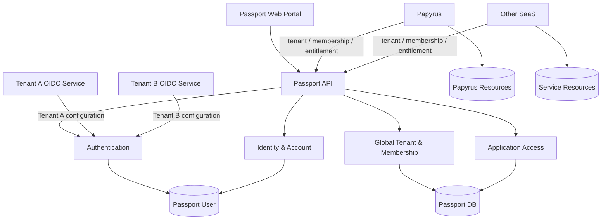
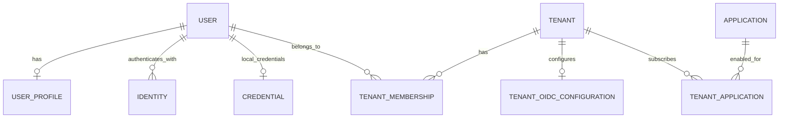

# Passport 개발 요구사항 정의서 (SRS 초안)

- **문서 버전:** 0.1
- **작성일:** 2026-10-25
- **상태:** 초안 — 확정된 아키텍처 결정과 권장 구현 요구사항을 구분함
- **대상:** Passport Frontend, Backend, Papyrus 등 연동 SaaS
- **범위:** 기능, 데이터, 보안, SaaS 연동, 사용자 화면, 비기능, 검증 기준

## 1. 문서 목적과 요구사항 관리 기준

이 문서는 Passport 개발의 기준선(Baseline)을 정의한다. Passport는 여러 기업용 SaaS가 공통으로 활용하는 **Authentication, Identity, Account & Global Tenant Management Service**이다. 구현을 시작하기 전에 확정된 요구사항과 추가 결정이 필요한 정책을 구분하여 무분별한 범위 확장을 방지한다.

**결정 상태**

- **확정:** 기존 논의에서 사용자가 명시적으로 결정한 사항.
- **권장:** 현재까지의 결정에 부합하는 구현 제안이며 최종 승인 대상.
- **미결:** 제품 정책 또는 프로토콜 계약을 먼저 결정해야 하는 사항.

**우선순위**

- **P0:** 최소 서비스(MVP) 운영에 필수.
- **P1:** 초기 정식 운영 또는 기업 고객 확대 전에 필요.
- **P2:** 장기 확장 기능.

> 이 문서에서 `해야 한다`는 표현은 **해당 항목이 승인되었을 때의 구현·검증 기준**을 의미한다. `권장`과 `미결`을 사용자가 이미 확정한 것으로 간주하지 않는다.

## 2. 확정된 제품 및 아키텍처 결정 (ADR 요약)

| ID      | 결정                                                         | 상태             |
| ------- | ------------------------------------------------------------ | ---------------- |
| ADR-001 | 서비스 이름은 **Passport**이다.                              | 확정             |
| ADR-002 | Passport는 인증뿐 아니라 개인정보, 계정, 전역 테넌트, 서비스 이용 관계를 관리한다. | 확정             |
| ADR-003 | 인증은 **외부 OIDC Provider** 및 **자체 Local Authentication**을 지원한다. | 확정             |
| ADR-004 | 외부 OIDC Provider의 토큰을 Passport 토큰으로 재발급·교환하지 않고 원본 발급자를 유지한다. | 확정             |
| ADR-005 | Local Authentication을 통해 Passport 발급 **JWT Access Token**을 지원한다. 별도의 사용자 신원 정보 전달용 JWT는 발급하지 않으며, 사용자 정보는 인증된 API로 조회한다. | 확정             |
| ADR-006 | Passport를 **OIDC Provider** 또는 **OAuth2 Authorization Server**로 정의하지 않는다. | 확정             |
| ADR-007 | 모든 연동 SaaS는 Passport가 관리하는 하나의 **Global Tenant** 모델을 사용한다. 테넌트는 논리적인 고객 조직이며 법인·회사와 일대일 대응을 강제하지 않는다. 같은 회사도 여러 독립 테넌트를 가질 수 있다. | 확정             |
| ADR-008 | Hybrid Tenant 및 서비스별 별도 Application Tenant는 현재 도입하지 않는다. | 확정             |
| ADR-009 | Papyrus 등 각 SaaS는 자신의 도메인 리소스 및 리소스 수준 권한 정책을 관리한다. | 확정된 책임 경계 |
| ADR-010 | Frontend와 Backend를 하나의 리포지토리에서 개발하되 코드와 실행 단위는 구분한다. | 확정된 개발 방향 |
| ADR-011 | Backend는 FastAPI와 FastAPI DI 기반의 Modular Monolith로 구성한다. 현재의 사용자 정의 패키지 구조인 `api`, `apps`, `core`, `db`, `settings`, `utils`에 따라 책임을 구분하고, `main.py`에서 앱을 생성·조립하며 `server.py`에서 서버를 실행한다. | 확정             |
| ADR-012 | TOTP(시간 기반 OTP) 방식의 MFA 인증을 지원하며, MFA 제공 여부는 테넌트별 설정으로 관리한다. | 확정             |
| ADR-013 | 외부 OIDC 설정은 테넌트별로 독립 관리하며, OIDC 인증 시 대상 테넌트에 설정된 서비스만 이용한다. Local 인증은 기존과 동일하게 유지하며 로그인 후 소속 테넌트를 선택하여 접근할 수 있다. | 확정             |
| ADR-014 | 웹 관리 포털과 모바일 등 모든 클라이언트의 API 인증은 Access Token으로 통일한다. 서버 세션 및 세션 ID를 이용한 인증은 제공하지 않으며, 로그인 유지는 Refresh Token으로 Access Token을 갱신한다. | 확정             |
| ADR-015 | Local JWT Access Token은 RFC 9068을 기준으로 표준화한다. Local Access Token과 외부 JWT Access Token은 발급자·테넌트별 검증 설정을 적용하는 동일한 JWT 검증 엔진에서 처리하고, 검증 결과를 공통 내부 인증 정보로 변환하여 사용한다. | 확정             |
| ADR-016 | 인증 기능은 추상 `Authentication` 클래스를 공통 계약으로 구현한다. Local·OIDC 인증 구현은 이를 상속하며, 향후 SAML 인증도 같은 계약을 구현하여 추가할 수 있도록 설계한다. | 확정             |

### 2.1 이번 범위에서 제외할 것

- OAuth2 Authorization Server의 표준 인증/토큰 엔드포인트 전체 제공
- OIDC Provider 기능 및 Discovery를 제공한다는 대외적 약속
- 외부 토큰을 Passport JWT로 교환하는 토큰 브로커 기능
- 외부 opaque Access Token 지원(초기 제품 범위에서 제외)
- 서비스별 독립 테넌트 또는 Hybrid Tenant
- 사용자별 SaaS 이용 자격 및 `ApplicationMembership` 모델
- 서로 다른 Passport 계정의 병합 및 외부 신원의 계정 간 이전
- Papyrus 문서·위키 공간·페이지의 직접 관리
- 자체 구현한 범용 RBAC/ABAC 정책 엔진
- Microservices로 분리된 Passport Backend

> **토큰 용어:** Local Authentication에서는 JWT Access Token과 별개인 `Identity JWT` 또는 표준 OIDC `ID Token`을 발급하지 않는다. 사용자 정보는 유효한 Access Token으로 인증된 사용자 조회 API를 통해 제공한다. 외부 OIDC Provider가 발급한 ID Token의 수신·검증은 외부 OIDC 인증 요구사항을 따른다.

## 3. 시스템 경계와 주요 행위자

### 3.1 주요 행위자

| 행위자                        | 책임과 행동                                                  |
| ----------------------------- | ------------------------------------------------------------ |
| 일반 사용자(User)             | 회원가입, 로그인, 개인정보 확인·변경, 계정 탈퇴, 본인 소속 테넌트 조회 |
| 테넌트 관리자(Tenant Admin)   | 허가된 테넌트의 정보, 멤버십 및 서비스 이용 관계 관리        |
| 플랫폼 관리자(Platform Admin) | Passport 전체 애플리케이션 등록, 테넌트 운영 및 정책 설정    |
| 외부 OIDC Provider            | 테넌트별 독립 설정에 따라 사용자를 인증하고 자신의 토큰을 발급·관리 |
| Papyrus 및 기타 SaaS          | Passport 신원/테넌트/이용자 정보 참조, 자체 리소스와 권한 관리 |
| Passport 관리 포털            | Passport API를 호출하는 Frontend                             |

### 3.2 책임 경계

| 영역                                        | Passport                             | Papyrus 등 SaaS                     |
| ------------------------------------------- | ------------------------------------ | ----------------------------------- |
| 외부 OIDC 신원 연결 및 Local Authentication | 소유                                 | Passport 또는 발급자 신뢰 정책 사용 |
| 테넌트별 OIDC 설정 및 인증 허용 범위         | 테넌트별 독립 관리 및 인증 결과 검증   | 대상 테넌트의 허용된 인증 여부 검증 |
| 사용자 개인정보·계정 상태                   | 소유                                 | 최소 정보만 참조·캐시               |
| 전역 `tenant_id` 발급과 상태                | 소유                                 | 동일 식별자를 사용                  |
| 사용자-테넌트 소속                          | 소유                                 | 검증 및 활용                        |
| 테넌트-서비스 이용 관계                     | 소유                                 | 활성 여부 검증                      |
| 서비스 이용 자격                            | 테넌트 단위로 관리, 사용자별 별도 허가 없음 | 활성 구성원의 이용 자격과 도메인 권한을 구별 |
| 위키, 공간, 문서, 프로젝트                  | 소유하지 않음                        | 소유                                |
| 문서별 읽기·편집 등 리소스 권한             | 소유하지 않음                        | 소유                                |



## 4. 기능 요구사항

### 4.1 Authentication: Local

Local 인증은 테넌트별 OIDC 설정과 별개로 기존과 동일하게 제공한다. Local 인증을 완료한 사용자는 소속 테넌트를 선택하여 접근할 수 있으며, 계정 상태·테넌트 상태·현재 멤버십·MFA·서비스 이용 자격 검증을 모두 충족해야 한다.

**Local Access Token 수용 범위(확정):** Passport API와 Papyrus 등 연동 SaaS API는 Passport가 발급한 Local JWT Access Token을 인증 수단으로 수용한다. 각 API는 자신의 audience 등 토큰 검증 계약과 현재 접근 자격을 검증해야 하며, Local 로그인 성공만으로 모든 SaaS의 이용 권한을 부여하지 않는다. 구체적인 audience 구성·발급 방식 및 SaaS의 철회 상태 검증 계약은 후속 설계한다.

| ID          | 요구사항                                                     | 우선순위 | 상태 |
| ----------- | ------------------------------------------------------------ | -------- | ---- |
| FR-AUTH-001 | Local 계정은 안전하게 보관된 자격 증명으로 로그인할 수 있어야 한다. | P0       | 확정 |
| FR-AUTH-002 | 인증 성공 시 Passport가 서명한 JWT Access Token을 발급할 수 있어야 한다. 토큰 포맷은 FR-AUTH-008-01의 공통 표준을 따른다. | P0       | 확정 |
| FR-AUTH-003 | 사용자는 본인의 비밀번호를 변경할 수 있어야 한다.            | P0       | 확정 |
| FR-AUTH-004 | 비밀번호 분실 시 검증된 복구 수단을 이용한 재설정 절차를 제공한다. | P1       | 확정 |
| FR-AUTH-005 | 탈퇴·차단·비활성 상태의 계정은 신규 로그인 및 허가되지 않은 작업이 거부되어야 한다. | P0       | 확정 |
| FR-AUTH-006 | 로그인 실패 횟수 제한, 속도 제한 및 계정 열거 방지 메시지를 적용한다. | P0       | 확정 |
| FR-AUTH-007 | 비밀번호는 평문·복호화 가능한 형태가 아닌 적응형 해시(예: Argon2id)로 저장한다. | P0       | 확정 |
| FR-AUTH-008 | Passport가 발급하는 Local JWT Access Token의 유효기간은 발급 후 30분으로 한다. Local Access Token 서명키는 90일마다 자동 교체한다. 키 식별자, 검증 규칙 및 키 교체 세부 절차는 후속 설계한다. 로그인 유지 시간과 즉시 철회 정책은 별도로 적용하며, 외부 OIDC Access Token의 수명은 Provider별 연동 계약에서 정한다. | P0       | 확정 |
| FR-AUTH-008-01 | Local JWT Access Token은 RFC 9068의 JWT Access Token 프로파일을 따른다. `typ`은 `at+jwt`로 명시하고, `iss`, `sub`, `aud`, `exp`, `iat`, `jti`, `client_id` 등 필수 클레임과 서명·검증 규칙을 적용한다. | P0       | 확정 |
| FR-AUTH-008-02 | Passport는 Local Access Token과 외부 JWT Access Token의 파싱·서명·표준 클레임 검증을 동일한 JWT 검증 엔진에서 처리해야 한다. 발급자별 차이는 검증 설정과 클레임 매핑으로 처리한다. | P0       | 확정 |
| FR-AUTH-008-03 | 공통 검증 엔진은 Local 또는 대상 테넌트의 신뢰 설정에 따라 허용 발급자·알고리즘·검증 키·API audience·토큰 용도·필수 클레임을 검증해야 한다. 검증되지 않은 토큰의 값만으로 신뢰할 발급자나 키를 추가하지 않으며, 다른 테넌트의 OIDC 신뢰 설정을 재사용하지 않는다. ID Token은 API Access Token으로 허용하지 않는다. | P0       | 확정 |
| FR-AUTH-008-04 | 검증을 통과한 Local Access Token과 외부 JWT Access Token은 Passport 사용자 신원·원본 발급자·인증 방식·테넌트 인증 범위를 표현하는 공통 내부 인증 정보로 변환하여 사용한다. 외부 신원은 `(issuer, subject)`로 Passport 사용자에 매핑하며, 이후 계정·테넌트·멤버십·MFA·이용 자격 검사는 공통 처리한다. 이 변환은 내부 자료 구조의 변환이며 외부 토큰의 재발급·교환을 의미하지 않는다. | P0       | 확정 |
| FR-AUTH-009-01 | Access Token이 만료되어도 로그인 유지 조건을 충족하면 사용자에게 자격 증명 재입력을 요구하지 않고 새 Access Token을 발급해야 한다. | P0       | 확정 |
| FR-AUTH-009-02 | 웹 관리 포털과 모바일 등 모든 클라이언트의 API 인증은 Access Token을 사용한다. 서버 세션 및 세션 ID를 이용한 인증은 모두 폐기하며 제공하지 않는다. 클라이언트별 로그인 유지 방식은 하위 항목으로 관리한다. | P0       | 확정 |
| FR-AUTH-009-02-01 | 웹 관리 포털은 Access Token으로 API를 호출하고, 로그인 유지 조건을 충족하면 Refresh Token으로 Access Token을 갱신한다. | P0       | 확정 |
| FR-AUTH-009-02-02 | 모바일 앱 등 웹 관리 포털 외에 API를 직접 호출하는 사용자 클라이언트는 지원 시 Access Token으로 인증하고 Refresh Token으로 Access Token을 갱신한다. | P0       | 확정 |
| FR-AUTH-009-03 | 웹 관리 포털과 모바일 앱 등 웹 관리 포털 외의 사용자 클라이언트의 최대 로그인 유지 시간 및 미사용 만료 시간은 각각 별도로 설정할 수 있어야 한다. | P0       | 확정 |
| FR-AUTH-009-03-01 | 웹 관리 포털의 로그인 상태는 로그인 시점부터 최대 8시간 동안 유지한다. 사용자 활동이나 자동 갱신으로 이 최대 유지 시간을 연장하지 않으며, 만료 후에는 재로그인을 요구한다. | P0       | 확정 |
| FR-AUTH-009-03-02 | 웹 관리 포털의 로그인 상태는 마지막 사용자 활동 이후 30분 동안 사용되지 않으면 만료되어야 한다. 최대 유지 시간 8시간 이내라도 미사용 만료 시 재로그인을 요구한다. | P0       | 확정 |
| FR-AUTH-009-03-03 | 웹 관리 포털의 미사용 만료 시간을 초기화하는 활동은 사용자의 화면 이동·조회·저장 등 명시적인 동작으로 발생한 인증된 요청으로 한정한다. 백그라운드 자동 갱신·주기적 조회 요청은 사용자 활동으로 인정하지 않으며, 미사용 만료 시간을 초기화하지 않는다. | P0       | 확정 |
| FR-AUTH-009-03-04 | FR-AUTH-009-02-02의 Refresh Token 기반 사용자 클라이언트의 로그인 상태는 최초 로그인 시점부터 최대 7일 동안 유지한다. Refresh Token 갱신으로 이 최대 유지 시간을 연장하지 않으며, 만료 후에는 재로그인을 요구한다. | P0       | 확정 |
| FR-AUTH-009-03-05 | FR-AUTH-009-02-02의 Refresh Token 기반 사용자 클라이언트의 로그인 상태는 마지막 사용자 활동 이후 3일 동안 사용되지 않으면 만료되어야 한다. 최대 유지 시간 7일 이내라도 미사용 만료 시 Refresh Token을 통한 Access Token 갱신을 거부하고 재로그인을 요구한다. | P0       | 확정 |
| FR-AUTH-009-03-06 | FR-AUTH-009-02-02의 Refresh Token 기반 사용자 클라이언트의 미사용 만료 시간을 초기화하는 활동은 사용자 동작으로 발생한 인증된 요청으로 한정한다. 자동 토큰 갱신·백그라운드 동기화는 사용자 활동으로 인정하지 않으며, 미사용 만료 시간을 초기화하지 않는다. | P0       | 확정 |
| FR-AUTH-009-04 | 기본 로그아웃은 현재 브라우저 또는 앱의 로그인만 종료하고, 별도로 '모든 기기에서 로그아웃' 기능을 제공한다. 종료 대상에 연결된 Passport 관리 Refresh Token을 폐기하여 해당 로그인 상태의 유지·갱신을 거부한다. 이미 발급된 Access Token은 FR-AUTH-009-06에 따라 즉시 철회한다. | P0       | 확정 |
| FR-AUTH-009-05 | 비밀번호 직접 변경·분실 후 재설정·계정 차단·비활성화 시 모든 Passport 관리 로그인을 종료하고 Refresh Token을 폐기해야 한다. 세부 처리 정책은 하위 항목으로 관리하며, 이미 발급된 Access Token의 철회 정책은 FR-AUTH-009-06을 따른다. | P0       | 확정 |
| FR-AUTH-009-05-01 | 로그인한 사용자가 비밀번호를 직접 변경하면 현재 로그인을 포함한 해당 사용자의 모든 Passport 관리 로그인을 종료하고, 연결된 Refresh Token을 폐기한다. 이후 새 비밀번호로 재로그인을 요구하며, 이미 발급된 Access Token의 철회 정책은 FR-AUTH-009-06을 따른다. | P0       | 확정 |
| FR-AUTH-009-05-02 | 비밀번호 분실 후 재설정이 완료되면 해당 사용자의 모든 Passport 관리 로그인을 종료하고, 연결된 Refresh Token을 폐기한다. 이후 새 비밀번호로 로그인을 요구하며, 이미 발급된 Access Token의 철회 정책은 FR-AUTH-009-06을 따른다. | P0       | 확정 |
| FR-AUTH-009-05-03 | 계정을 차단하거나 비활성화하면 해당 사용자의 모든 Passport 관리 로그인을 종료하고, 연결된 Refresh Token을 폐기한다. 계정 재활성화 시 기존 로그인 상태를 복원하지 않으며 재로그인을 요구한다. 이미 발급된 Access Token의 철회 정책은 FR-AUTH-009-06을 따르며, 차단·비활성 상태의 접근 거부 원칙(FR-AUTH-005)은 유지한다. | P0       | 확정 |
| FR-AUTH-009-06 | 일반 로그아웃 및 비밀번호 변경·재설정·계정 차단·비활성화·Refresh Token 재사용 탐지에 따른 강제 종료 시, 하위 항목과 FR-AUTH-009-07-01의 종료 범위에 해당하는 Passport 발급 Access Token을 즉시 철회하고 후속 API 요청을 거부해야 한다. | P0       | 확정 |
| FR-AUTH-009-06-01 | 일반 로그아웃 시 종료 대상 로그인에 연결된 Passport 발급 Access Token을 만료 전이라도 즉시 철회하고, 해당 토큰을 사용하는 후속 API 요청을 거부해야 한다. 현재 로그인 로그아웃은 해당 로그인에, '모든 기기에서 로그아웃'은 해당 사용자의 모든 Passport 관리 로그인에 적용한다. | P0       | 확정 |
| FR-AUTH-009-06-02 | 비밀번호 직접 변경·분실 후 재설정·계정 차단·비활성화 시 해당 사용자의 기존 Passport 발급 Access Token 전체를 즉시 철회하고, 해당 토큰을 사용하는 후속 API 요청을 거부해야 한다. | P0       | 확정 |
| FR-AUTH-009-07 | Refresh Token으로 Access Token을 갱신할 때마다 새 Refresh Token을 발급하고 이전 Refresh Token을 무효화해야 한다. 무효화된 Refresh Token의 재사용을 탐지해야 하며, 토큰 교체로 FR-AUTH-009-03의 클라이언트별 최대 로그인 유지 시간(웹 최대 8시간, 모바일 등 최대 7일)을 연장하거나 미사용 시간을 초기화하지 않는다. | P0       | 확정 |
| FR-AUTH-009-07-01 | 무효화된 Refresh Token의 재사용을 탐지하면 해당 사용자의 모든 Passport 관리 로그인을 종료하고, 모든 Passport 관리 Refresh Token을 폐기해야 한다. 해당 사용자의 기존 Passport 발급 Access Token 전체를 즉시 철회하고 후속 API 요청을 거부하며, 재로그인을 요구한다. | P0       | 확정 |
| FR-AUTH-010 | Local Authentication에서는 Access Token 외에 사용자 신원 정보 전달을 위한 별도의 JWT 또는 OIDC ID Token을 발급하지 않는다. 사용자 정보는 유효한 Access Token으로 인증된 현재 사용자 조회 API(`/api/v1/users/me` 등)를 통해 일반 JSON 응답으로 제공한다. | P1       | 확정 |
| FR-AUTH-011 | 인증 구현의 공통 계약을 정의하는 추상 `Authentication` 클래스를 구현해야 한다. Local·OIDC 인증은 이를 상속한 개별 클래스로 구현하고, 향후 SAML 인증 구현을 추가할 수 있어야 한다. 인증 방식별 자격 증명·응답 검증은 개별 구현에서 수행하며, 검증 결과는 공통 내부 인증 정보로 제공한다. 현재 구현 대상은 Local·OIDC이며 SAML은 향후 확장 대상이다. | P0       | 확정 |

**FR-AUTH-009 세분화:** 웹 관리 포털과 모바일 등 모든 클라이언트의 API 인증은 Access Token으로 통일하며, 서버 세션 및 세션 ID를 이용한 인증은 폐기한다(FR-AUTH-009-02 및 하위 항목 확정). 로그인 유지는 Refresh Token으로 Access Token을 갱신하는 방식으로 제공한다. 웹 최대 8시간·미사용 30분, 모바일 등 최대 7일·미사용 3일의 로그인 유지 시간과 사용자 활동 기준은 유지한다. 이 로그인 유지 시간은 개별 Access Token의 수명과 구분하며, Passport 발급 Local Access Token의 유효기간은 발급 후 30분이다. 로그인 유지 조건 위반이나 즉시 철회 시에는 토큰의 남은 유효기간과 관계없이 접근을 거부한다. 현재/전체 로그아웃, 비밀번호 변경·재설정·계정 차단·비활성화 시 전체 로그인 종료, Passport 발급 Access Token 즉시 철회 및 Refresh Token 교체·재사용 탐지 정책도 유지한다. 로그인 유지 시간·활동·토큰 철회 상태를 검증하기 위한 서버 측 상태 관리는 유지한다. 외부 OIDC 토큰의 원본 발급자 유지 및 Passport 토큰으로 재발급·교환하지 않는 결정은 변경하지 않는다. 이 결정으로 모바일 앱 개발 범위를 추가하지 않는다. 웹 관리 포털의 토큰 저장·전달 방식은 아래 결정에 따르며, 쿠키 속성과 CSRF/XSS 방어의 상세 설계, 외부 OIDC의 API용 토큰·갱신 계약 및 연동 SaaS의 철회 상태 검증·반영 계약은 후속 설계한다.

**웹 관리 포털 토큰 저장·전달(확정):** Access Token은 브라우저 메모리에 저장하고 API 호출 시 `Authorization: Bearer` 헤더로 전달한다. Refresh Token은 `HttpOnly` 쿠키에 저장하며 `Secure`, `SameSite` 및 CSRF 방어를 적용한다. 페이지 새로고침 시 유효한 Refresh Token과 로그인 유지 조건을 확인하여 Access Token을 다시 확보한다. 구체적인 쿠키 속성·적용 범위, CSRF/XSS 방어 및 외부 OIDC Provider별 갱신 계약은 후속 설계한다. 이 결정은 웹 관리 포털에 적용하며 모바일 등 다른 클라이언트의 저장 방식은 별도 설계한다.

**JWT Access Token 공통화:** FR-AUTH-008-01~04는 확정이다. Local 토큰은 RFC 9068을 따르고, 외부 JWT Access Token은 Provider별로 합의한 토큰 프로파일·검증 설정·클레임 매핑을 공통 검증 엔진에 적용한다. 모든 외부 Provider의 토큰이 이미 RFC 9068을 준수한다고 가정하지 않는다. 공통 내부 인증 정보의 상세 필드·자료형과 Provider별 매핑 계약은 후속 설계하며, 인증 방식 및 검증된 테넌트·OIDC 설정의 연관성을 보존한다. JWT 검증 성공 이후에도 로그인 유지·철회 상태와 최신 접근 자격 검사를 적용한다.

**FR-AUTH-010 결정 범위:** 별도 신원 JWT를 발급하지 않으므로 해당 토큰의 명칭·클레임·검증 규칙·유효기간·철회 정책은 추가 설계하지 않는다. 이는 Access Token에 `sub` 등 사용자 식별 정보를 포함하지 않는다는 의미가 아니다. Local Access Token의 포맷·공통 검증·내부 인증 정보 변환은 FR-AUTH-008-01~04로 확정하며, 수용 범위는 Passport API와 Papyrus 등 연동 SaaS API로 확정한다. audience 등 구체적인 계약은 D-02에서 계속 정의한다.

**검증 예:** 올바른 자격 증명으로 인증 성공, 잘못된 자격 증명으로 실패, 차단 계정 접근 거부, 비밀번호 변경 이후 기존 인증 수단의 처리 정책 확인, 만료·변조된 JWT 거부.

### 4.2 Authentication: External OIDC

| ID          | 요구사항                                                     | 우선순위 | 상태 |
| ----------- | ------------------------------------------------------------ | -------- | ---- |
| FR-OIDC-001 | 각 테넌트가 독립적으로 보유한 OIDC 설정에 따라 외부 OIDC Provider와 인증 연동을 지원한다. 초기 연동·검증 대상은 Keycloak과 Auth0로 한다. 구체적인 제품 버전·지원 설정 및 API별 JWT Access Token 계약은 후속 설계한다. 플랫폼 공통 Provider를 모든 테넌트의 기본 인증 수단으로 간주하지 않는다. | P0       | 확정 |
| FR-OIDC-002 | 외부 토큰의 발급자와 원본 토큰은 유지하며 Passport 자체 JWT로 바꾸지 않는다. | P0       | 확정 |
| FR-OIDC-003 | 로그인 시작 시 선택한 테넌트의 OIDC 설정을 기준으로 인증 결과의 발급자, 서명, 만료, 대상자, 상태/nonce 등 흐름별 필수 검증을 실시한다. ID Token의 대상자는 해당 설정의 client_id를 기준으로, API Access Token의 대상자는 호출 API의 계약을 기준으로 검증한다. | P0       | 확정 |
| FR-OIDC-004 | 외부 사용자 식별은 이메일 단독이 아니라 `(issuer, subject)` 조합으로 수행한다. | P0       | 확정 |
| FR-OIDC-005 | 동일 이메일이라는 이유로 기존 Passport 계정과 외부 계정을 자동 연결하지 않는다. 사용자가 기존 Passport 계정 재인증과 연결할 외부 OIDC 인증을 모두 완료하고 명시적으로 연결을 확인하면 직접 연결할 수 있다. 플랫폼 관리자 승인은 요구하지 않는다. 최초 OIDC 인증 시 동일 이메일의 기존 Passport 계정이 있으면 새 계정을 생성하지 않고 기존 계정 재인증 후 명시적으로 연결하도록 안내한다. 연결하려는 외부 신원이 이미 다른 Passport 사용자에게 연결되어 있으면 새 연결 요청을 거부하고 기존 연결을 유지한다. 계정 병합과 외부 신원의 계정 간 이전은 이번 범위에서 제공하지 않는다. | P0       | 확정 |
| FR-OIDC-006 | Provider 설정 오류, 키 교체, 인증 취소, 통신 장애에 대한 실패 처리를 제공한다. | P0       | 확정 |
| FR-OIDC-007 | 브라우저 로그인에 OIDC Authorization Code Flow를 채택한다면 `state`, `nonce` 및 PKCE 등 필요한 방어를 적용한다. | P0       | 확정 |
| FR-OIDC-008 | 대상 테넌트에 설정되지 않았거나 비활성인 Provider의 인증 결과와 API 대상이 아닌 외부 Access Token을 거부한다. 다른 테넌트에서 승인된 Provider라도 대상 테넌트의 신뢰 대상으로 자동 인정하지 않는다. | P0       | 확정 |
| FR-OIDC-009 | 초기 제품은 외부 JWT Access Token만 지원한다. 검증 방식은 하위 항목과 Provider별 지원 계약으로 관리하며, 외부 opaque Access Token은 초기 지원 범위에서 제외한다. | P0       | 확정 |
| FR-OIDC-009-01 | 외부 JWT Access Token은 FR-AUTH-008-02~04에 따라 Local Access Token과 동일한 검증 엔진에서 검증하고 공통 내부 인증 정보로 변환한다. Provider별 토큰 프로파일·API audience·검증 키·필수 클레임·클레임 매핑을 연동 계약에 명시하며 원본 토큰과 발급자를 유지한다. | P0       | 확정 |
| FR-OIDC-009-02 | 외부 opaque Access Token은 초기 제품에서 API 인증 수단으로 수용하지 않는다. 초기 제품에 opaque 토큰 검증 API 연동을 포함하지 않는다. | P0       | 확정 |
| FR-OIDC-010 | 테넌트별 OIDC 설정에 issuer, client_id, 필요한 자격 증명 참조 및 활성 상태를 독립적으로 관리한다. 테넌트당 한 번에 하나의 OIDC Provider만 활성화할 수 있다. OIDC 인증에서는 대상 테넌트의 활성 설정만 사용한다. | P0       | 확정 |
| FR-OIDC-011 | 외부 OIDC 로그인 시작 전에 대상 테넌트를 식별하고 해당 테넌트의 OIDC 설정으로 인증을 시작한다. 테넌트 전용 로그인 링크와 공통 로그인 화면에서 테넌트 코드를 입력하는 진입 방식을 모두 지원한다. 링크·코드로 식별한 대상 테넌트의 설정만 사용하며, 구체적인 URL·코드 형식과 UI는 후속 설계한다. | P0       | 확정 |
| FR-OIDC-012 | OIDC 로그인 트랜잭션을 시작한 tenant_id와 OIDC 설정에 인증 요청 및 Callback 검증을 연결한다. Callback 경로·파라미터의 테넌트 또는 설정 변조와 다른 로그인 트랜잭션의 인증 응답 재사용을 거부한다. | P0       | 확정 |
| FR-OIDC-013 | OIDC 인증 결과는 검증한 대상 테넌트의 인증 근거로만 사용한다. 복수 테넌트에 소속된 동일 User라도 다른 테넌트로 전환할 때 유효한 Local 인증 또는 대상 테넌트의 유효한 OIDC 인증 결과가 필요하다. 기존 OIDC 로그인을 Local 인증으로 간주하지 않는다. | P0       | 확정 |
| FR-OIDC-014 | OIDC 설정이 없거나 비활성·오류 상태이면 해당 OIDC 인증을 거부하며, 플랫폼 공통 또는 다른 테넌트의 Provider로 자동 대체하지 않는다. 독립적인 Local 로그인과 이후 테넌트 선택은 기존 요구사항에 따라 허용한다. | P0       | 확정 |

**OIDC 설정 변경 반영(확정):** 발급자·클라이언트 ID 변경이나 설정 비활성화 등 인증 신뢰에 영향을 주는 변경 시, 변경된 설정에 근거한 해당 테넌트의 기존 OIDC 인증 근거를 즉시 무효화하고 후속 접근을 거부한다. 접근을 재개하려면 유효한 설정으로 다시 OIDC 인증을 수행해야 하며, 비활성화된 동안에는 해당 OIDC로 재로그인할 수 없다. 표시명·설명처럼 인증 신뢰에 영향을 주지 않는 변경은 기존 로그인을 유지한다. 독립적인 Local 인증이나 다른 테넌트의 인증 근거는 이 변경만으로 무효화하지 않는다. 이는 Passport와 연동 SaaS의 인증 근거 수용 정책이며, 외부 발급자의 토큰 자체를 Passport가 철회한다는 의미가 아니다. 변경 유형의 상세 분류, 즉시 무효화를 보장하는 설정 버전·캐시 검증 및 동시성 처리 방식은 후속 설계한다.

**인증 컨텍스트:** Passport와 SaaS는 인증 방식(Local/OIDC)과, OIDC인 경우 검증된 테넌트·OIDC 설정의 연관성을 신뢰할 수 있는 계약으로 확인해야 한다. 외부 토큰에 Passport의 tenant_id가 포함된다고 가정하지 않으며, 동일 User·동일 이메일·다른 테넌트 멤버십만으로 OIDC 인증 결과의 적용 범위를 확장하지 않는다. 전역 User와 `(issuer, subject)` 기반 신원 식별은 유지하되, 신원 연결과 대상 테넌트의 인증 요건 충족을 구분한다.

**서비스 간 SSO(확정):** 같은 테넌트에서 Passport 관리 포털 또는 Papyrus 등 연동 SaaS에 외부 OIDC로 로그인한 사용자는 다른 서비스로 이동할 때 아이디·비밀번호를 다시 입력하지 않고 이용할 수 있어야 한다. 정책상 필요한 MFA 및 재인증은 별도로 적용하며, 대상 테넌트의 현재 멤버십·서비스 이용 자격 검증은 유지한다. 외부 토큰의 원본 발급자 유지 및 Passport 토큰으로 교환·재발급하지 않는 원칙을 따른다.

**중요:** 외부 OIDC의 **ID Token**은 인증 결과를 Relying Party에 전달하기 위한 토큰이다. Papyrus 등 리소스 API에서 `Bearer`로 사용할 수 있는 Access Token과 동일하지 않다. 외부 Access Token이 Papyrus에 적합한 `aud`를 갖지 않는다면 원본 그대로 사용하더라도 Papyrus API 인증에는 사용할 수 없다. 서비스 간 SSO 제공 요구는 확정이며, 이를 충족하는 API별 외부 Access Token 확보 및 로그인 상태·인증 컨텍스트 연계 방식은 **후속 설계 사항**이다.

### 4.3 Identity & Account

| ID          | 요구사항                                                     | 우선순위 | 상태             |
| ----------- | ------------------------------------------------------------ | -------- | ---------------- |
| FR-USER-001 | Passport 전체에서 유일하고 불변인 `user_id`를 부여한다.      | P0       | 확정             |
| FR-USER-002 | 사용자 기본 프로필과 승인된 개인정보 항목을 저장·수정·조회한다. 필수 프로필 항목은 이메일과 표시 이름으로 한정하며, 표시 이름은 실명일 필요가 없다. 실명·전화번호는 필수로 요구하지 않는다. 선택 프로필 항목으로 프로필 사진·전화번호·실명을 제공한다. 테넌트 관리자는 자신의 테넌트 구성원이 입력한 실명·전화번호를 조회할 수 있다. | P0       | 확정             |
| FR-USER-003 | 누구나 직접 Local 계정을 만들 수 있는 공개 가입을 제공한다. 가입에 관리자 초대나 승인을 요구하지 않으며, 테넌트 소속과 SaaS 이용 권한은 별도로 부여한다. Local 계정의 정상 이용 전 이메일 소유 확인을 필수로 완료해야 한다. 확인 전에는 이메일 인증·재발송 등 가입 완료에 필요한 기능만 허용한다. | P0       | 확정             |
| FR-USER-004 | 사용자 계정 상태(`PENDING`, `ACTIVE`, `SUSPENDED`, `DEACTIVATED`, `DELETED` 등)를 관리한다. 실제 상태 집합은 별도 승인한다. | P0       | 확정             |
| FR-USER-005 | 회원 탈퇴 요청에 대해 본인 확인을 완료하고 사용자가 탈퇴를 확정하면 유예기간 없이 즉시 탈퇴를 완료한다. 탈퇴 취소 및 기존 계정 복구 기능은 제공하지 않는다. 멤버십·서비스 이용 자격의 종료와 개인정보 삭제/보존 정책을 구분한다. 탈퇴 후 고객 문의 처리·분쟁 대응·보안 사고 조사·부정 이용 조사를 위해 일정 기간 프로필을 추가 보관한다. 추가 보관 대상은 기존에 수집한 이메일·표시 이름·전화번호·실명으로 한정하며 프로필 사진은 추가 보관 대상에서 제외한다. 제품의 목표 추가 보관 기간은 탈퇴 시점부터 24시간으로 한다. 최종 삭제·보존 정책은 대상 국가·지역의 법령 검토를 반영하여 확정하며, 감사로그·백업의 처리는 별도로 검토한다. | P0       | 확정             |
| FR-USER-006 | 최초 제품(P0)부터 Local 신원과 복수의 외부 신원을 동일 `User`에 연결할 수 있는 모델 및 사용자 직접 연결 기능을 제공한다. 기존 계정 재인증과 외부 OIDC 인증 후 명시적으로 연결하며, 이메일 충돌 처리는 FR-OIDC-005를 따른다. | P0       | 확정             |
| FR-USER-007 | 인증 수단 정보와 개인정보 모델을 분리하여 인증 Provider 변경에 따른 계정 중복을 방지한다. | P0       | 확정             |
| FR-USER-008 | 사용자 본인의 개인정보 열람, 수정 및 삭제·반출 요청의 처리 경로를 제공한다. | P1       | 확정             |

**OIDC 최초 계정 생성(확정):** 기존 Passport 계정이 없는 사용자가 대상 테넌트의 OIDC 설정에 따른 외부 인증에 성공하면, Passport 사용자 계정과 `(issuer, subject)` 기반 외부 신원 연결을 자동 생성한다. 별도의 Local 회원가입을 요구하지 않는다. 동일 이메일이라는 이유로 기존 계정에 자동 연결하지 않는 원칙은 유지한다. 기존 계정에 외부 신원을 추가할 때는 기존 Passport 계정 재인증과 연결할 외부 OIDC 인증을 모두 완료하고 사용자가 명시적으로 연결을 확인해야 하며, 플랫폼 관리자 승인은 요구하지 않는다. 최초 OIDC 인증 시 동일 이메일의 기존 Passport 계정이 있으면 새 계정을 생성하지 않고 기존 계정 재인증 후 명시적으로 연결하도록 안내한다. 연결하려는 외부 신원이 이미 다른 Passport 사용자에게 연결되어 있으면 새 연결 요청을 거부하고 기존 연결을 유지한다. 계정 병합과 외부 신원의 계정 간 이전은 이번 범위에서 제공하지 않는다. 사용자 계정 생성과 테넌트 멤버십 부여는 구분한다. 최초 OIDC 인증 시 테넌트 소속 부여 방식은 테넌트별로 설정하며, 테넌트 관리자가 일반 구성원 자동 등록 또는 관리자 사전 등록·초대 방식 중 선택한다. 새 테넌트의 기본값은 관리자 사전 등록·초대이며, 자동 등록은 테넌트 관리자가 명시적으로 활성화해야 한다.

**PII 최소화:** 초기 서비스는 대한민국과 해외 고객을 함께 대상으로 설계한다. 초기 지원 국가·지역은 대한민국, 미국, 일본, 대만, 캄보디아, 베트남, 태국, 러시아, 말레이시아, 인도네시아, 필리핀, 캐나다, 싱가포르로 확정한다. 초기에는 일반 기업의 공통 인증·계정·테넌트 관리 및 개인정보 보호 요구사항을 우선하며, 특정 업종의 추가 요건은 후속 범위로 둔다. 필수 프로필 항목은 이메일과 표시 이름이며 표시 이름은 실명일 필요가 없다. 실명·전화번호는 필수로 요구하지 않는다. 선택 프로필 항목은 프로필 사진·전화번호·실명으로 확정한다. 테넌트 관리자는 자신의 테넌트 구성원이 입력한 실명·전화번호를 조회할 수 있다. 구체적인 수집 목적, 최종 보존 정책, 제3자 제공 범위 및 그 외 행위자의 필드별 열람 권한은 대상 국가·지역을 반영한 별도 개인정보 처리 명세에서 승인한다. 패스워드, 외부 Access Token, 민감 개인정보는 로그에 기록하지 않는다.

### 4.4 Global Tenant

| ID         | 요구사항                                                     | 우선순위 | 상태             |
| ---------- | ------------------------------------------------------------ | -------- | ---------------- |
| FR-TEN-001 | Passport만 전역 테넌트를 생성·조회·수정·상태 변경하는 권위 있는 원천(Source of Truth)이다. 이메일 소유 확인을 완료한 사용자는 플랫폼 관리자 승인 없이 Passport를 통해 새 테넌트를 직접 생성할 수 있다. | P0       | 확정             |
| FR-TEN-002 | 하나의 `tenant_id`를 모든 SaaS에서 동일하게 사용한다.        | P0       | 확정             |
| FR-TEN-003 | 테넌트별 명칭, 식별자, 상태, 기본 메타데이터를 관리한다. 테넌트는 논리적인 고객 조직이며 법인·회사와 일대일 대응을 강제하지 않는다. 같은 회사도 운영 목적에 따라 여러 독립 테넌트를 가질 수 있다.     | P0       | 확정             |
| FR-TEN-004 | 테넌트 활성/비활성 상태는 소속 사용자 및 서비스의 접근 판단에 반영되어야 한다. | P0       | 확정             |
| FR-TEN-005 | 서비스별 독립 테넌트나 `ApplicationTenant`를 생성하지 않는다. | P0       | 확정             |
| FR-TEN-006 | 연구소/영업본부 등 서비스 내부 공간은 서비스 도메인에서 `Workspace`/`Space` 등으로 관리한다. | P0       | 확정             |
| FR-TEN-007 | 테넌트 탈퇴·폐쇄 시 연동 SaaS의 데이터 처리 절차와 상태 전파를 정의한다. | P1       | 확정             |
| FR-TEN-008 | 테넌트별 설정으로 OTP 기반 MFA 인증의 활성/비활성 여부를 관리할 수 있어야 한다. 새 테넌트의 기본값은 비활성화이며, 권한 있는 관리자가 명시적으로 활성화하면 해당 테넌트 접근 시 FR-MFA-003의 기존 로그인 유예 정책에 따라 새 로그인부터 MFA를 요구한다. 테넌트 관리자는 자신의 테넌트 MFA 설정을 변경할 수 있고, 플랫폼 관리자는 전체 테넌트의 MFA 설정을 변경할 수 있다. | P0       | 확정             |
| FR-TEN-009 | 각 테넌트는 자신의 OIDC 설정을 독립적으로 보유한다. 테넌트 관리자는 자신의 테넌트 설정을 플랫폼 관리자 승인 없이 등록·조회·변경·활성화·비활성화할 수 있으며, 플랫폼 관리자는 전체 테넌트의 설정을 관리할 수 있다. 테넌트 관리자가 다른 테넌트의 설정을 조회·변경하는 것은 허용하지 않는다. 자격 증명의 비밀 관리와 변경 감사에는 9장의 보안 요구사항을 적용한다. | P0       | 확정             |

### 4.5 Tenant Membership

| ID         | 요구사항                                                     | 우선순위 | 상태 |
| ---------- | ------------------------------------------------------------ | -------- | ---- |
| FR-MEM-001 | 사용자와 테넌트의 다대다 소속 관계를 저장한다.               | P0       | 확정 |
| FR-MEM-002 | 하나의 사용자는 여러 테넌트에 소속될 수 있다.                | P0       | 확정 |
| FR-MEM-003 | 테넌트 관리자는 권한 범위 내에서 멤버를 추가·조회·상태 변경·제거할 수 있다. | P0       | 확정 |
| FR-MEM-004 | 최소한 테넌트 관리자와 일반 구성원 역할을 구별한다. 사용자가 테넌트를 생성하면 생성자를 해당 테넌트의 첫 관리자로 자동 등록하여 구성원·설정 등을 관리할 수 있도록 한다. 이로 인해 플랫폼 관리자 권한을 부여하지 않는다.          | P0       | 확정 |
| FR-MEM-005 | 같은 사용자와 테넌트 간 중복 활성 멤버십이 생성되지 않도록 데이터 제약을 둔다. | P0       | 확정 |
| FR-MEM-006 | 특정 사용자를 서비스에 초대하는 초대장·수락·만료 절차를 제공한다. | P1       | 확정 |
| FR-MEM-007 | 외부 협력자는 일반 구성원과 동일한 TenantMembership으로 관리하며, 별도의 게스트 유형이나 전용 멤버십 모델을 도입하지 않는다. 외부 협력자에 대한 서비스 내 접근 제한은 각 SaaS의 권한 정책으로 처리한다. | P2       | 확정 |
| FR-MEM-008 | 관리자가 멤버십을 해지·비활성화한 사용자는 서비스 내에서 재가입을 신청할 수 있으며, 해당 테넌트 관리자의 승인 후 멤버십을 복구한다. OIDC 재로그인이나 자동 등록 설정만으로 기존 멤버십을 복구하지 않으며, 신청·승인 대기 중에는 해당 테넌트 접근을 허용하지 않는다. | P1       | 확정 |

**OIDC 테넌트 소속 부여(확정):** 테넌트 관리자는 자신의 테넌트에서 OIDC로 처음 인증한 사용자의 소속 부여 방식을 설정할 수 있다. 자동 등록 모드에서는 해당 테넌트의 OIDC 인증 성공 시 일반 구성원으로 등록하며, 사전 등록·초대 모드에서는 관리자가 사전 등록하거나 초대한 사용자만 소속을 부여한다. 새 테넌트의 기본값은 관리자 사전 등록·초대이며, 자동 등록은 테넌트 관리자가 명시적으로 활성화해야 한다. 관리자가 해지·비활성화한 기존 멤버십은 자동 등록 모드에서도 자동 복구하지 않으며, FR-MEM-008의 사용자 재가입 신청·테넌트 관리자 승인을 거쳐 복구한다. 재가입 신청·승인 기능과 관련 UI는 기업 운영 강화 단계(P1)에 포함한다. OIDC 재로그인만으로 기존 멤버십을 자동 복구하지 않는 원칙과 해지·비활성 멤버십의 접근 차단은 최초 제품(P0)에서도 적용한다.

**FR-MEM-007 결정 범위:** 외부 협력자에게도 기존 계정·테넌트·멤버십 관리 및 초대 정책을 적용한다. 유효한 Local 인증 또는 대상 테넌트의 OIDC 인증, 현재 멤버십, MFA 및 서비스 이용 자격 검증을 충족해야 하며, 외부 협력자라는 이유로 인증·인가 예외를 허용하지 않는다. 일반 구성원과 외부 협력자 모두 D-07에 따라 테넌트 단위의 서비스 이용 자격을 적용하며, Passport에서 사용자별 별도 서비스 허가를 관리하지 않는다.

### 4.6 SaaS Application Registry & Access

| ID         | 요구사항                                                     | 우선순위 | 상태             |
| ---------- | ------------------------------------------------------------ | -------- | ---------------- |
| FR-APP-001 | Passport와 연동할 SaaS를 `Application`으로 등록·조회·상태 관리한다. | P0       | 확정             |
| FR-APP-002 | `TenantApplication`을 통해 테넌트별 서비스 활성/비활성·이용 관계를 기록한다. | P0       | 확정             |
| FR-APP-003 | Papyrus는 Passport `tenant_id`를 사용하고 자체 테넌트 ID를 별도 발행하지 않는다. | P0       | 확정             |
| FR-APP-004 | SaaS는 사용자의 인증뿐 아니라 대상 테넌트에서 허용된 인증 방식·OIDC 설정, 테넌트 소속·서비스 이용 자격을 확인해야 한다. Local 인증은 테넌트 선택 후 접근할 수 있으며, 외부 OIDC 인증은 대상 테넌트의 설정에 부합해야 한다. | P0       | 확정             |
| FR-APP-005 | SaaS 이용 자격은 `TenantApplication`을 통해 테넌트 단위로만 관리한다. 서비스가 활성화된 테넌트의 모든 활성 구성원은 공통 인증·계정·테넌트·멤버십·MFA 검증 충족 시 해당 서비스를 이용할 수 있다. Passport에서 사용자별 별도 서비스 허가나 `ApplicationMembership` 모델을 도입하지 않는다. 리소스별 권한은 각 SaaS가 관리한다. | P0       | 확정             |
| FR-APP-006 | SaaS 서비스별 리소스 권한(위키·문서·페이지 등)은 SaaS가 관리한다. | P0       | 확정된 책임 경계 |
| FR-APP-007 | Passport와 SaaS 간 신뢰 가능한 서비스 간 호출 인증 및 최소 권한을 적용한다. | P0       | 확정             |
| FR-APP-008 | 멤버십 해지·비활성화, 테넌트 중지 및 서비스 이용 중단에 따른 접근 차단·캐시 검증·변경 반영은 FR-APP-008-01~09의 정책을 따라야 한다. | P0       | 확정             |
| FR-APP-008-01 | 사용자의 테넌트 멤버십 해지·비활성화, 테넌트 중지·비활성화 또는 테넌트의 특정 SaaS 이용 중단 시, 변경 API가 성공 응답을 반환한 뒤 시작되는 해당 범위의 신규 API 요청부터 즉시 거부해야 한다. 변경 전의 허용 캐시나 아직 만료되지 않은 Access Token으로 이 차단을 우회할 수 없어야 한다. | P0       | 확정             |
| FR-APP-008-02 | 접근 자격 변경 API가 성공 응답을 반환하기 전에 이미 인가 검사를 통과하여 처리 중인 요청은 완료를 허용한다. 해당 접근 자격 변경만을 이유로 완료 전 권한 재검증이나 강제 중단·롤백을 요구하지 않는다. 이후 시작되는 신규 요청에는 FR-APP-008-01을 적용한다. | P0       | 확정             |
| FR-APP-008-03 | 장애·타임아웃 등으로 접근 자격의 최신 상태를 확인할 수 없으면 해당 요청을 허용하지 않고 일시적인 검증 불가 오류를 반환해야 한다. 이전 허용 캐시로 대체하여 접근을 허용하지 않으며, 이 검증 실패만을 이유로 기존 로그인 상태 또는 Refresh Token을 폐기하지 않는다. | P0       | 확정             |
| FR-APP-008-04 | SaaS는 접근 자격 정보를 캐시할 수 있으나, 이를 사용하는 테넌트 범위 신규 API 요청마다 Passport를 통해 최신 여부를 확인해야 한다. 최신으로 확인된 캐시만 사용하며, 변경된 캐시는 폐기하고 현재 자격 정보를 다시 조회·검증한다. 최신 여부 확인에 실패하면 FR-APP-008-03을 적용한다. | P0       | 확정             |
| FR-APP-008-05 | 접근 자격의 변경 버전은 Tenant, 사용자별 TenantMembership, 테넌트별 TenantApplication 단위로 각각 관리한다. 캐시 항목은 사용자·테넌트·SaaS별로 구분하고 관련 세 버전을 함께 기록한다. 해당 캐시의 최신 여부를 확인할 때 관련 버전을 모두 비교하며, 하나라도 달라지면 캐시를 폐기하고 현재 자격 정보를 다시 조회·검증한다. | P0       | 확정             |
| FR-APP-008-06 | 접근 자격 상태 변경과 관련 access_version 갱신은 같은 DB 트랜잭션에서 원자적으로 처리해야 한다. 두 변경의 커밋이 완료된 후 변경 API의 성공 응답을 반환하며, 트랜잭션 실패 시 상태와 버전 변경을 모두 롤백한다. | P0       | 확정             |
| FR-APP-008-07 | 접근 자격 상태와 버전의 원본은 DB에 유지하고, Passport의 최신 버전 검증에는 Valkey의 버전 캐시를 활용한다. 변경 API는 DB 커밋 후 관련 최신 버전의 Valkey 반영과 검증 경로의 최신성 보장을 완료한 뒤 성공 응답을 반환한다. 이전 버전의 재등록·덮어쓰기를 방지하고, 최신성을 확인할 수 없는 Valkey 값으로 접근을 허용하지 않는다. | P0       | 확정             |
| FR-APP-008-08 | Valkey 장애 또는 버전의 최신성을 신뢰할 수 없는 경우 Passport는 DB의 현재 커밋된 상태·버전을 직접 조회하여 접근 자격을 검증한다. DB 검증 결과 접근 자격이 유효한 경우에만 허용하며, DB에서도 최신 상태를 확인할 수 없으면 FR-APP-008-03에 따라 요청을 차단하고 기존 로그인은 유지한다. 이 대체 검증은 변경 API의 Valkey 반영 완료 조건을 면제하지 않는다. | P0       | 확정             |
| FR-APP-008-09 | DB 커밋 후 Valkey 반영에 실패하면 변경 API는 DB 저장 완료와 Valkey 반영 미완료를 구분하여 일시적인 오류를 반환해야 한다. 커밋된 DB 변경은 유지하고, 동일 요청을 식별하여 DB 상태 변경과 버전 갱신을 중복 적용하지 않는 안전한 재시도를 지원한다. 재시도 시 DB의 최신 상태·버전을 기준으로 Valkey 반영을 수행하며, 변경 완료 조건은 FR-APP-008-07을 따른다. | P0       | 확정             |

**FR-APP-008 세분화:** 접근 자격 변경의 반영·캐시·장애 대응 정책은 FR-APP-008-01~09로 세분화하여 모두 확정한다. 변경 완료 응답은 DB 커밋과 Valkey 최신 버전 반영을 완료한 뒤 반환하며, DB 커밋 후 Valkey 반영 실패 시에는 저장 완료·반영 미완료를 구분한 일시적인 오류와 안전한 동일 요청 재시도를 제공한다. 기존 로그아웃·강제 종료에 따른 Passport 발급 Access Token 즉시 철회 정책(FR-AUTH-009-06~07)은 유지한다. API 경로·요청 및 응답 스키마와 동시성 제어의 구현 세부 사항은 이 정책을 충족하도록 후속 설계한다.

### 4.7 Passport 관리 포털 (Frontend)

| ID         | 화면/기능                                                 | 우선순위 | 상태 |
| ---------- | --------------------------------------------------------- | -------- | ---- |
| FR-WEB-001 | Local 로그인 및 대상 테넌트 식별 후 해당 테넌트의 OIDC 서비스로 연결하는 외부 로그인 진입 화면 | P0       | 확정 |
| FR-WEB-002 | 회원가입, 본인 프로필 조회·변경, 비밀번호 변경, 기존 계정 재인증 후 외부 신원 연결, 탈퇴 요청 | P0       | 확정 |
| FR-WEB-003 | 사용자가 소속된 테넌트 목록 및 테넌트 선택 UI. Local 로그인 후 테넌트 선택을 지원하며, OIDC 사용자의 전환 시 대상 테넌트의 인증 요건을 확인한다. | P0       | 확정 |
| FR-WEB-004 | 테넌트 관리자용 멤버 목록·추가·제거·역할 관리 UI          | P0       | 확정 |
| FR-WEB-005 | 테넌트별 이용 가능한 SaaS 목록·활성 상태 조회 UI          | P0       | 확정 |
| FR-WEB-006 | 플랫폼 관리자용 Tenant/Application 관리 화면              | P0       | 확정 |
| FR-WEB-007 | 감사 이력 조회 및 운영 상태 화면                          | P1       | 확정 |
| FR-WEB-008 | 권한 있는 관리자를 위한 테넌트별 MFA 설정 UI             | P0       | 확정 |
| FR-WEB-009 | 사용자 OTP 등록·MFA 인증 코드 입력·일회용 복구 코드 발급 및 사용·TOTP 분실 복구 UI                 | P0       | 확정 |
| FR-WEB-010 | 권한 있는 관리자를 위한 테넌트별 OIDC 설정 관리 UI. 다른 테넌트의 설정과 비밀값을 노출하지 않는다. | P0       | 확정 |
| FR-WEB-011 | 사용자의 테넌트 재가입 신청 및 해당 테넌트 관리자의 신청 조회·승인 UI를 제공한다(FR-MEM-008). | P1       | 확정 |

### 4.8 Authentication: OTP 기반 MFA

| ID         | 요구사항                                                     | 우선순위 | 상태 |
| ---------- | ------------------------------------------------------------ | -------- | ---- |
| FR-MFA-001 | RFC 6238의 TOTP(시간 기반 OTP)를 추가 인증 수단으로 사용하는 MFA 인증을 제공해야 한다. | P0       | 확정 |
| FR-MFA-002 | MFA 인증의 제공 여부는 대상 테넌트의 설정에 따라 적용되어야 한다. 새 테넌트는 기본 비활성화로 생성하며, 권한 있는 관리자가 명시적으로 활성화하면 해당 테넌트 접근 시 FR-MFA-003의 기존 로그인 유예 정책에 따라 새 로그인부터 MFA를 요구한다. 테넌트 관리자는 자신의 테넌트 MFA 설정을 변경할 수 있고, 플랫폼 관리자는 전체 테넌트의 MFA 설정을 변경할 수 있다. | P0       | 확정 |
| FR-MFA-003 | MFA 활성화 후 성립한 새 로그인으로 해당 테넌트에 접근할 때 MFA 정책 충족 여부를 검증하고, 미충족 시 OTP 추가 인증을 요구한다. 활성화 시점에 이미 유효한 로그인은 기존 로그인 유효기간까지 MFA 추가 요구를 유예한다. 이 유예는 다른 인증·인가 검사나 로그인 만료 조건을 면제하지 않으며, Refresh Token 갱신으로 기존 로그인 유지 한도를 연장하지 않는다. 복수 테넌트 소속 사용자의 테넌트 전환 시에도 대상 테넌트의 정책을 검증한다. 외부 OIDC Provider에서 수행한 MFA가 대상 테넌트의 정책을 충족했음을 Passport가 검증할 수 있으면 Passport의 추가 OTP를 생략한다. 검증할 수 없으면 Passport의 TOTP 인증을 요구한다. MFA 완료 상태는 해당 테넌트의 현재 로그인이 유효한 동안 재사용한다. 웹 최대 8시간·기타 사용자 클라이언트 최대 7일 및 각 클라이언트의 미사용 만료 조건을 따르며, 새 로그인에서는 대상 테넌트의 MFA 정책 충족 여부를 다시 검증한다. | P0       | 확정 |
| FR-MFA-004 | OTP 등록·검증·해제 및 인증 수단 분실 시 복구 절차를 제공하며, 설정 변경에는 적절한 권한 확인과 감사 기록을 적용한다. 분실 복구는 일회용 복구 코드와 관리자 본인 확인 후 초기화를 모두 제공한다. 복구 코드는 사용자·테넌트별로 발급·검증하며, 기존 계정 인증과 함께 사용하여 해당 테넌트의 TOTP를 재등록한다. 관리자 복구는 대상 사용자의 본인 확인 후 해당 테넌트의 TOTP를 초기화하여 재등록하도록 한다. 테넌트 관리자는 자신의 테넌트에 속한 다른 구성원의 TOTP를, 플랫폼 관리자는 전체 테넌트의 다른 사용자의 TOTP를 복구 초기화할 수 있다. Passport TOTP는 사용자·테넌트 조합 단위로 등록·관리한다. 같은 사용자도 테넌트마다 독립적인 TOTP를 각각 등록하며, 등록 정보와 비밀값을 테넌트별로 격리한다. MFA 정책 충족 여부는 대상 테넌트별로 검증한다. | P0       | 확정 |
| FR-MFA-005 | OTP 검증에 유효기간, 재사용 방지 및 실패 시도 제한을 적용하고, OTP 원문과 인증용 비밀값을 로그에 기록하지 않는다. | P0       | 확정 |

**개발 단계(확정):** OTP 기반 MFA는 최초 제품(P0)에 포함하며, 첫 출시부터 OTP 등록·인증·해제·분실 복구 및 테넌트별 설정을 제공한다. **OTP 방식(확정):** RFC 6238의 TOTP(시간 기반 OTP)를 지원한다. **기본값(확정):** 새 테넌트의 MFA는 비활성화이며, 권한 있는 관리자가 명시적으로 활성화해야 한다. **설정 권한(확정):** 테넌트 관리자는 자신의 테넌트 MFA 설정을 변경할 수 있고, 플랫폼 관리자는 전체 테넌트의 MFA 설정을 변경할 수 있다. **외부 MFA 인정(확정):** 외부 OIDC Provider의 MFA가 대상 테넌트 정책을 충족했음을 Passport가 검증할 수 있으면 추가 OTP를 생략하고, 확인할 수 없으면 Passport TOTP를 요구한다. **TOTP 등록 범위(확정):** 사용자·테넌트 조합 단위로 등록·관리하며, 같은 사용자도 테넌트마다 독립적인 TOTP를 각각 등록한다. MFA 정책 충족 여부는 대상 테넌트별로 검증한다. **MFA 완료 상태 유효기간(확정):** 해당 테넌트의 현재 로그인이 유효한 동안 완료 상태를 재사용하며, 새 로그인에서는 대상 테넌트의 MFA 정책 충족 여부를 다시 검증한다. 웹 최대 8시간·기타 사용자 클라이언트 최대 7일 및 미사용 만료 조건을 따른다. **분실 복구 방식(확정):** 일회용 복구 코드와 관리자 본인 확인 후 초기화를 모두 제공한다. 복구 코드는 사용자·테넌트별로 관리하고 기존 계정 인증과 함께 사용하여 TOTP를 재등록한다. **복구 권한(확정):** 테넌트 관리자는 자신의 테넌트의 다른 구성원을, 플랫폼 관리자는 전체 테넌트의 다른 사용자를 대상으로 본인 확인 후 TOTP 복구 초기화를 수행할 수 있다. **MFA 활성화 반영 시점(확정):** 활성화 전에 이미 유효한 로그인은 기존 유효기간까지 유지하며, 새 로그인부터 MFA를 적용한다. 토큰 갱신으로 기존 로그인 유지 한도를 연장하지 않는다. 등록·해제·복구 및 기타 설정 변경의 상세 절차는 후속 설계한다. Provider별 MFA 근거·정책 매핑과 SaaS의 전달·검증 계약은 후속 설계한다. 외부 OIDC에 MFA를 적용할 때도 원본 발급자를 유지하고 외부 토큰을 Passport 토큰으로 교환하지 않는 원칙은 유지한다.

## 5. 인가(Authorization) 모델

인가는 다음 순서의 **독립된 검사**로 정의한다.

1. **인증 신뢰성:** Access Token이 유효하며 Passport에 매핑된 사용자 신원인가?
2. **테넌트 인증 요건:** 유효한 Local 인증인가, 또는 대상 테넌트의 OIDC 설정으로 검증된 유효한 인증인가?
3. **계정 유효성:** 사용자 계정이 활성화되어 있는가?
4. **테넌트 소속:** 요청한 `tenant_id`에 대한 현재 멤버십이 유효한가?
5. **서비스 이용 계약:** 해당 `tenant_id`에서 대상 `Application`이 활성화되어 있는가?
6. **도메인 권한:** Papyrus가 요청 리소스에 대한 읽기/쓰기 등을 허용하는가?

**MFA 적용 검증(확정):** MFA가 활성화된 테넌트는 서비스 접근을 허용하기 전에 해당 테넌트의 MFA 정책 충족 여부를 추가로 확인한다. 단, 활성화 시점에 이미 유효한 로그인은 기존 로그인 유효기간까지 MFA 추가 요구를 유예하며, 새 로그인부터 적용한다. 정책 충족을 검증할 수 있는 외부 OIDC MFA 결과는 인정하며, 확인할 수 없으면 Passport TOTP를 요구한다. 구체적인 인증 결과 전달·검증 계약은 후속 설계한다.

**보안 불변 조건**

- 클라이언트의 `tenant_id`는 **선택자**일 뿐 권한 증명이 아니다. 서버가 항상 인증된 사용자와 현재 멤버십을 대조한다.
- 외부 OIDC 인증에서 대상 테넌트와 검증된 OIDC 설정의 연관성을 확인한다. 다른 테넌트의 OIDC 인증 결과나 사용자 신원 연결만으로 대상 테넌트 접근을 허용하지 않는다. 유효한 Local 인증에 의한 테넌트 선택은 별도로 허용한다.
- 모든 테넌트 범위 조회·수정은 `tenant_id` 범위 또는 동등한 강제 경계를 적용한다.
- `user_id`와 `tenant_id`는 유일하고 임의 추측하기 어려운 식별자로 설계한다. 식별자 난수성만으로 인가를 대체하지 않는다.
- 플랫폼 관리자 기능은 일반 테넌트 API와 분리하여 강한 인증, 최소 권한, 감사 기록을 적용한다.
- JWT의 이전 멤버십 클레임이나 변경 전의 허용 캐시만으로 현재 접근 자격을 보장하지 않는다. FR-APP-008-01의 변경 API 성공 응답 이후 신규 요청 차단을 보장하는 상태 검증·캐시 무효화 정책을 정의한다.

## 6. 주요 데이터 모델 (논리 ERD)

| 엔터티                  | 주요 속성(예시)                                      | 핵심 제약                          |
| ----------------------- | ---------------------------------------------------- | ---------------------------------- |
| `User`                  | `id`, `status`, `created_at`                         | 전역 불변 ID                       |
| `UserProfile`           | `user_id`, `display_name`, `email`, `avatar_ref`, `phone`, `real_name` | 이메일·표시 이름 필수, 프로필 사진·전화번호·실명 선택, PII 보호 |
| `Identity`              | `user_id`, `provider_type`, `issuer`, `subject`      | 외부 신원 `(issuer, subject)` 유일 |
| `Credential`            | `user_id`, `password_hash`, `updated_at`             | 안전한 해시, 접근 최소화           |
| `Tenant`                | `id`, `name`, `status`, `access_version`             | 전역 불변 ID, 테넌트 접근 자격 변경 버전 |
| `TenantOIDCConfiguration` | `id`, `tenant_id`, `issuer`, `client_id`, `credential_ref`, `status` | 테넌트별 독립 설정, 비밀값은 안전한 참조로 관리 |
| `TenantMembership`      | `tenant_id`, `user_id`, `role`, `status`, `access_version` | 중복 활성 소속 제한, 사용자별 멤버십 변경 버전 |
| `Application`           | `id`, `code`, `name`, `status`                       | 서비스 코드 고유                   |
| `TenantApplication`     | `tenant_id`, `application_id`, `status`, `access_version` | 테넌트-서비스 관계 고유, 서비스 이용 관계 변경 버전 |
| `AuditEvent`            | `actor_id`, `tenant_id`, `action`, `target_id`, `at` | 변경 추적, PII 최소화              |



**모델링 주의:** `User`의 이메일과 외부 Provider 이메일은 신원 유일성을 판단하는 단독 키가 아니다. 하나의 User에 여러 인증 수단을 연결할 수 있다. `Tenant`는 논리적인 고객 조직을 나타내며 법인·회사와 일대일 관계를 강제하지 않는다. 같은 회사의 여러 테넌트도 각각 독립적으로 관리한다. `Organization`과 `Tenant`의 별도 분리는 현재 요구하지 않는다.

**OIDC 설정 격리:** 테넌트별 OIDC 설정과 로그인 트랜잭션은 독립 관리한다. 설정이 없거나 비활성인 테넌트의 OIDC 로그인은 허용하지 않는다. 같은 OIDC 제품을 사용하더라도 설정과 검증 범위를 테넌트별로 구분하며, issuer 하나만으로 대상 테넌트의 인증 요건 충족을 판단하지 않는다. Local 인증 및 전역 User·테넌트 멤버십 모델은 유지한다.

## 7. API 계약 초안 (예시이며 경로 확정 아님)

| 기능                           | HTTP 메서드 및 경로(초안)                     | 호출 주체         |
| ------------------------------ | --------------------------------------------- | ----------------- |
| Local 로그인                   | `POST /api/v1/auth/local/login`               | 사용자            |
| 테넌트별 외부 OIDC 시작        | `GET /api/v1/tenants/{tenant_id}/auth/oidc/start` | 브라우저          |
| 테넌트별 외부 OIDC Callback    | `GET /api/v1/tenants/{tenant_id}/auth/oidc/callback` | 브라우저/Provider |
| 테넌트 OIDC 설정 관리          | `GET/PUT /api/v1/tenants/{tenant_id}/oidc-configuration` | 해당 권한자       |
| 현재 사용자 조회               | `GET /api/v1/users/me`                        | 사용자            |
| 현재 사용자 수정               | `PATCH /api/v1/users/me`                      | 사용자            |
| 비밀번호 변경                  | `POST /api/v1/users/me/password`              | Local 사용자      |
| 탈퇴 요청                      | `POST /api/v1/users/me/withdrawal`            | 사용자            |
| 소속 테넌트 목록               | `GET /api/v1/users/me/tenants`                | 사용자            |
| 테넌트 생성/목록               | `POST/GET /api/v1/tenants`                    | 승인된 관리자     |
| 테넌트 조회/수정               | `GET/PATCH /api/v1/tenants/{tenant_id}`        | 해당 권한자       |
| 멤버십 관리                    | `GET/POST /api/v1/tenants/{tenant_id}/members` | 해당 권한자       |
| 테넌트 서비스 목록             | `GET /api/v1/tenants/{tenant_id}/applications` | 해당 권한자       |
| SaaS 앱 등록/조회              | `POST/GET /api/v1/applications`               | 플랫폼 관리자     |
| SaaS 연동용 접근 자격 검증·조회 | **경로·스키마 설계 필요** (요청별 최신 버전 검증 및 현재 자격 조회; FR-APP-008) | 인증된 SaaS       |

- 외부 공개 API는 OpenAPI 계약으로 관리하며 하위 호환 정책을 정의한다.
- Python 내부 속성명과 외부 JSON 형식 모두 `snake_case`를 기본으로 한다.
- 목록 API는 페이징·검색·정렬 및 인가 필터를 제공한다.
- 상태 변경 API는 동시성 제어, 감사 기록 및 재시도 시 중복 처리 방지를 고려한다.
- 접근 자격 변경 API의 DB 커밋 후 Valkey 반영 실패 응답에는 DB 저장 완료와 Valkey 반영 미완료를 구분하여 표시한다. 동일 요청의 재시도는 상태 변경·버전 갱신을 중복 적용하지 않아야 하며, Valkey 반영 완료 전에는 변경 완료로 응답하지 않는다(FR-APP-008-09).
- OIDC Callback의 tenant_id는 로그인 시작 시 서버가 바인딩한 테넌트·설정과 대조한다. 테넌트 경로만으로 인증 응답의 적용 대상을 신뢰하지 않으며, OIDC 설정 조회 응답에 자격 증명 비밀값을 포함하지 않는다.
- 401(인증 실패), 403(인가 실패), 404(보호 대상 은닉 필요 시), 409(상태 충돌), 422(입력 오류) 등을 일관되게 사용한다.

## 8. 핵심 사용 시나리오 및 인수 기준

### SC-01 Local 가입 및 로그인

1. 사용자가 관리자 초대나 승인 없이 Passport에 Local 계정 공개 가입을 요청한다.
2. Passport가 계정·자격 증명을 등록하며, 이메일 소유 확인 전에는 이메일 인증·재발송 등 가입 완료에 필요한 기능만 허용한다.
3. 사용자가 인증 링크나 코드로 이메일 소유 확인을 완료한다. 구체적인 확인 수단·유효기간·재발송 제한은 후속 설계한다.
4. 사용자가 정상적인 자격 증명으로 로그인한다.
5. Passport가 유효한 Local JWT Access Token을 발급한다.
6. 사용자가 소속 테넌트를 선택하고, 계정·테넌트·멤버십·MFA·서비스 이용 자격 검증 후 접근한다.

**인수 기준:** 이메일 소유 미확인 Local 계정은 일반 API 및 SaaS 이용이 거부되고, 이메일 인증·재발송 등 가입 완료에 필요한 기능만 허용됨. 이메일 확인 완료 후에도 테넌트 소속 및 SaaS 이용 권한은 별도로 검증됨. 잘못된 비밀번호 또는 비활성 사용자일 때 인증 실패. 비밀번호 원문 미저장. 발급 토큰의 만료·서명·발급자 검증 성공. Local 로그인 응답에 별도 신원 JWT 또는 OIDC ID Token을 발급하지 않으며, 인증된 현재 사용자 조회 API로 사용자 정보를 제공함. Local 인증 사용자는 대상 테넌트의 OIDC 인증 없이 소속 테넌트를 선택할 수 있으나, 멤버십·MFA·서비스 이용 자격 검증을 우회할 수 없음.

### SC-02 외부 OIDC 로그인

1. 사용자가 테넌트 전용 로그인 링크로 접속하거나 공통 로그인 화면에서 테넌트 코드를 입력하여 대상 테넌트를 식별한다.
2. Passport는 해당 테넌트의 활성 OIDC 설정으로 인증을 시작하고, 로그인 트랜잭션에 테넌트·설정을 연결한다.
3. 사용자는 해당 테넌트의 OIDC 서비스에서 인증한다.
4. Passport는 시작 시 연결한 테넌트·설정을 기준으로 응답과 흐름별 필수 클레임·토큰을 검증한다.
5. `(issuer, subject)`를 기준으로 Passport User와 매핑한다. 기존 Passport 계정이 없는 사용자는 별도의 Local 회원가입 없이 사용자 계정과 외부 신원 연결을 자동 생성한다. 기존 계정과의 연결·충돌은 D-08 정책을 따른다.
6. 해당 테넌트의 현재 멤버십·MFA·서비스 이용 자격을 검증한다.
7. 외부 토큰을 Passport가 새로 발급한 Access Token으로 치환하지 않는다.

**인수 기준:** 테넌트 전용 링크와 공통 화면의 테넌트 코드 입력 모두 대상 테넌트의 설정에 따른 OIDC 로그인을 시작할 수 있음. 신규 외부 신원의 이메일이 기존 Passport 계정과 같으면 새 계정을 생성하거나 자동 연결하지 않고 기존 계정 재인증 후 명시적 연결을 안내함. 대상 테넌트에 설정되지 않은 발급자, 잘못된 서명·nonce·audience, 테넌트·설정·Callback 변조 및 계정 연결 충돌을 거부. 동일 이메일만으로 자동 병합하지 않음. OIDC 설정 누락·비활성·오류 시 다른 테넌트나 플랫폼 공통 Provider로 자동 대체하지 않음.

### SC-03 전역 테넌트와 서비스 활성화

1. 이메일 소유 확인을 완료한 사용자 `U-100`이 플랫폼 관리자 승인 없이 `T-100` 테넌트를 생성한다.
2. Passport가 생성자 `U-100`을 `T-100`의 첫 관리자로 자동 등록한다.
3. `T-100`에서 Papyrus 이용을 활성화한다.
4. Papyrus는 `T-100`을 그대로 참조한다.

**인수 기준:** 이메일 소유 확인을 완료한 사용자는 플랫폼 관리자 승인 없이 Passport에서 새 테넌트를 생성할 수 있음. 생성자는 해당 테넌트의 첫 관리자로 자동 등록되며 해당 테넌트의 구성원·설정을 관리할 수 있으나, 테넌트 생성으로 플랫폼 관리자 권한을 얻지 않음. Passport와 Papyrus의 `tenant_id`가 일치. 서비스 활성화 전에는 접근 불가. 별도 Application Tenant가 생성되지 않음.

### SC-04 동일 사용자의 복수 테넌트 접근

1. `U-100`이 `T-100`, `T-200` 모두에 소속된다.
2. 사용자가 활성 테넌트를 선택한다.
3. Local 인증 사용자는 유효한 Local 인증으로 테넌트를 선택할 수 있다. OIDC 인증 사용자는 대상 테넌트의 유효한 OIDC 인증 결과가 없으면 해당 테넌트의 OIDC 로그인 또는 별도의 Local 로그인이 필요하다.
4. 각 요청에서 선택된 테넌트에 대한 인증 요건 및 현재 멤버십을 검증한다.

**인수 기준:** 허가된 테넌트만 접근 가능. 단순 URL/헤더의 테넌트 ID 변경으로 권한 상승 불가. `T-100`의 OIDC 인증만으로 `T-200`에 접근할 수 없음. 동일 User에 외부 신원이 연결되어 있거나 양쪽 멤버십이 있더라도 이 조건을 우회할 수 없음. 유효한 Local 인증 사용자는 대상 테넌트의 멤버십 등 접근 조건 충족 시 두 테넌트를 선택하여 접근 가능.

### SC-05 멤버십 해지와 SaaS 접근 차단

1. 테넌트 관리자가 사용자의 멤버십을 해지한다.
2. Passport의 멤버십이 비활성화된다.
3. 변경 API가 성공 응답을 반환한 뒤 시작되는 Papyrus의 해당 테넌트 범위 신규 API 요청부터 거부한다.

**인수 기준:** 변경 API 성공 응답 이후 시작된 해당 범위의 신규 API 요청은 즉시 거부된다. 변경 전의 허용 캐시나 유효한 Access Token이 남아 있어도 접근할 수 없다. 테넌트 중지·비활성화와 테넌트의 특정 SaaS 이용 중단에도 같은 기준을 적용한다. 변경 성공 응답 전에 이미 인가 검사를 통과하여 처리 중인 요청은 완료를 허용하며, 해당 변경만을 이유로 강제 중단·롤백하지 않는다. 장애로 접근 자격의 최신 상태를 확인할 수 없으면 요청을 차단하고 일시적인 검증 불가 오류를 반환한다. 이전 허용 캐시가 있어도 접근을 허용하지 않으며, 이 실패만으로 기존 로그인 상태·Refresh Token을 폐기하지 않는다. 접근 자격 캐시를 재사용하는 요청도 매번 Passport의 최신 여부 검증을 거쳐야 하며, 변경된 캐시로 접근을 허용하지 않고 현재 자격 정보를 다시 조회·검증한다.

**재가입 검증:** 관리자가 멤버십을 해지·비활성화한 사용자는 자동 등록 모드에서 유효한 OIDC로 다시 인증해도 멤버십이 복구되지 않아야 한다. 서비스 내 재가입 신청이 가능하며, 신청·승인 대기 중에는 접근이 거부되어야 한다. 해당 테넌트 관리자의 승인으로 멤버십을 복구한 후에도 공통 인증·계정·테넌트·MFA·서비스 이용 자격 검증을 충족해야 접근할 수 있다.

**버전 격리 검증:** 한 사용자의 멤버십 변경은 해당 사용자의 해당 테넌트 캐시에, 테넌트 상태 변경은 해당 테넌트의 모든 접근 자격 캐시에, 테넌트의 SaaS 이용 관계 변경은 해당 테넌트·SaaS의 접근 자격 캐시에 반영한다. 변경 버전이 일치하지 않는 캐시는 재사용하지 않으며, 관련되지 않은 사용자·테넌트·SaaS의 자격을 함께 무효화하지 않는다.

**트랜잭션 검증:** 접근 자격 상태와 관련 버전의 변경은 같은 DB 트랜잭션으로 커밋되어야 한다. 트랜잭션 실패 시 두 변경 모두 반영되지 않으며, 상태 또는 버전만 변경되는 부분 성공을 허용하지 않는다. 변경 API는 해당 커밋이 완료된 후 성공 응답을 반환한다.

**Valkey 버전 캐시 검증:** 변경 API의 성공 응답 이전에 DB의 관련 최신 버전이 Valkey 검증 경로에 반영되어야 한다. 늦게 도착한 이전 버전이나 복구 과정의 오래된 값이 최신 버전을 대체하여 접근을 허용하지 않는지 검증한다. DB 커밋과 Valkey 반영은 별도 처리 단계이며, Valkey 반영·최신성 검증이 완료되지 않은 상태를 변경 완료로 응답하지 않는다.

**DB 대체 검증:** Valkey를 사용할 수 없거나 그 버전의 최신성을 신뢰할 수 없을 때 DB의 현재 커밋된 상태·버전으로 직접 검증하는지 확인한다. DB에서 접근 자격이 유효한 경우에는 요청을 허용하고, 자격 회수가 확인되면 거부한다. DB 검증도 실패하면 이전 캐시로 허용하지 않고 일시적인 검증 불가 오류를 반환하며, 이 실패만으로 기존 로그인 상태·Refresh Token을 폐기하지 않는다.

**부분 실패·재시도 검증:** DB 커밋 후 Valkey 반영 실패를 유도했을 때 DB 상태·버전이 유지되고, 저장 완료·Valkey 반영 미완료를 구분한 일시적인 오류가 반환되는지 확인한다. 동일 요청을 재시도해도 DB 상태 변경과 버전 갱신이 중복 적용되지 않아야 한다. 재시도는 최신 DB 상태·버전을 기준으로 Valkey를 동기화하며, 뒤이어 발생한 다른 변경을 이전 상태·버전으로 되돌리지 않아야 한다. 변경 완료 응답은 Valkey 반영과 검증 경로의 최신성 보장을 완료한 뒤에만 반환한다.

### SC-06 계정 탈퇴

1. 사용자가 탈퇴를 요청한다.
2. 재인증 등 필요한 확인을 수행한다.
3. 사용자가 탈퇴를 확정하면 유예기간 없이 즉시 탈퇴를 완료하고 계정·인증 수단·멤버십의 효력을 종료한다. 탈퇴 취소 및 기존 계정 복구는 제공하지 않는다.
4. 개인정보는 승인된 보존·삭제 정책에 따라 처리한다.

**인수 기준:** 본인 확인 후 탈퇴 확정 시 유예기간 없이 탈퇴가 완료되고, 탈퇴 취소·기존 계정 복구가 제공되지 않음. 탈퇴 이후 무단 재로그인 및 이전 소속으로의 접근 불가. 개인정보 삭제·보존 시점은 별도 승인된 정책을 따르며 데이터 보존/삭제 조치가 추적 가능.

### SC-07 테넌트별 OTP MFA 적용

1. 권한 있는 관리자가 `T-100`의 MFA를 활성화하고 `T-200`의 MFA는 비활성화한다.
2. 두 테넌트에 소속된 사용자가 MFA 활성화 후 새 Local 로그인 또는 `T-100`에 설정된 새 OIDC 로그인으로 `T-100`에 접근하면 해당 테넌트의 MFA 정책 충족 여부를 검증한다. 외부 Provider의 MFA 완료로 정책 충족을 검증할 수 있으면 추가 OTP를 생략하고, 확인할 수 없으면 Passport TOTP를 요구한다.
3. 사용자가 테넌트를 전환하면 대상 테넌트의 MFA 설정과 인증 충족 여부를 확인한다.

**인수 기준(권장):** MFA 활성화 후 성립한 새 로그인의 경우 `T-100`은 정책 충족을 검증한 외부 OIDC MFA 또는 유효한 Passport TOTP 인증 완료 전 접근이 거부되며, MFA 정책 충족 후 나머지 접근 조건을 검증하여 접근할 수 있다. 활성화 시점에 이미 유효한 로그인은 기존 유효기간까지 MFA 추가 요구가 유예되며, 계정·테넌트·멤버십·서비스 이용 자격 검사는 계속 적용된다. 토큰 갱신으로 이 유예나 기존 로그인 유지 한도를 연장하지 않는다. 잘못되거나 만료·재사용된 OTP는 거부된다. `T-100`의 설정 변경은 `T-200`의 설정을 변경하지 않으며, `T-200`에서의 인증만으로 `T-100`의 MFA 검증을 우회할 수 없다.

## 9. 비기능 및 보안 요구사항

| ID            | 요구사항                                                     | 우선순위 | 상태           |
| ------------- | ------------------------------------------------------------ | -------- | -------------- |
| NFR-SEC-001   | 통신 전 구간 TLS, 자격 증명·키의 안전한 비밀 관리, 최소 권한 적용 | P0       | 확정           |
| NFR-SEC-002   | JWT의 허용 알고리즘, `iss`, `aud`, `exp`, `nbf` 등 필요한 검증과 키 교체 대응 | P0       | 확정           |
| NFR-SEC-003   | 웹 관리 포털의 Access Token은 메모리에 저장하고 Bearer 헤더로 전달하며, Refresh Token은 `HttpOnly` 쿠키에 저장한다. 쿠키에는 `Secure`, `SameSite`와 CSRF 방어를 적용한다. | P0       | 확정           |
| NFR-SEC-004   | Tenant ID 변조·IDOR·권한 상승·Cross-Tenant 데이터 접근을 거부 | P0       | 확정           |
| NFR-SEC-005   | 비밀번호 해시는 Argon2id 등 검증된 적응형 알고리즘 사용      | P0       | 확정           |
| NFR-SEC-006   | 개인정보 최소 수집, 권한별 노출 제한, 암호화 필요 필드 및 보존 기간 관리 | P0       | 확정           |
| NFR-SEC-007   | 계정·테넌트·멤버십·서비스 접근의 보안 중요 변경을 AuditEvent로 기록 | P0       | 확정           |
| NFR-SEC-008   | 운영 로그에 비밀번호, 토큰 원문, 민감 개인정보를 기록하지 않음 | P0       | 확정           |
| NFR-OPS-001   | 구조화 로그, 요청 추적 ID, 에러 분류, 헬스 체크 및 메트릭 제공 | P0       | 확정           |
| NFR-OPS-002   | DB 마이그레이션·백업·복원 절차와 장애 복구 연습 마련         | P0       | 확정           |
| NFR-OPS-003   | 외부 Provider 연결에 연결/읽기 타임아웃·재시도 정책·장애 격리 적용 | P0       | 확정           |
| NFR-OPS-004   | OIDC 검증 클라이언트 등 Stateless Adapter는 앱 기동 시 생성해 재사용; DB 세션 등은 요청 스코프 관리 | P0       | 확정           |
| NFR-OPS-005   | Graceful shutdown과 종료 시 리소스 정리; 프로세스당 라이프사이클 분리 | P0       | 확정           |
| NFR-PERF-001  | 단일 Passport 설치에서 전체 테넌트를 합쳐 등록 사용자 1,000,000명을 지원하는 것을 설계·검증 목표로 한다. 로그인·토큰 검증·테넌트 목록·멤버십 조회의 p95 지연 및 목표 TPS를 명시하고 부하 테스트한다. 관리 포털과 연동 SaaS를 합친 피크 동시 활성 사용자 수는 1,000명을 목표로 한다. 단일 설치의 초기 API 처리량 목표는 초당 100건(100 RPS)이며, 연동 SaaS가 Passport에 보내는 접근 자격 검증 요청을 포함한다. 목표 부하에서 조회·접근 자격 검증 API의 서버 응답 시간은 p95 100ms 이내로 한다. 측정 범위는 Passport 서버의 요청 수신부터 응답까지다. 비밀번호 검증을 포함한 Local 로그인 API의 서버 응답 시간은 목표 부하에서 p95 500ms 이내로 한다. 측정 범위는 Passport 서버의 요청 수신부터 응답까지다. 요청 종류별 비율·부하 지속 시간·테스트 환경 및 그 외 API의 지연 목표는 후속 설계한다. | P1       | 확정           |
| NFR-AVAIL-001 | 단일 Passport 설치의 월간 시간 기준 가용성 목표(SLO)는 99.9%로 한다. 사전 공지·합의된 조건을 충족하는 배포·업데이트·정기 점검 시간은 가용성 계산에서 제외한다. 제외 조건을 충족하지 않는 중단은 중단 시간에 포함한다. 구체적인 공지·합의 절차, 제외 시간 한도 및 측정·집계 기준은 후속 설계한다. 장애 발생부터 정상 서비스 복구까지의 목표 시간(RTO)은 30분 이내로 한다. RPO는 15분으로 하며 장애 직전 최대 15분간의 데이터 변경 손실을 허용한다. 복구 시나리오, 접근 차단·토큰 철회 등 보안 상태의 복구 처리 및 멤버십 변경 전파의 세부 목표는 후속 설계한다. | P1       | 확정           |
| NFR-TEST-001  | 단위·통합·E2E·보안 테스트를 CI에서 자동화                    | P0       | 확정           |

**확정 범위:** 아래 필수 보안 테스트를 포함한 9장의 모든 요구사항을 확정한다. 웹 관리 포털의 토큰 저장·전달 방식은 D-03으로 확정하며, 쿠키 속성과 CSRF/XSS 방어의 상세 설계는 후속 설계한다. 접근 자격 변경의 신규 요청 차단 시점은 FR-APP-008-01로 확정이다. 등록·동시 활성 사용자 규모, API 처리량, 조회·접근 자격 검증 및 Local 로그인 API의 p95, 월간 가용성 SLO와 계획 점검 처리, RTO/RPO는 D-11의 확정값을 따른다. 부하 환경·요청 구성·측정 및 집계·복구 시나리오는 후속 설계하며 변경 처리·이벤트 전파의 나머지 정량 목표는 별도 결정한다. 요구사항 확정으로 아직 명시되지 않은 방식이나 수치가 확정된 것으로 간주하지 않는다.

### 필수 보안 테스트 묶음 (확정)

- 다른 테넌트의 리소스 ID를 직접 요청하는 IDOR 테스트
- 다른 테넌트의 멤버를 추가·제거하려는 시도
- 허용되지 않은 외부 issuer / audience / 키 / JWT alg 거부
- Local Access Token과 OIDC ID Token의 혼용 거부
- Local JWT Access Token의 RFC 9068 준수 및 Local·외부 JWT Access Token의 동일 검증 엔진 처리·공통 내부 인증 정보 변환 검증
- 공통 검증 엔진에서 발급자·검증 키·API audience·토큰 용도·테넌트 신뢰 설정의 혼용 거부와 `(issuer, subject)` 기반 사용자 매핑 검증
- 웹·모바일 API의 유효한 Access Token 인증 및 세션 ID만을 사용한 인증 거부
- 이용 종료 테넌트 및 해지된 멤버십의 접근 차단
- 동시 회원가입·중복 소속·중복 서비스 활성화 경합 조건
- 접근 자격 변경·캐시 갱신·Valkey 장애 복구·동일 요청 재시도 중 이전 허용 상태 복원 및 중복 버전 갱신 방지(FR-APP-008)
- 외부 OIDC Provider 장애 또는 키 회전 중 서비스의 안전한 실패 처리
- 테넌트별 OIDC 설정·자격 증명·로그인 트랜잭션 격리 및 다른 테넌트 설정 조회·변경 거부
- 서로 다른 테넌트의 OIDC 응답·토큰·Callback 혼용 거부; 동일 issuer의 다른 client_id로 발급된 ID Token도 대상 설정과 대조
- 테넌트 전환 시 대상 테넌트의 OIDC 인증 근거 검증 및 OIDC 로그인을 Local 인증으로 간주하는 우회 거부
- 유효한 Local 로그인 후 소속 테넌트 선택 허용 및 기존 멤버십·MFA 검증 유지
- 인증 오류를 통한 사용자 존재 여부 추정 및 과도한 로그인 시도 방지

## 10. 개발 아키텍처 및 리포지토리 구조

### 10.1 현재 리포지토리 구조

아래 구조는 현재 리포지토리의 디렉터리와 파일을 기준으로 한다. Backend는 `apps/api/passport/`에 Python 패키지를 직접 배치한다. Frontend 영역인 `apps/web/`는 현재 빈 디렉터리이며, React + TypeScript 관리 포털의 세부 구조는 구현 시 정한다.

```text
passport/                              # 리포지토리 루트
├── apps/
│   ├── web/                           # Frontend 영역, 현재 빈 디렉터리
│   └── api/                           # Backend 프로젝트 루트
│       ├── passport/                  # Python import 패키지
│       │   ├── __init__.py
│       │   ├── py.typed
│       │   ├── main.py                # FastAPI 앱 팩터리 및 ASGI app
│       │   ├── server.py              # 서버 실행 진입점
│       │   ├── api/                   # HTTP 요청·응답 처리
│       │   ├── apps/                  # 업무 기능 및 지원 컴포넌트
│       │   │   ├── application/       # SaaS Application 정보
│       │   │   ├── authentication/    # Local/OIDC/MFA, Access Token·Refresh Token
│       │   │   ├── identity/          # 사용자·계정 생명주기
│       │   │   ├── tenant/            # 전역 테넌트·멤버십
│       │   │   ├── audit/             # 감사 기록
│       │   │   ├── cache/             # 캐시 연동
│       │   │   ├── notification/      # 알림 처리
│       │   │   └── background_job/    # 백그라운드 작업 연동
│       │   ├── core/                  # 공통 타입·예외·컨텍스트
│       │   ├── db/
│       │   │   └── models/            # SQLAlchemy ORM 모델
│       │   ├── settings/              # 실행 환경 설정
│       │   ├── utils/                 # 범용 보조 함수
│       │   └── workers/               # Workers
│       ├── tests/                     # Backend 테스트
│       ├── migrations/                # DB 마이그레이션
│       ├── .python-version
│       ├── pyproject.toml
│       ├── uv.lock
│       └── README.md
├── docs/
│   ├── ARCHITECTURE.md
│   └── REQUIREMENTS.md
├── scripts/
├── .gitignore
├── LICENSE
└── README.md
```

**구현 상태:** 현재 `main.py`는 `create_app()`과 ASGI `app`을 제공하며, `server.py`는 Uvicorn 실행 함수를 제공한다. 나머지 Backend 디렉터리는 대부분 초기 패키지 상태이다. 위 주석과 아래 책임 정의는 각 패키지에 구현할 역할이며, 업무 기능·DB 연결·Lifespan·의존성 공급이 이미 구현되었다는 의미는 아니다. SaaS 이용 관계 관리 기능의 세부 패키지 배치는 구현 시 정하며, D-07에 따라 사용자별 `ApplicationMembership` 모델은 이번 범위에서 도입하지 않는다.

### 10.2 패키지별 책임

| 위치 | 책임 |
| ---- | ---- |
| `passport/main.py` | `create_app()`으로 FastAPI 앱을 생성하고 ASGI `app`을 노출한다. 라우터·미들웨어·예외 처리·Lifespan 등록과 구성 요소 조립의 시작점으로 사용한다. |
| `passport/server.py` | `main()`에서 Uvicorn을 실행한다. 앱 구성은 `passport.main:app`을 사용한다. |
| `passport/api/` | HTTP 라우터, 요청·응답 스키마, HTTP 오류 변환 및 요청에 필요한 FastAPI 의존성 연결을 담당한다. 업무 절차는 `apps`의 서비스에 위임한다. |
| `passport/apps/` | 인증, 사용자·계정, 테넌트 등 업무 기능과 감사·캐시·알림·백그라운드 작업 컴포넌트를 관리한다. 업무 서비스는 HTTP API와 백그라운드 작업에서 재사용할 수 있도록 구성한다. |
| `passport/core/` | 여러 기능에서 공유하는 타입·예외·인증 컨텍스트 등 공통 정의를 관리한다. 개별 업무 절차나 외부 연동을 모으는 위치로 사용하지 않는다. |
| `passport/db/` | DB 연결·연결 풀·요청별 세션·트랜잭션 기반 구성을 관리한다. ORM 모델은 `db/models/`에 배치한다. |
| `passport/settings/` | 환경변수와 실행 환경별 설정을 관리한다. 테넌트별 OIDC 설정 등 런타임 업무 데이터는 해당 업무 기능과 DB 모델에서 관리한다. |
| `passport/utils/` | 특정 업무에 속하지 않는 작은 보조 함수를 관리한다. 인증·인가·테넌트 정책은 담당 업무 기능에 둔다. |
| `tests/`, `migrations/` | 각각 Backend 테스트와 DB 스키마 변경 이력을 관리한다. |

### 10.3 구현 원칙

1. Backend는 하나의 배포 가능한 Modular Monolith로 시작하며, 기능과 컴포넌트를 위 패키지 구조로 구분한다.
2. 주요 호출·의존 방향은 `api → apps → db/core`로 구성한다. `db`의 ORM 모델에서 업무 서비스를 호출하거나 `core`가 `api`·개별 업무 서비스에 역으로 의존하여 순환 관계를 만들지 않도록 한다.
3. 요청용 FastAPI `Depends()` 연결은 `api`에서 시작하고, DB 세션 공급이나 서비스 구성 함수는 해당 책임을 가진 모듈에 둔다. 모든 의존성을 하나의 공통 디렉터리로 모으도록 강제하지 않는다. 전역 가변 Singleton에 의존하지 않는다.
4. 앱 조립은 `main.py`에서 시작한다. Lifespan은 공유 자원의 시작·종료를 관리하도록 앱에 등록하며, 초기화·연결 코드가 커지면 별도 모듈로 분리할 수 있다. 별도 `bootstrap` 패키지는 현재 구조의 필수 요소가 아니다.
5. OIDC 검증 클라이언트 등 Stateless 컴포넌트와 DB 연결 풀은 프로세스별 Lifespan에 맞춰 생성·재사용·정리한다. DB 세션은 요청별로 공급·정리한다. 테넌트별 OIDC 설정·자격 증명·검증 컨텍스트를 구분하며, 실행 중 설정 변경은 D-06의 인증 신뢰 변경 시 즉시 무효화 정책을 충족하도록 반영하며, 이를 보장하는 설정 버전·캐시 검증·동시성 처리의 상세는 후속 설계한다.
6. SQLAlchemy ORM 모델은 `db/models/`에서 관리한다. 비밀번호 변경 후 전체 로그인 종료와 같은 업무 절차는 해당 `apps` 서비스에서 처리하며, ORM 모델에서 알림 발송이나 백그라운드 작업 실행을 직접 호출하지 않는다.
7. Frontend와 Backend는 Git Repository를 공유하지만 코드 경계와 빌드는 분리한다. Browser는 하나의 Origin 하에서 정적 Web과 `/api`를 이용하도록 Reverse Proxy를 두는 배포를 권장한다.
8. FastAPI OpenAPI를 API 계약의 기준으로 활용하고, Frontend TypeScript Client 자동 생성은 권장한다.
9. 현재 Backend 의존성에는 SQLAlchemy의 asyncio 지원과 PostgreSQL 드라이버인 psycopg가 등록되어 있다. 실제 DB 연결 설정·모델·마이그레이션은 후속 구현 대상이다.
10. `Authentication` 추상 클래스는 `apps/authentication`에서 인증 방식의 공통 계약을 정의하며, 호출부는 이 계약에 의존한다. Local·OIDC 구현과 향후 SAML 구현은 각 방식의 검증을 담당하고 공통 내부 인증 정보를 반환한다. JWT 검증이 필요한 구현은 FR-AUTH-008-02의 공통 JWT 검증 엔진을 재사용한다.

### 10.4 빌드 및 실행 구성

| 항목 | 현재 설정 |
| ---- | --------- |
| Python | `>=3.15`; `.python-version`은 `3.15` |
| 배포 프로젝트명 | `Passport-API` |
| Python import 패키지 | `passport` |
| 빌드 Backend | `uv_build` |
| 패키지 탐색 | `[tool.uv.build-backend]`의 `module-name = "passport"`, `module-root = ""`로 Backend 프로젝트 루트의 `passport/`를 지정 |
| CLI 진입점 | `[project.scripts]`의 `api = "passport.server:main"` |
| ASGI 진입점 | `passport.main:app` |
| 기본 로컬 실행 주소 | `http://127.0.0.1:8000` |

설치와 실행은 `apps/api/`에서 수행한다.

```sh
uv sync --locked
uv run api
```

개발 중 자동 재시작이 필요하면 같은 디렉터리에서 다음 명령을 사용한다.

```sh
uv run uvicorn passport.main:app --reload
```

소스 배포본과 wheel 빌드는 같은 디렉터리에서 `uv build`로 수행한다. 실행 후 API 문서는 `/docs`, OpenAPI 명세는 `/openapi.json`에서 확인한다.

## 11. 단계별 개발 범위 제안

### Phase 0 — 기반 구성 구현 (확정)

- `db/session.py`에 비동기 연결 코드 및 커넥션 풀링 구현.
- DB 세션은 FastAPI DI를 통해 요청별 `AsyncSession`으로 공급하고, 요청 종료 시 정리한다. 요청 간 세션을 공유하지 않으며, 커넥션 풀 크기와 연결 대기 타임아웃을 설정할 수 있도록 한다.
- DB 트랜잭션은 `apps`의 업무 서비스에서 유스케이스 단위로 경계와 커밋 책임을 관리하고, 예외 발생 시 롤백한다. 세션 공급 의존성은 자동 커밋하지 않으며, 접근 자격 상태와 관련 `access_version` 변경은 같은 트랜잭션에서 원자적으로 처리한다.
- `migrations/`에 Alembic 기반 DB 마이그레이션 설정 및 초기 마이그레이션 작성. ORM 공통 Base·메타데이터를 연결하고, 애플리케이션 실행용 DB 계정과 마이그레이션용 DB 계정을 분리한다.
- `settings/`에 OS 환경변수 `PASSPORT_CONFIG_PATH`로 지정한 `config.json` 파일의 전체 경로를 읽는 애플리케이션 설정 구현. 환경변수가 설정되지 않았거나 빈 값이면 Backend 프로세스의 현재 작업 디렉터리(CWD)에 있는 `config.json`을 기본 설정 파일로 사용한다.
- API와 Alembic은 동일한 설정 로더를 사용한다. 설정 파일을 읽을 수 없거나 JSON 형식·설정값 검증에 실패하면 명확한 오류와 함께 실행을 중단하며, 환경변수로 지정한 경로의 오류를 기본 경로로 대체하지 않는다.
- `core/`에 비동기 방식의 로깅 구현
- `main.py`에서 앱 Lifespan을 등록하여 DB 엔진·커넥션 풀·로깅 자원을 프로세스별로 초기화하고, 앱 종료 시 연결 정리 및 남은 로그 배출을 수행한다.

### Phase 1 — Passport 최소 제품 (P0)

- Local 회원가입·로그인·비밀번호 변경·탈퇴 요청
- 사용자 식별 및 개인정보 기본 관리
- OTP 기반 MFA 등록·인증·해제·분실 복구, 테넌트별 MFA 설정 및 관련 관리 포털 UI
- 테넌트별 독립 OIDC 설정, Keycloak·Auth0 각각의 연동·검증·사용자 매핑 및 두 테넌트 이상의 설정·인증 격리 검증
- Passport Local JWT 발급·검증 계약
- 기존 계정 재인증·외부 OIDC 인증 후 사용자 직접 신원 연결, 동일 이메일 충돌 처리 및 관련 관리 포털 UI
- Global Tenant 및 TenantMembership 관리
- Application, TenantApplication 등록·조회 및 서비스 활성 상태
- 인증/인가 경계, Cross-Tenant 보안 테스트
- 기본 관리 포털: 로그인·내 계정·테넌트·멤버 관리
- 감사 로그 및 운영 기본 관측성
- Papyrus와의 최소 통합 시나리오 1개 E2E 검증

### Phase 2 — 정식 기업 운영 강화 (P1)

- 사용자 초대·수락·복구 플로우
- 테넌트 멤버십 재가입 신청·관리자 승인 기능 및 관련 UI
- 고도화된 계정 연결 관리, OIDC Provider 호환성 확대 및 테넌트별 설정 운영 고도화
- 비밀번호 초기화, 보안 이벤트 조회, 사용자·테넌트 상태 관리 UI
- 개인정보 열람·반출, 운영자 감사 조회
- 서비스 이용 종료, 변경 전파 및 운영 자동화
- 정량 성능·가용성 요구와 장애 복원 검증

### Phase 3 — 필요가 발생할 때만 확장 (P2)

- 고급 인증 정책, SCIM 연동, 세부 서비스 관리 위임
- 별도 중앙 정책 엔진과 연계(실제 요구가 발생한 경우)
- 서비스 테넌트 독립화는 **현재 범위 아님**. 별도 아키텍처 변경 결정 필요.

**OTP MFA 개발 단계:** OTP 기반 MFA 및 테넌트별 설정 지원은 최초 제품(P0)에 포함한다. 첫 출시부터 OTP 등록·인증·해제·분실 복구와 테넌트별 설정 및 관련 관리 포털 UI를 제공한다.

## 12. 구현 착수 전 결정해야 할 핵심 질문

| 우선     | 의사결정                                                  | 선택지/권장 방향                                             |
| -------- | --------------------------------------------------------- | ------------------------------------------------------------ |
| **D-01** | 외부 OIDC 로그인 결과를 Papyrus에서 어떻게 사용할 것인가? | **SSO 범위 확정:** 같은 테넌트 내 Passport 관리 포털과 Papyrus 등 연동 SaaS 간 이동 시 아이디·비밀번호 재입력 없는 SSO를 필수로 제공한다. 정책상 필요한 MFA·재인증은 별도 적용한다. 외부 토큰 원본 발급자 유지 및 Passport 토큰으로 교환·재발급하지 않는 원칙을 따른다. **초기 Provider 확정:** Keycloak과 Auth0를 연동·검증 대상으로 한다. **후속 설계:** 구체적인 제품 버전·지원 설정, 테넌트별 OIDC Provider의 API별 JWT Access Token 발급 계약, Papyrus의 테넌트별 발급자 신뢰 및 인증 컨텍스트 검증, 서비스 간 로그인 상태 연계 방식. **최우선** |
| **D-02** | Passport Local JWT Access Token을 어떤 API가 수용하는가?  | **수용 범위 확정:** Passport API와 Papyrus 등 연동 SaaS API 모두 Local Access Token을 인증 수단으로 수용한다. 각 API의 audience 등 토큰 검증 및 현재 접근 자격 검증은 필수다. Local 토큰의 RFC 9068 표준화 및 Local·외부 JWT Access Token의 공통 검증 엔진·내부 인증 정보 변환은 확정(FR-AUTH-008-01~04). 구체적인 `issuer`·`audience` 값과 구성·발급 방식, 키 배포, 확정된 수명·키 교체 주기의 적용 및 철회 검증 세부 계약, 공통 내부 인증 정보의 상세 필드 및 Provider별 매핑은 후속 설계. **외부 토큰 형식 확정:** 초기 제품은 외부 JWT Access Token만 지원하며 opaque Access Token은 지원 범위에서 제외한다(FR-OIDC-009-02). 별도 신원 JWT는 발급하지 않음(FR-AUTH-010 확정) |
| **D-03** | 브라우저 토큰 저장·전달 방법은?                           | **웹 관리 포털 방식 확정:** Access Token은 메모리에 저장하고 `Authorization: Bearer` 헤더로 전달한다. Refresh Token은 `HttpOnly` 쿠키에 저장하고 `Secure`, `SameSite` 및 CSRF 방어를 적용한다. 페이지 새로고침 시 유효한 Refresh Token과 로그인 유지 조건을 확인하여 Access Token을 다시 확보한다. 서버 세션 인증은 제공하지 않는다. 구체적인 쿠키 속성·적용 범위, CSRF/XSS 방어, 외부 OIDC Provider별 갱신 계약 및 다른 클라이언트의 토큰 저장 방식은 후속 설계한다. |
| D-04     | Local 사용자 가입 승인 및 이메일 확인 정책은?             | **가입 방식 확정:** 누구나 직접 Local 계정을 만들 수 있는 공개 가입을 제공한다. 관리자 초대나 승인은 요구하지 않으며, 테넌트 소속과 SaaS 이용 권한은 별도로 부여한다. **이메일 확인 확정:** Local 계정의 정상 이용 전 이메일 소유 확인은 필수이며, 확인 전에는 이메일 인증·재발송 등 가입 완료에 필요한 기능만 허용한다. 구체적인 확인 수단·유효기간·재발송 제한은 후속 설계한다. |
| D-05     | 테넌트 생성 권한과 의미는?                                | **생성 권한 확정:** 이메일 소유 확인을 완료한 사용자는 플랫폼 관리자 승인 없이 새 테넌트를 직접 생성할 수 있다. Passport가 전역 테넌트와 식별자의 권위 있는 원천이라는 책임은 유지한다. **최초 관리자 확정:** 테넌트 생성자를 해당 테넌트의 첫 관리자로 자동 등록하며 플랫폼 관리자 권한은 부여하지 않는다. **테넌트 의미 확정:** 논리적인 고객 조직으로 관리하며 법인·회사와 일대일 대응을 강제하지 않는다. 같은 회사도 운영 목적에 따라 여러 독립 테넌트를 가질 수 있다. |
| D-06     | 테넌트별 OIDC 설정 및 운영 세부 정책은?                    | 테넌트별 독립 설정과 해당 OIDC 서비스만 허용하는 외부 인증 정책은 확정(ADR-013, FR-OIDC-010~014, FR-TEN-009). Local 로그인 및 이후 테넌트 선택은 기존대로 유지. **활성 Provider 수 확정:** 테넌트당 한 번에 하나의 OIDC Provider만 활성화할 수 있다. **로그인 진입 방식 확정:** 테넌트 전용 로그인 링크와 공통 로그인 화면의 테넌트 코드 입력을 모두 지원한다. 구체적인 URL·코드 형식과 UI는 후속 설계한다. **설정 관리 권한 확정:** 테넌트 관리자는 자신의 테넌트 OIDC 설정을 플랫폼 관리자 승인 없이 등록·조회·변경·활성화·비활성화할 수 있으며, 플랫폼 관리자는 전체 테넌트의 설정을 관리할 수 있다. **설정 변경 반영 확정:** 발급자·클라이언트 ID 변경 또는 비활성화 등 인증 신뢰에 영향을 주는 변경은 해당 설정에 근거한 해당 테넌트의 기존 OIDC 인증 근거를 즉시 무효화하고 재인증을 요구한다. 비활성화된 설정으로는 재로그인할 수 없다. 표시명·설명 변경은 기존 로그인을 유지한다. 독립적인 Local 인증 및 다른 테넌트의 인증 근거는 이 변경만으로 무효화하지 않는다. 변경 유형의 상세 분류와 설정 버전·캐시 검증·동시성 처리는 후속 설계한다. |
| D-07     | 서비스 이용 자격은 테넌트 단위만 관리하는가?              | **확정:** SaaS 이용 자격은 `TenantApplication`으로 테넌트 단위로만 관리한다. 활성화된 서비스는 공통 인증·계정·테넌트·멤버십·MFA 검증을 충족하는 해당 테넌트의 모든 활성 구성원이 이용할 수 있다. 사용자별 별도 서비스 허가 및 `ApplicationMembership` 모델은 이번 범위에서 도입하지 않는다. 리소스별 권한은 각 SaaS가 관리한다. |
| D-08     | 가입자와 외부 신원 계정 연결 정책은?                      | **최초 계정 생성 확정:** 기존 Passport 계정이 없는 사용자는 대상 테넌트의 OIDC 인증 성공 시 사용자 계정과 `(issuer, subject)` 기반 외부 신원 연결을 자동 생성하며 별도의 Local 회원가입을 요구하지 않는다. 동일 이메일만으로 기존 계정에 자동 연결하지 않는다. **테넌트 소속 부여 확정:** 테넌트 관리자가 일반 구성원 자동 등록 또는 관리자 사전 등록·초대 방식 중 테넌트별로 선택한다. **기본값 확정:** 새 테넌트는 관리자 사전 등록·초대 방식을 기본으로 적용하며, 자동 등록은 테넌트 관리자가 명시적으로 활성화해야 한다. **재가입 처리 확정:** 관리자가 해지·비활성화한 기존 멤버십은 OIDC 재로그인만으로 자동 복구하지 않으며, 서비스 내 사용자 재가입 신청과 해당 테넌트 관리자 승인 후 복구한다. 승인 대기 중에는 접근을 허용하지 않는다. **기존 계정 연결(P0) 확정:** 최초 제품부터 연결 기능과 관련 모델·UI를 제공한다. 기존 Passport 계정 재인증과 연결할 외부 OIDC 인증을 모두 완료한 뒤 사용자가 명시적으로 확인하면 직접 연결한다. 플랫폼 관리자 승인은 요구하지 않는다. **동일 이메일 처리 확정:** 최초 OIDC 인증 시 동일 이메일의 기존 Passport 계정이 있으면 새 계정을 생성하지 않고 기존 계정 재인증 후 명시적 연결을 안내한다. **외부 신원 충돌 처리 확정:** 연결하려는 외부 신원이 이미 다른 Passport 사용자에게 연결되어 있으면 새 연결 요청을 거부하고 기존 연결을 유지한다. 계정 병합과 외부 신원의 계정 간 이전은 이번 범위에서 제공하지 않는다. **재가입 기능 개발 단계 확정:** 신청·승인 기능과 관련 UI는 기업 운영 강화 단계(P1)에 포함한다. OIDC 재로그인에 의한 자동 복구 금지와 기존 접근 차단 원칙은 P0에서도 적용한다. 전역 User 연결이 테넌트별 OIDC 인증 요건을 우회하지 않아야 한다. |
| D-09     | 로그인 유지·Refresh/Logout/철회는?                        | FR-AUTH-009-01~07 및 하위 항목의 정책은 확정. 모든 클라이언트는 Access Token으로 API를 인증하고 Refresh Token으로 갱신한다. 웹 최대 8시간·미사용 30분, 모바일 등 최대 7일·미사용 3일, 백그라운드 자동 요청의 활동 제외, 현재/전체 로그아웃, 비밀번호 변경·재설정·계정 차단·비활성화 시 전체 로그인 종료, 종료 대상 Passport 발급 Access Token 즉시 철회 및 Refresh Token 매회 교체·재사용 탐지를 적용한다. Refresh Token 재사용 탐지 시 모든 Passport 관리 로그인 종료, Refresh Token 전체 폐기 및 기존 Passport 발급 Access Token 전체 즉시 철회도 확정(FR-AUTH-009-07-01). **Local Access Token 수명 확정:** 발급 후 30분으로 하며, 로그인 유지 조건과 즉시 철회 정책은 별도로 적용한다. 외부 OIDC Access Token 수명은 Provider별 연동 계약에서 정한다. **서명키 교체 방식·주기 확정:** Local Access Token 서명키는 90일마다 자동 교체한다. 키 배포·전환 및 긴급 대응의 세부 계약은 후속 설계한다. 외부 OIDC 토큰·갱신 계약과 연동 SaaS의 철회 상태 검증·반영 계약은 D-01~02에서, 토큰 저장·전달은 D-03의 확정 방식을 따르며 보안 세부 계약은 후속 설계한다. |
| D-10     | PII 수집·보존·탈퇴 정책은?                                | **초기 대상 지역 확정:** 대한민국과 해외 고객을 처음부터 함께 대상으로 설계한다. 지원 국가·지역은 대한민국, 미국, 일본, 대만, 캄보디아, 베트남, 태국, 러시아, 말레이시아, 인도네시아, 필리핀, 캐나다, 싱가포르다. **대상 업종 범위 확정:** 초기에는 일반 기업의 공통 인증·계정·테넌트 관리 및 개인정보 보호 요구사항을 우선하며, 특정 업종의 추가 요건은 후속 범위로 둔다. **필수 프로필 확정:** 이메일과 표시 이름만 필수로 하며, 표시 이름은 실명일 필요가 없다. 실명·전화번호는 필수로 요구하지 않는다. **선택 프로필 항목 확정:** 프로필 사진·전화번호·실명을 선택 항목으로 제공한다. **탈퇴 처리 확정:** 본인 확인 후 탈퇴를 확정하면 유예기간 없이 즉시 탈퇴를 완료하며, 탈퇴 취소 및 기존 계정 복구 기능은 제공하지 않는다. **탈퇴 후 추가 보관 목적 확정:** 고객 문의 처리·분쟁 대응·보안 사고 조사·부정 이용 조사를 위해 일정 기간 프로필을 추가 보관한다. **추가 보관 대상 확정:** 기존에 수집한 이메일·표시 이름·전화번호·실명으로 한정하며 프로필 사진은 추가 보관 대상에서 제외한다. **목표 추가 보관 기간 확정:** 탈퇴 시점부터 24시간으로 한다. **실명·전화번호 열람 범위 확정:** 테넌트 관리자는 자신의 테넌트 구성원이 입력한 실명·전화번호를 조회할 수 있다. **미결:** 구체적인 수집 목적, 그 외 행위자의 필드별 열람 범위 및 법령 검토를 반영한 최종 개인정보 삭제·보존 정책. 국가별 법령에 따른 보존 필요 여부와 감사로그·백업 처리는 별도로 검토한다. 구체적인 지원 국가·지역과 업종의 법령 검토를 반영하여 개인정보 처리 명세를 확정한다. |
| D-11     | 정량 운영 요구는?                                         | **등록 사용자 규모 확정:** 단일 Passport 설치에서 전체 테넌트를 합쳐 등록 사용자 1,000,000명을 지원하는 것을 설계·검증 목표로 한다. **동시 활성 사용자 규모 확정:** 관리 포털과 연동 SaaS를 합쳐 피크 1,000명을 목표로 한다. **초기 처리량 확정:** 단일 설치에서 Passport API 요청 합계 초당 100건(100 RPS)을 목표로 하며, 연동 SaaS의 접근 자격 검증 요청을 포함한다. 요청 구성·부하 지속 시간·테스트 환경은 후속 설계한다. **조회·접근 자격 검증 API 지연 확정:** 목표 부하에서 Passport 서버의 요청 수신부터 응답까지 p95 100ms 이내로 한다. **Local 로그인 API 지연 확정:** 비밀번호 검증을 포함하여 목표 부하에서 Passport 서버의 요청 수신부터 응답까지 p95 500ms 이내로 한다. 그 외 API의 지연 목표는 후속 설계한다. **가용성 목표 확정:** 단일 설치의 월간 시간 기준 SLO는 99.9%로 한다. **계획 점검 처리 확정:** 사전 공지·합의된 조건을 충족하는 계획 점검 시간은 가용성 계산에서 제외한다. 조건을 충족하지 않는 중단은 중단 시간에 포함한다. 구체적인 공지·합의 절차, 제외 시간 한도 및 측정·집계 기준은 후속 설계한다. **복구 시간 목표 확정:** 장애 발생부터 정상 서비스 복구까지 RTO 30분 이내로 한다. **데이터 복구 목표 확정:** RPO는 15분으로 하며 장애 직전 최대 15분간의 데이터 변경 손실을 허용한다. 복구 시나리오와 접근 차단·토큰 철회 등 보안 상태의 복구 처리는 후속 설계한다. **미결:** 변경 처리·이벤트 전파의 정량 목표. 접근 자격 변경 API 성공 응답 이후 신규 API 요청의 즉시 차단은 확정(FR-APP-008-01) |
| D-12     | 테넌트별 OTP MFA의 세부 정책과 개발 단계는?                 | **개발 단계 확정:** 최초 제품(P0)에 OTP 등록·인증·해제·분실 복구, 테넌트별 설정 및 관련 관리 포털 UI를 포함한다. **OTP 방식 확정:** RFC 6238의 TOTP(시간 기반 OTP)를 지원한다. **기본값 확정:** 새 테넌트의 MFA는 비활성화이며, 권한 있는 관리자가 명시적으로 활성화하면 해당 테넌트 접근 시 MFA를 요구한다. **설정 권한 확정:** 테넌트 관리자는 자신의 테넌트 MFA 설정을, 플랫폼 관리자는 전체 테넌트의 MFA 설정을 변경할 수 있다. **외부 MFA 인정 확정:** 외부 Provider의 MFA가 대상 테넌트 정책을 충족했음을 검증할 수 있으면 Passport 추가 OTP를 생략하며, 확인할 수 없으면 Passport TOTP를 요구한다. Provider별 MFA 근거·정책 매핑과 SaaS의 전달·검증 계약은 후속 설계한다. **TOTP 등록 범위 확정:** 사용자·테넌트 조합 단위로 등록·관리하며, 같은 사용자도 테넌트마다 독립적인 TOTP를 각각 등록한다. MFA 정책 충족 여부는 대상 테넌트별로 검증한다. **MFA 완료 상태 유효기간 확정:** 해당 테넌트의 현재 로그인이 유효한 동안 재사용하며, 새 로그인에서는 대상 테넌트의 MFA 정책 충족 여부를 다시 검증한다. 웹 최대 8시간·기타 사용자 클라이언트 최대 7일 및 미사용 만료 조건을 따른다. **분실 복구 방식 확정:** 일회용 복구 코드와 관리자 본인 확인 후 초기화를 모두 제공한다. 복구 코드는 사용자·테넌트별로 관리하고 기존 계정 인증과 함께 사용하여 해당 테넌트의 TOTP를 재등록한다. **복구 권한 확정:** 테넌트 관리자는 자신의 테넌트의 다른 구성원을, 플랫폼 관리자는 전체 테넌트의 다른 사용자를 대상으로 본인 확인 후 TOTP 복구 초기화를 수행할 수 있다. **MFA 활성화 반영 시점 확정:** 활성화 전에 이미 유효한 로그인은 기존 유효기간까지 유지하며 새 로그인부터 MFA를 적용한다. 토큰 갱신으로 기존 로그인 유지 한도를 연장하지 않는다. 등록·해제·복구 및 기타 설정 변경의 상세 절차는 후속 설계한다. |

## 13. 개발 완료 판정 (Definition of Done)

- P0 각 요구사항에 대해 API 계약, 오류 응답, 단위·통합 테스트가 연결되어 있다.
- 외부 OIDC와 Local 로그인 시나리오가 정상·실패 양쪽에서 검증된다.
- 추상 `Authentication` 클래스와 이를 상속한 Local·OIDC 구현이 공통 인증 계약을 충족하며, 향후 SAML 구현을 추가할 수 있는 구조로 구성된다(FR-AUTH-011).
- Local JWT Access Token은 RFC 9068을 따르며, Local·외부 JWT Access Token은 동일한 검증 엔진을 거쳐 공통 내부 인증 정보로 변환된다. 발급자·테넌트별 검증 설정과 원본 발급자·인증 범위가 보존된다.
- 서로 다른 두 테넌트의 독립 OIDC 설정·로그인·Callback·토큰 검증이 격리되며, 다른 테넌트의 OIDC 인증 결과를 재사용하는 접근은 거부된다.
- Local 인증 사용자는 기존과 동일하게 소속 테넌트를 선택하여 접근할 수 있으며, 멤버십·MFA·서비스 이용 자격 검증을 충족한다.
- `User`, `Tenant`, `TenantMembership`, `Application`, `TenantApplication` 관계가 데이터 제약과 함께 검증된다.
- Papyrus는 Passport에서 발급한 전역 `tenant_id`를 재사용한다.
- 사용자 본인의 인증 성공만으로 타 테넌트 또는 미계약 SaaS 접근이 허용되지 않는다.
- 접근 자격 변경의 즉시 차단, 변경 대상별 버전·캐시 검증, Valkey 장애 시 DB 대체 검증 및 부분 실패의 안전한 재시도가 FR-APP-008-01~09에 따라 검증된다.
- 웹 관리 포털과 모바일 등 모든 클라이언트의 API 인증은 Access Token으로 수행되며, 세션 ID만으로 인증되지 않는다.
- 외부 OIDC ID Token이 API Access Token으로 오용되지 않는다.
- 정보 보안 이벤트에 감사 추적이 남으며 로그에 비밀/토큰 원문이 없다.
- OpenAPI 계약과 Frontend 핵심 화면 E2E 테스트가 통과한다.
- D-01~D-03 등 토큰 신뢰 경계와 토큰 저장·전달 정책을 구현 전에 승인한다.

## 14. 참고 표준 및 보안 가이드

- [OpenID Connect Core 1.0](https://openid.net/specs/openid-connect-core-1_0.html) — `iss`·`sub` 기반 외부 신원 및 ID Token
- [RFC 8725: JSON Web Token Best Current Practices](https://www.rfc-editor.org/rfc/rfc8725.html) — JWT 검증·토큰 용도 혼동 방지
- [RFC 9068: JWT Profile for OAuth 2.0 Access Tokens](https://www.rfc-editor.org/rfc/rfc9068.html) — Access Token의 Audience 등 검증
- [RFC 6238: TOTP: Time-Based One-Time Password Algorithm](https://www.rfc-editor.org/rfc/rfc6238) — 시간 기반 OTP
- [RFC 9700: Best Current Practice for OAuth 2.0 Security](https://www.rfc-editor.org/rfc/rfc9700.html) — 다중 발급자 인증 흐름의 Mix-Up 방어 및 PKCE 등
- [OWASP Authentication Cheat Sheet](https://cheatsheetseries.owasp.org/cheatsheets/Authentication_Cheat_Sheet.html) — 인증 실패 처리 및 방어
- [OWASP Password Storage Cheat Sheet](https://cheatsheetseries.owasp.org/cheatsheets/Password_Storage_Cheat_Sheet.html) — 비밀번호 해시
- [OWASP Multi-Tenant Security Cheat Sheet](https://cheatsheetseries.owasp.org/cheatsheets/Multi_Tenant_Security_Cheat_Sheet.html) — 테넌트 격리 및 접근 통제

---

**요약:** Passport는 공통 Identity/Account/Authentication/Global Tenant의 Source of Truth이며, 외부 OIDC 설정과 인증 허용 범위는 테넌트별로 독립 관리한다. Local 인증은 기존대로 유지하고 로그인 후 소속 테넌트를 선택하여 접근할 수 있다. OIDC 인증에서는 대상 테넌트에 설정된 서비스만 이용하며, 다른 테넌트의 인증 결과를 재사용하여 접근할 수 없다. Papyrus 등 SaaS는 공통 사용자·테넌트·이용 자격을 참조하면서 도메인별 리소스와 세부 접근 정책을 소유한다. 가장 먼저 구체화할 설계 과제는 **Keycloak·Auth0의 원본 JWT Access Token을 유지하면서 확정된 서비스 간 SSO, API별 토큰 수용 및 테넌트 인증 컨텍스트 검증을 연결하는 계약**이다.
